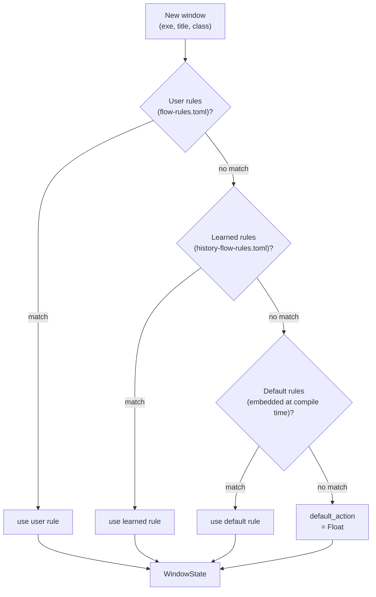
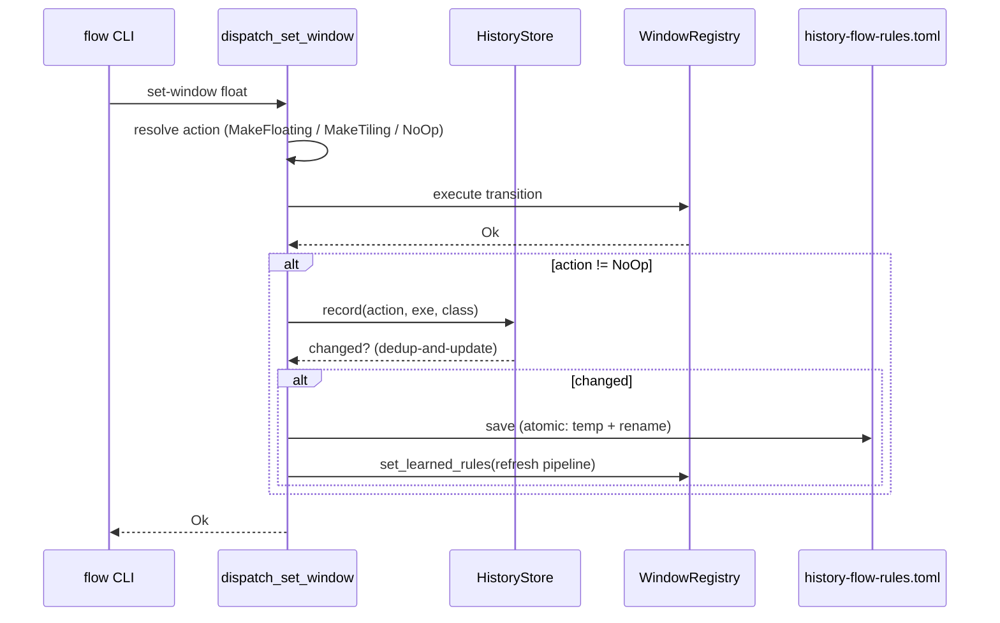

# Classification & Learned Rules

flow classifies every new window as **tiling**, **floating**, or **ignored**. This
chapter covers *why* the default is float, *how* flow learns from the user's
explicit `set-window` decisions, and *where* that learned state lives on disk.
For the rule-matching algorithm itself — the Win32 pre-filters, the per-layer
first-match-wins evaluation, and the regex/field semantics — see
[Window Registry](./window-registry.md).

## The Whitelist Model: Float by Default

Most tiling window managers take a **blacklist** approach: every window tiles
unless the user adds a rule to float it. flow inverts this. **Every window
floats unless the user promotes it to tiling** — either with an explicit rule
in `flow-rules.toml` or by running `flow dispatch set-window tile` on it once.

This whitelist model is encoded in a single value: the `default_action` field
of `WindowRulesConfig` defaults to `Float` (see
`src/config/types.rs`). When no rule at any layer
matches a window, the pipeline returns `Float` rather than `Tile`. The bundled
`default-flow-rules.toml` carries `default_action = "float"` to match.

The rationale: on a scrolling-canvas tiler like flow, most application windows
(notably transients, dialogs, and small utilities) look wrong in a tile column.
Tiling is most useful for a small set of "main" apps the user actively works
in — and the user is the best judge of which apps those are.

## The Four-Layer Priority Chain

Every classification consults four layers in priority order. The first layer to
match wins; layers below it are not consulted:

The four layers, from highest to lowest priority:

1. **User rules** — hand-written in `flow-rules.toml`. Always win. The escape
   hatch for "I want this app to behave this way regardless of what flow
   learned."
2. **Learned rules** — machine-written to `history-flow-rules.toml`. See
   [Learned Rules](#learned-rules) below.
3. **Default rules** — embedded into the binary at compile time from
   `default-flow-rules.toml`. Catch well-known
   system windows (taskbar, Chromium helper windows, dialogs).
4. **`default_action`** — the unconditional fallback, now `Float`.

One shape rule sits over the chain: a window **untileable by shape** (see
[Undecorated Popups Float](#undecorated-popups-float)) is never tiled by
layers 2-4; only a user rule tiles it.

User rules outrank learned rules deliberately: if flow's learned behavior
conflicts with the user's intent, the user's `flow-rules.toml` entry wins and
the learned rule is never consulted for that app.

### Rule Fields That Have No Effect

Two rule fields still parse but do nothing (stage 33b): `initial_width_px` (a
new tile's width comes from the `[columns]` width patterns, ADR-0017) and
`override_persist` (an explicit rule already wins over learned rules, by the
order above). `WindowRulesConfig::inert_field_warnings` names each one per rule
(`rule N (exe = "…"): initial_width_px has no effect in this version`);
`flow config check` prints those lines for `flow-rules.toml` as
`flow: warning:` lines and still reports the configuration valid (through the
daemon's `CheckConfig`, or locally without a daemon), and the daemon logs them
at info when it loads the file
(`load_rules_config` in `src/config/lifecycle.rs`).

## Learned Rules

Learned rules are flow's memory of the user's explicit float/tile decisions.
When the user runs `flow dispatch set-window float` or `flow dispatch set-window
tile` on a window, flow records the decision keyed on that app's identity. The
next time a window of the same app appears, it is classified automatically —
no rule writing required.

### What Triggers a Recording

Only **actual transitions** are recorded. A `set-window` call that resolves to a
no-op (the window was already in the requested mode) records nothing. This
keeps the history file free of redundant entries and makes repeated commands
idempotent.

An **adoption** is a transition too: `set-window tile|cycle|float|fullscreen`
on an `Ignored` window (maximized or fullscreen at creation, or ignored by a
rule) un-maximizes it if needed, seats it as a tile or a float, and records
`Tile` or `Float` for the app (`fullscreen` records `Tile`, since the window
entered the tiled layout; fullscreen itself is a view and never learned). For
a window ignored by a **bundled** rule this is what makes the next window of
the app managed: the learned layer sits above the default rules. A window
ignored by the user's own `flow-rules.toml` is adopted just the same, but the
user rule keeps outranking the learned one for the app's next window — the
user's file is the escape hatch and is never overridden by history.
Automatic adoption through the `adopt_maximized` config key records nothing:
it is the rules deciding, not the user.

The recording happens inside `dispatch_set_window`, after the transition
succeeds:

The pipeline refresh (`set_learned_rules`) is what makes the new decision take
effect immediately — the very next window of that app is classified using the
updated learned layer, with no daemon restart.

### App Identity: `exe` + `class`

The identity key for a learned rule is the app's **executable name** plus its
**Win32 window class name** (e.g. `chrome.exe` + `Chrome_WidgetWin_1`). Both
fields are used when the class is non-empty; when the class is empty, the key
falls back to `exe` alone.

Title is deliberately **not** part of the key. A window's title changes
constantly (the document name, the current tab, the cursor position), so keying
on it would fragment one app into dozens of "different" apps. The exe + class
pair is stable for the lifetime of an application version.

### Dedup-and-Update, Not Append

When the user toggles an app's mode repeatedly — float it, then tile it, then
float it again — flow does **not** append a new rule each time. Instead, the
existing learned rule for that `exe + class` is updated in place. This keeps
the history file bounded and makes the most recent decision authoritative.

If append were used instead, first-match-wins evaluation would keep returning
the *first* recorded (stale) decision forever, and the file would grow without
bound. Dedup-and-update avoids both problems.

### The History File

Learned rules persist to `history-flow-rules.toml` in the config directory
(default `%USERPROFILE%\.config\flow\`, overridable via `FLOW_CONFIG_DIR`). The
file uses the same schema as `flow-rules.toml` — a `default_action` field and a
`[[rules]]` array — so it is human-readable and human-editable. flow writes it
atomically (write to `.toml.tmp`, then rename) so a crash mid-write cannot
corrupt the existing file.

The `default_action` field in the history file is ignored at load time; only
the `rules` array is read. (The field exists only because the schema is shared
with `flow-rules.toml`.)

### Shell Surfaces Are Never Learned

`set-window` acts on the OS foreground. Before this rule, a `set-window` (for
example Mod+F) pressed while the Start menu or search was open landed on the
search host (`SearchHost.exe`, class `Windows.UI.Core.CoreWindow`): it was
adopted as a tile and the decision was learned. Learned rules outrank the
default rules, so from then on the default `ignore` for `SearchHost.exe` lost,
and every time the Start menu showed the search surface it was tiled into the
strip and taken out again when it hid: the other tiles reflowed as if an app
had opened and closed (seen on the host from 2026-10-27, fixed 2026-10-31).

Since ADR-0033 the search host is in a shell band (6 or 13) and the band
gate leaves it alone ahead of every rule, learned ones included. Two guards
remain for the shell surfaces of the desktop band, keyed on the shell
classes of the floating layer (`top_layer::SHELL_CLASSES`: taskbars,
desktop, the daemon's own surfaces):

- a shell surface in the foreground is not a dispatch target; `set-window` and
  the manual drag use the registry's focus instead, as with no foreground;
- a learned rule keyed on a shell class is skipped when the learned rules are
  handed to the pipeline (at startup and after each recording), and such a
  decision is never recorded. The file is not rewritten; an info line in the
  log names the skipped entry so it can be deleted by hand.

An explicit rule in `flow-rules.toml` can still tile or float a shell surface;
only the learned layer is filtered.

At registration a shell surface gets nothing beyond what every ignored window
gets: it is tracked for the foreground decisions and never moved. It is not a
floating-layer member either, even when an explicit default rule ignores it
(it would get `HWND_TOPMOST` on every raise; ADR-0024, see
[Floating Space](./floating-space.md#the-floating-layer-floating-always_on_top)). A shell
surface an older build tiled and left at a slot (it was hidden when that
daemon stopped; see [IPC & Watchdog](./ipc-and-watchdog.md#hidden-tiles-go-home)) keeps that
position until its process restarts: end `SearchHost.exe` once (Task Manager
or a sign-out); Windows starts it again on the next Win key. flowd never kills
a shell process itself.

### Clearing or Overriding Learned State

To forget everything flow has learned:

- **Delete `history-flow-rules.toml`** — flow recreates it (empty) on the next
  recorded transition. Until then, classification falls through to the default
  rules and `default_action = Float`.

- **Delete a single app's entry** — open the file in a text editor and remove
  the matching `[[rules]]` block. flow will not re-add it until the user runs
  `set-window` on that app again.

- **Override a learned rule permanently** — add an explicit rule for the app in
  `flow-rules.toml`. User rules outrank learned rules, so the user's choice
  always wins regardless of what the history file says.

> The `ForgetApp` / `ForgetAllApps` IPC commands (declared in
> `src/ipc/message.rs`) are intended as a
> programmatic way to clear learned state without touching the file by hand.
> They are not yet implemented.

## Elevated Windows Are Unmanaged

A window whose process runs elevated (an Alacritty or PowerShell started as
administrator, Task Manager on an admin account) cannot be managed by a flowd
running at medium integrity: User Interface Privilege Isolation refuses every
`SetWindowPos`, z-order change and activation flowd sends it. Before this rule
such a window was seated as a column, each move failed (`apply_batch error for
instant targets: backend error: Access is denied`), and the column stayed where
it was, overlapping its neighbours.

At arrival (`get_window_info`) flowd reads the process token
(`OpenProcess(PROCESS_QUERY_LIMITED_INFORMATION)` + `OpenProcessToken(TOKEN_QUERY)`
+ `GetTokenInformation(TokenElevation)`, which works across integrity levels for
the same user). An elevated process, or one whose token cannot be read at all
(another user, a protected or system process), makes the window
`Ignored(Elevated)`: this outranks every rule and the maximized / fullscreen
overrides. The registry logs one info line per window,
`window 0x.. (exe) is elevated; left unmanaged (UIPI)`, and `flow query all`
shows the state `Ignored::Elevated`. The window gets no seat, no border, no
pre-placement and no learned rule; `set-window` on it is refused with a message.
Elevation is fixed for a process's life, so it is never re-evaluated.

Unlike an explicit-rule ignore it is **not** a floating-layer member and not a
window flow owns in the foreground: the layer cannot lift it, so treating it as
flow's would leave a float covering the focused elevated window. It is foreign
to the layer instead: when it takes the foreground the layer drops under it,
like under any other app, and its own dialogs never ride. If flowd itself runs
elevated, the check is skipped and elevated windows are managed as usual. Why:
ADR-0025 (`docs/adr/0025-elevated-windows-are-unmanaged.md`).

## Shell Bands Are Unmanaged

Since Windows 8 every top-level window sits in a z-order band; ordinary
windows are in the desktop band (1), and a normal process cannot create a
window anywhere else. `get_window_info` reads the band once at arrival through
`GetWindowBand`, an undocumented user32 export resolved with `GetProcAddress`
(`registry::win32::window_band`). A known band above the UIAccess band (2) is a
shell surface: the emoji panel (3), notifications, toasts and flyouts (4),
Task View (5), Start and jump lists (6), search (13), Alt+Tab (16), the lock
screen (17). Such a window is registered
`Ignored(ShellBand(n))` right after the elevated gate and before every rule;
the registry logs `window 0x.. (exe "class") is in shell band n; left
unmanaged`, and `flow query all` shows the state `Ignored::ShellBand` and
`band` for every window (`null` when it could not be read). Like elevation it
outranks every rule and cannot be overridden: the window is drawn above every
desktop window whatever flow does, and Windows refuses to hand it the
foreground. `set-window` on it is refused with a message.

The band replaces the class and exe lists wherever it covers them
(ADR-0034): the bundled rules name no shell host any more (Start, search,
ShellExperienceHost, the lock screen), and `SHELL_CLASSES` keeps only the
desktop-band surfaces: the taskbars, the desktop and flowd's own windows.
`Xaml_WindowedPopupClass` keeps its rule, because the Win+X menu, the tray
overflow and the snap layouts flyout are band 1. The floating layer, the
dispatch foreground and the `set-window` target ask
`top_layer::is_shell_surface(class, band)`, which is either test. Learned-rule
filtering keeps the class test, because a rule has no band. Some shell
windows are created cloaked in band 1 and moved to their band before they
are shown; flow registers a window only once it is shown and uncloaked, so
it reads the final band. Without the export, or when the call fails, the
band is unknown and the removed surfaces are classified by `default_action`;
no fallback list is kept (the export exists since Windows 8). Why, the probe
tables and the per-entry table: ADR-0033
(`docs/adr/0033-window-bands-and-foreground-pushes.md`) and ADR-0034
(`docs/adr/0034-shell-bands-replace-shell-lists-and-the-session-lock.md`).

## The Session Lock

The session sink (`daemon::session`) registers for `WM_WTSSESSION_CHANGE`
(`WTSRegisterSessionNotification`, `NOTIFY_FOR_THIS_SESSION`) and reports
`WTS_SESSION_LOCK` / `WTS_SESSION_UNLOCK` to the main loop
(`registry::hooks::report_session_lock`), which applies the change before it
drains the hook events. While the session is locked:

- a window that passes the elevated and shell-band gates is registered
  `Ignored(SessionLocked)` (`... arrived while the session is locked; held
  until the unlock`; `flow query all`: `Ignored::SessionLocked`), so it is
  not seated, moved, bordered or raised, and `set-window` refuses it;
- flowd pushes nothing to the foreground, and the floating layer's and book
  mode's backstops leave the z-order alone; nothing is pre-placed.

At the unlock the held windows leave the registry and go through the
creation pipeline as new windows (a window hidden by then is simply
dropped; a later show registers it), and every `Ignored(ShellBand)` window
that is hidden, cloaked or iconic is dropped: LockApp cloaks its window at
the credential prompt and never destroys it. One info line reports it:
`session unlocked: N held window(s), C classified, D dropped; S hidden
shell surface(s) dropped`.

The lock surfaces themselves arrive anywhere from 40 ms after to 400 ms
before `WTS_SESSION_LOCK` (measured) and go before `WTS_SESSION_UNLOCK`; the
band (17), not the lock, leaves them alone. Disconnect and connect notifications are only
logged. Why: ADR-0034.

## Overlays Are Unmanaged

A top-level window with `WS_EX_TRANSPARENT` (mouse input passes through it)
or `WS_EX_NOACTIVATE` (it never becomes the foreground window) is an
overlay: a screen-share border, a click-through indicator. The user can
neither focus nor arrange it, so flow never manages it, whatever its other
styles. `get_window_info` reads `GWL_STYLE` and `GWL_EXSTYLE` once at
arrival (`registry::win32::window_styles`); `register_window_from_info`
tests `classification::is_overlay` right after the shell-band gate and
before the session lock and every rule. The window is registered
`Ignored(Overlay)` (`flow query all`: `Ignored::Overlay`), with one info
line, `window 0x.. (exe "class") is a click-through or no-activate overlay
(ex-style 0x..); left unmanaged`. It is not a floating-layer member, never
moved or bordered, and `set-window` refuses it. An unreadable style reads
as 0: the rules decide (fail-open).

An overlay that is also a tool window (`WS_EX_TOOLWINDOW` without
`WS_EX_APPWINDOW`, like the Teams share border) is skipped earlier by the
Alt+Tab creation gate and never registered; the overlay gate covers the
ones that gate lets through. Why: ADR-0036
(`docs/adr/0036-untileable-windows.md`).

## Undecorated Popups Float

A window is **untileable by shape** when its style is `WS_POPUP` with no
sizing border (`WS_THICKFRAME`) and no title bar (not both bits of
`WS_CAPTION`; a thin border or a dialog frame alone is no title bar):
`classification::is_untileable_shape`. Such a popup was made at a size its
app chose and offers the user no way to resize it (a share control bar, a
toolbar strip). `WS_POPUP` is required, so a borderless main window built as
an overlapped window (Alacritty with `decorations = "None"` keeps
`WS_CAPTION | WS_THICKFRAME`) is not caught.

`classification::shaped_verdict` runs the four layers as usual and then,
for such a window, turns a `Tile` from a learned rule, a bundled rule or
`default_action` into `Float`; a `Tile` from a user rule stands, and an
`Ignore` or `Float` is untouched. The shape is read once at arrival and
kept on the window (`Window::untileable_shape`), so the reclassification
after an un-maximize uses it too. `flow query all` shows `untileable:
"undecorated popup"`.

- Overruled tile, info, once per window: `window 0x.. (exe "class") is an
  undecorated popup without a sizing border (style 0x..); it floats (a
  learned rule that tiles it does not apply)` (or `a bundled rule`,
  `default_action`).
- User rule, warn, once per rule per load of `flow-rules.toml`:
  `flow-rules.toml rule N (exe = "...", class = "...") tiles window 0x..
  (exe "class"), an undecorated popup without a sizing border; it is tiled
  because the rule says so`. A tile that then keeps its own size is still
  released by the placement check ([Floating Space](./floating-space.md#released-tiles-a-window-that-refuses-its-slot)).
- A new float of this shape stays where its app put it, not centred on the
  focused screen.
- **Not learned.** `set-window` on such a window still acts, but records
  nothing (`set-window: exe (class) is an undecorated popup; the decision is
  not learned`): a learned rule is keyed on exe + class, which the app's
  main window may share, so a `float` learned from the popup would float
  the main window. Existing learned rules are not rewritten; they keep
  tiling the windows of the class that have another shape.

Why: ADR-0036.

## Windows That Stop Answering

A window whose thread has stopped pumping messages for five seconds is
reported hung by Windows (`IsHungAppWindow`, documented); half a second later
DWM covers it with a `Ghost` window (class `Ghost`, owned by `dwm.exe`,
desktop band, titled "... (Not Responding)") that takes the foreground. Every
synchronous call that moves, raises or activates the frozen window
(`SetWindowPos` without `SWP_ASYNCWINDOWPOS`, `SetWindowPlacement`,
`BringWindowToTop`) waits on its thread, and so would the daemon.

flowd therefore takes such a window out of its hands (ADR-0035):

- **Parked.** The foreground sync tick (`[focus] foreground_sync_interval_ms`)
  and every command ask `IsHungAppWindow` for each active tile and float
  (`FlowWM::reconcile_hung`). A hung tile becomes `Tiling(Hung)`: its restore
  seat is recorded as for a hide, it leaves its strip, the neighbours close
  the gap and the strip's focus moves to the successor, but the foreground is
  not pushed (the `Ghost` holds it, and the user may be waiting on that
  window). A hung float becomes `Floating(Hung)` and leaves the floating
  layer. Neither is moved: it stays exactly where it froze. The registry
  logs `window 0x.. (exe) is not responding (IsHungAppWindow); parked where it
  is`, and `flow query all` shows the state `Tiling::Hung` /
  `Floating::Hung` and the mode `hung`. Focus commands skip it.
- **Back.** When `IsHungAppWindow` turns false (the next tick, or the
  window's next foreground event) the window is `Active` again: a tile goes
  back into its seat (`[minimize_restore] strategy`, the view does not
  follow), a float back into the layer with the rect it had. Log line:
  `window 0x.. (exe) answers again; back from not responding`.
- **Every call checks too.** The Win32 wrappers that would wait on the
  window's thread (`place_window` for the animator's frames and the
  teleports, `set_topmost`, `insert_below[_quiet]`, `move_window_keep_size`,
  `show_window_restored`, `maximize_window`, `set_window_placement`, the
  foreground push) skip a window `IsHungAppWindow` reports, at `debug`, which
  covers the moment between the freeze being reported and the next poll.

`FLOW_TEST_BYPASS_HUNG_GATE=1` in the daemon's environment turns the check
off; it exists for the VM suite that exercises the push guard rail
(event pipelines, *Foreground pushes*), logs a warning at start, and is not a
setting.

## Where the Code Lives

| Concern | Location |
|---------|----------|
| History store (load, record, dedup, save) | `src/config/history.rs` |
| History file path resolution | `history_rules_path[_in]` in `src/config/dirs.rs` |
| `default_action = Float` default | `Default` impl for `WindowRulesConfig` in `src/config/types.rs` |
| Four-layer pipeline evaluation | `ClassificationPipeline::classify` in `src/registry/classification.rs` |
| Runtime pipeline refresh | `set_learned_rules` on `ClassificationPipeline` and `WindowRegistry` |
| Capture on `set-window` transition | `record_learned_transition` in `src/daemon/dispatch.rs` |
| Daemon-owned history store | `history` field on `FlowWM`, loaded in `new()` |
| Elevation gate (ADR-0025) | `process_elevation` / `elevation_blocks` in `src/registry/win32.rs`, `register_window_from_info` in `src/registry/core.rs` |
| Shell-band gate (ADR-0033, ADR-0034) | `window_band` in `src/registry/win32.rs`, `is_shell_band` in `src/registry/classification.rs`, `register_window_from_info` |
| Session lock (ADR-0034) | `SessionSink` in `src/daemon/session.rs`, `report_session_lock` in `src/registry/hooks.rs`, `on_session_lock_change` in `src/daemon/hooks.rs` |
| Overlay gate, untileable shape (ADR-0036) | `is_overlay` / `is_untileable_shape` / `shaped_verdict` in `src/registry/classification.rs`, `window_styles` in `src/registry/win32.rs`, `register_window_from_info` |
| Placement acceptance check (ADR-0036) | `src/daemon/placement_check.rs` |
| Not-responding windows (ADR-0035) | `is_hung` / `misses_message_within` in `src/registry/win32.rs`, `mark_hung` / `mark_responding` in `src/registry/core.rs`, `src/daemon/hung.rs` |

## Cross-References

- [Window Registry](./window-registry.md) — the full classification algorithm:
  Win32 pre-filters, the rule-pipeline flow diagram, and per-field match
  semantics.
- [Config & Persistence](./config-and-persistence.md) — the `flow-rules.toml`
  format for user-defined rules and the "code is the source of truth" config
  philosophy.
- [Floating Space](./floating-space.md) — where float-classified windows live
  and how tile↔float transitions are animated.
