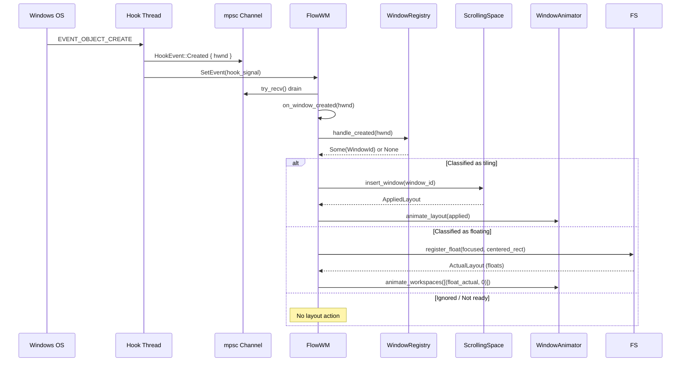
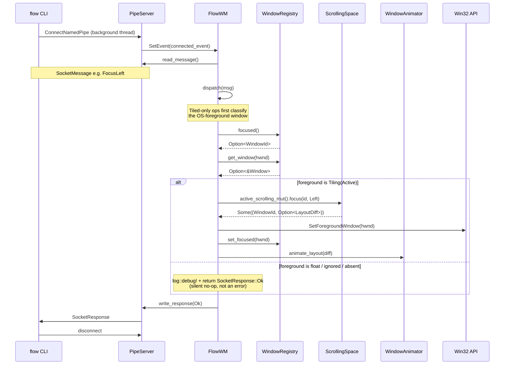

# Event Pipelines

Every layout change in `flow` is driven by one of two flows: a Win32 hook event
(from the OS reacting to window lifecycle changes) or an IPC command (from the
`flow` CLI). Both flows converge on the same three-stage pipeline: mutate the
virtual layout, project to actual pixel coordinates, and animate the result.
This chapter traces each flow end-to-end and documents the per-event behavior
of the hook handlers.

## The Win32 Hook Pipeline

When the OS creates, destroys, minimizes, or focuses a window, the event travels
through the hook thread's `mpsc` channel and into the daemon's event loop.

The full pipeline for a created window:

1. The hook callback sends `HookEvent::Created { hwnd }` and signals the main
   thread.
2. `on_window_created()` calls `registry.handle_created(hwnd)`, which runs the
   full classification pipeline: visibility check, title check, Alt-Tab visibility,
   owner check, rule evaluation. Returns `Some(WindowId)` if the window is
   classified as tiling; `None` otherwise (the handler then inspects the
   registry to distinguish a fresh float from ignored / not-ready).
3. If tiling, `ScrollingSpace::insert_window()` places the new column
   immediately after the focused window, shifts right-side columns, and moves
   focus to the new window.
4. If freshly classified as floating, the handler completes the same float setup
   an explicit `set-window float` performs — `centered_rect` →
   `FloatingSpace::add` → registry state `Floating(Active { rect })` →
   `add_float_hwnd` tracking → `animate_workspaces` → border attach — so a
   rule-classified float is indistinguishable from a toggled one. See
   [Floating Space](./floating-space.md).
5. `animate_layout()` / `animate_workspaces()` convert the result into animation
   targets and submit them to the `WindowAnimator`. The new window has no
   previous rect, so it is placed at its slot instantly while the other
   columns tween (the first-placement rule, see
   [Animation](./animation.md#first-placement); ADR-0023, *Appearing in
   place*).
6. `reconcile_new_window_focus()` pushes the OS foreground to the new window,
   syncs the registry focus, and refreshes borders (see *Foreground on
   creation* below).

If classification fails (window not yet visible or titled), the hwnd is added to
`pending_creations` and retried on subsequent loop iterations until it passes or
the retry budget is exhausted.

Before the hwnd goes to `pending_creations`, `pre_place_created()`
(`daemon::pre_place`) may move it: a window that is not shown yet, a plausible
top-level app window (root, unowned, not a child or tool window, with a caption
or sizing frame) on a monitor other than the active one, that no rule would
ignore without a title and whose thread answers a `WM_NULL` within 50 ms, is
moved into the active monitor's work area (size kept, offset kept and clamped)
before its first show. Only with `[focus] new_window_monitor = "focused"`,
tiling on, more than one monitor, and once per window (`FlowWM::pre_placed`,
cleared when the window is classified, destroyed or given up on). When it is
classified later, its seat finds it on the focused monitor already, so it never
paints on the other screen. A pre-placed window's `pre_manage_rect` is on the
focused screen. Why and the limits: ADR-0023, *Pre-placement before the first
paint*.

A program the daemon starts itself (`Spawn` IPC command, the keymap's
non-admin spawn binds, `[startup] spawn`) usually never reaches this step:
`daemon::spawn` passes `STARTF_USEPOSITION | STARTF_USESIZE` with the rect
the new column will get (a dry run of the seat on a clone of the active
strip, `ScrollingSpace::insert_preview_rect`, inset by the border ring), so
the window is created on the focused screen in its slot and the `Created`
event finds it there (nothing to move across screens; at most the invisible
border, or the app's own size, to correct). ADR-0023, *Spawning on the
focused screen* and *Appearing in place*.

### Foreground on creation

The layout engine has already moved focus to the new window by step 3, but that
is flow-internal — the **OS foreground** (the window that receives keyboard
input) is a separate quantity owned by Windows. `reconcile_new_window_focus()`
pushes the two back into agreement.

For a normally-launched app the OS has already foregrounded it (a launch is a
user activation, which grants foreground permission), so the push is a no-op: a
cheap `GetForegroundWindow` check sees the window is already foreground and
skips the `SetForegroundWindow` call. The registry focus is then synced from
that authoritative query, which is what fixes the late-titled-app case (Windows
Terminal, recovered via NAMECHANGE/SHOW) where `EVENT_SYSTEM_FOREGROUND` fired
before the window was tracked.

The push matters for apps launched **without** a user-visible activation — the
canonical case being an AutoHotkey launcher such as `Run("chrome.exe …", ,
"Hide")`. The `Hide` option starts the process with a hidden window, so the OS
never grants Chrome foreground permission; when Chrome later shows itself its
own `SetForegroundWindow` is denied by the foreground lock, and it appears with
a border but no keyboard focus. `set_foreground_window()` defeats the lock via
the `AttachThreadInput` trick, making the new window the real foreground
regardless of how it was launched. The resulting `EVENT_SYSTEM_FOREGROUND` is
re-consumed by `on_focus_changed()`, which is idempotent on this path (same
workspace, and the border refresh short-circuits on an unchanged style).

### Foreground reconciliation (echo backstop)

`EVENT_SYSTEM_FOREGROUND` is a **best-effort** stream, not a complete ledger.
Microsoft guarantees in-order delivery but explicitly warns that events "fired
very rapidly" can be dropped or degraded — exactly what happens during a close
cascade (e.g. a browser tearing down multiple tabs). The OS can settle the
foreground onto its final window **without** emitting the final
`EVENT_SYSTEM_FOREGROUND`, leaving flow's tracked focus (border + layout cursor)
stranded on the previously-echoed window while the real keyboard foreground has
already moved on. The visible symptom: the border sits on a sibling window while
keystrokes land elsewhere.

Rather than fight the OS, flow treats the foreground query as the tie-breaker.
The main loop folds a third deadline —
`last_foreground_sync + config.focus.foreground_sync_interval_ms` (default
250 ms) — into its `MsgWaitForMultipleObjects` timeout, so it never sleeps past
the next reconciliation pass. On every wake, `reconcile_foreground()`:

1. Queries the authoritative `GetForegroundWindow()` (a single microsecond-scale
   read).
2. **No-ops** when the tracked focus already matches reality — the common case.
3. Otherwise, if the real foreground is a tracked window **in the active
   workspace**, re-runs the `on_focus_changed()` path to correct the border +
   layout cursor.

The active-workspace restriction is deliberate: a background poll should never
trigger a workspace switch. A genuine cross-workspace focus change still arrives
promptly via `EVENT_SYSTEM_FOREGROUND`, which remains the primary driver; the
poll is only a backstop for the cases where that event is dropped. The interval
is hot-reloadable via `flow.toml`'s `[focus]` section — lower values catch drift
sooner at the cost of more wakeups, higher values the reverse.

## The IPC Command Pipeline

The `flow` CLI connects to the daemon's named pipe, sends a JSON command, and
reads the response.

Every IPC command follows the same pattern:

1. **Busy gate**: if a tile drag is in progress (`drag_state.is_some()`) and
   the command is layout-mutating (`is_layout_mutating()`), `dispatch()` returns
   `SocketResponse::Busy` immediately. Read-only queries and daemon lifecycle
   commands still pass through. See (tile-drag.md) for the full classification.
2. `dispatch()` matches on the `SocketMessage` variant and calls the appropriate
   subsystem method.
3. **Tiled-only ops** (focus / swap-window / swap-column / merge / promote /
   expand / shrink / set-column-width / toggle-monocle / center) first resolve
   the OS foreground via `registry.focused()`, look up the window, and verify
   `matches!(state, WindowState::Tiling(TilingState::Active { .. }))`. If the
   foreground is a float, ignored, minimized, hidden, or absent, the handler
   logs at `debug!` and returns `SocketResponse::Ok` silently — a deliberate
   no-op, not an error. This prevents the bug where a float foreground caused
   these ops to act on the stale `last_focused_window` tile cursor. See
   [Floating Space / Focus Model](./floating-space.md#focus-model-clarification).
4. Layout commands call `active_scrolling_mut()` to reach the `ScrollingSpace`,
   mutate the virtual layout, and receive an `AppliedLayout` or `Option<LayoutDiff>`.
   The target `WindowId` is now passed explicitly from the dispatch layer rather
   than re-resolved inside `ScrollingSpace` from `last_focused_window`.
 5. Some commands require OS-level side effects (e.g. `FocusLeft` calls
   `SetForegroundWindow` and syncs the registry's focus tracking).
 6. `animate_layout()` converts the result to animation targets.
 7. A `SocketResponse` is written back to the CLI.

Commands that close windows (`CloseWindow`) take a different path — they only
queue `WM_CLOSE` and let the `EVENT_OBJECT_DESTROY` hook handle the actual
layout removal, avoiding a race between the synchronous IPC response and the
asynchronous window destruction.

## The `animate_layout` Bridge

`animate_layout()` in [`src/daemon/animation.rs`](../../src/daemon/animation.rs) is
the conversion point between the layout engine's output and the animation
system's input:

| Layout type | Animation type | Notes |
|-------------|----------------|-------|
| `WindowId(isize)` | `WindowRef(isize)` | Direct passthrough |
| `Rect { x, y, width, height }` position | `IVec2::new(x, y)` | Visible rect translated to window rect |
| `Rect { x, y, width, height }` size | `IVec2::new(width, height)` | Visible rect translated to window rect |

The layout engine produces **visible rects** (content area coordinates), but
`SetWindowPos` uses **window rects** (which include invisible borders like
shadows and resize hit-test areas). The bridge translates each entry using the
window's stored `InvisibleBounds` so that windows land exactly where the layout
engine intended.

All windows in the actual layout are submitted as targets (not just "changed"
ones). The animator compares each target against the window's current on-screen
position and drops no-ops. This ensures windows mid-flight from a previous
interrupted animation are correctly retargeted.

The bridge also syncs the registry's tiling state (column/row indices and tiled
rects) from the new layout on every call, even when no pixel-level movement
occurred — a logical swap can change a window's position without triggering an
animation if the columns are the same width.

## Focus after a removal or a monitor switch

Two multi-monitor rules decide where the OS foreground goes when the daemon
has to pick a window itself. Both are pure functions with the Win32
questions injected, so they are unit-tested without a desktop.

### Which removal pushes a successor

`remove_from_layout_and_refocus` (destroy, minimize, hide, cloak) removes the
window from the strip that actually holds it — a tile minimized or hidden
while its workspace is parked (a taskbar minimize, Windows minimizing it on
a display change) leaves that *parked* strip, which is then re-seated at its
parking offset with no focus push; leaving it in place would seat it twice
when it comes back. Whether the strip's successor gets the OS foreground is
decided by `should_refocus_after_removal`: only when the removed window held
the user's focus (registry focus or OS foreground), or when it lived on the
active monitor *and* the registry's focus — read before the removal — was
nobody, the removed window or a tile of that strip. A window closing on a
monitor the user is not working on, or on the active monitor while the user
is in a float or a window elsewhere, must not drag the foreground over
(review finding B6); then only the strip's bookkeeping changes.

### Windows hands the focus to the other screen (stage 30)

When the foreground window closes, minimizes or hides, Windows activates the
next window in z-order itself, wherever it is — typically a window on the
other screen. The VM log of a Mod+Q on a DISPLAY2 tile shows the order:
`Hidden` (flow removes the tile and pushes the successor, the push is often
refused because the foreground is in transition), then `Foreground` for a
DISPLAY1 window, then `Destroyed`. The daemon used to follow that foreground
like any other: the active monitor flipped to DISPLAY1 and the next command
acted there. Two pieces keep the focus on the screen the tile left:

- **Focus held a moment ago.** `on_focus_changed` records the window that
  lost the foreground and when (`FlowWM::last_focus_loss`). The removal
  counts the removed window as the user's focus also when it lost the
  foreground less than `FOCUS_HANDOFF_WINDOW` (500 ms) ago to a window on
  *another* monitor — the order in which Windows' activation arrives before
  the removal event. Only for a destroy or a minimize: a window that hides
  may do so *because* it lost the foreground (hide on deactivation), and
  then the user's click elsewhere must stand.
- **The handoff.** When the removed window held the focus, its monitor stays
  the active one and `FlowWM::focus_handoff` is armed for the same 500 ms:
  the next foreground that lands on a managed window of *another* monitor is
  sent back — to the strip's successor, or, when the strip is now empty, to
  the desktop (`clear_foreground_window`, registry focus dropped), so no
  window of the other screen keeps the keyboard and the next new window
  opens on the emptied screen (ADR-0023). The redirect runs first in
  `on_focus_changed`; when it succeeds the stray event is not processed at
  all (a pile member of the other screen would otherwise flip its book), the
  `Foreground` event of the window it went back to follows. The handoff
  stays armed until it expires, because the drift poll
  (`reconcile_foreground`) and the hook can both report the same stray
  foreground; a report for a window that no longer has the foreground is
  simply dropped. A foreground on the same monitor, on the successor, on the
  desktop or on an unmanaged window passes; every IPC command but the
  queries disarms it, so a deliberate `focus-monitor` right after a close is
  never fought.

### Landing on a monitor's active workspace

`focus_monitor` (the `focus-monitor` command, a `move-to-monitor`, and the
foreground push after every workspace switch) walks the active workspace's
candidates in order — the strip's last-focused window, then every tile in
column/row order, then the floats top-most first (`focus_candidates`) — and
pushes the first one that takes the foreground (`resolve_focus_target_with`):

- a candidate that is not in the registry, or for which `IsWindow` is false,
  is **purged** from the strip, the floating space and the float-tracking
  set, and the walk continues. This is the fix for the VM log's
  `SetForegroundWindow failed ... 0x6` on a workspace switch: a window that
  died without its `DESTROY` reaching the layout stayed in the strip's
  memory and was pushed forever;
- a candidate that is hidden or cloaked (`IsWindowVisible && !cloaked`
  false) is **skipped without purging** — a tray-hidden or suspended UWP
  window may come back;
- a push answered with `ERROR_INVALID_HANDLE` is treated like a dead window
  — logged with title, class and exe, purged, next candidate — but only
  when `IsWindow` agrees. Windows reports that error loosely: it also comes
  back for a live window it merely refuses to activate (seen right after
  Windows snapped it), and such a window keeps its seat and simply does not
  get the foreground this time;
- any other refused push (the foreground lock) keeps the candidate: the
  window exists and is what the user should be on;
- a push is judged **after** the `BringWindowToTop` that follows it, not
  from `SetForegroundWindow`'s return value alone: with another thread's
  input attached the call often returns FALSE with no error code while the
  window is activated anyway (the VM showed `SetForegroundWindow failed
  ... 0x0` and the target's `EVENT_SYSTEM_FOREGROUND` in the same instant),
  so `set_foreground_window_impl` re-reads `GetForegroundWindow` for up to
  ~50 ms and counts the target being there as focused. Without that,
  `focus-floating` skipped the only float as refused while it took the
  foreground.

With nothing live and visible left, the monitor still becomes active, the
tracked focus is cleared (so a later command cannot act on the window the
user came from) and the OS foreground goes to the shell's desktop window
("Progman", then `GetDesktopWindow`) — the Win32 idiom for clicking empty
desktop space, since there is no "clear foreground" API — so keystrokes no
longer reach the previous workspace's window. That is logged at `debug`,
never `warn`: an empty workspace is a normal state. `focus_monitor` sets the
registry focus and recolours the borders itself, so the
`EVENT_SYSTEM_FOREGROUND` that `on_focus_changed` later consumes finds
nothing left to change.

### Which monitor a returning window belongs to

A window coming back into a layout (restored, re-shown, recovered from
maximized) is appended to its *home* monitor (`home_monitor_for_hwnd`,
`readd_tile_to_home_monitor`), resolved in this order of trust:

1. the **owning-monitor memory** (`Window::owner_monitor`), recorded whenever
   the daemon seats the window and surviving minimize / hide;
2. `MonitorFromWindow` matched to a known `HMONITOR` — authoritative for a
   window the daemon never seated, but for a window that was parked beyond
   the virtual screen when it was minimized it is merely the monitor
   *nearest* to a far-off rect, which is why the memory comes first;
3. the monitor whose bounds contain the window rect's centre;
4. the active monitor.

A window that is already seated somewhere (the hotplug reconcile seats the
windows it restores itself, ahead of their `MINIMIZEEND`) is left where it
is; only its registry slot and rect are re-synced, so no second column is
ever created. The same fallback chain answers every "which monitor does this
window belong to" question that must produce an answer, such as the
`monitor` field of `flow query all` for a minimized window.

## Per-Event Behavior

### Created (`EVENT_OBJECT_CREATE`)

| Condition | Action |
|-----------|--------|
| Not visible / no title / not Alt-Tab visible | Defer to `pending_creations`, retry later; a hidden top-level app window on another monitor is first pre-placed on the focused one (above) |
| Owned by another window (tooltip, etc.) | Skip |
| Already tracked (de-dup) | Skip |
| Minimized (iconic) | Classify from the placement's restore rect; register as `Tiling::Minimized` / `Floating::Minimized` (or `Ignored`), owning monitor from that rect, no layout — the restore hook seats it |
| Matches an ignore rule (maximized, fullscreen, explicit) | Register as `Ignored`, no layout |
| Maximized and `adopt_maximized` is on | Register as `Ignored(Maximized)`, then `reclassify_os_state()` un-maximizes it and classifies it through the rules: a tile is seated like a new window, a float like a new float; a window the rules ignore stays maximized |
| Classified as floating | Register as `Floating`, add to active `FloatingSpace` (centered), animate, attach border |
| Classified as tiling | Register as `Tiling::Active`, `insert_window()` next to focused, animate |

After either managed branch, `reconcile_new_window_focus()` actively pushes the
OS foreground to the new window (no-op when the OS already foregrounded it) and
syncs the registry focus. See [Foreground on creation](#foreground-on-creation)
above.

### Destroyed (`EVENT_OBJECT_DESTROY`)

| Condition | Action |
|-----------|--------|
| Not tracked | Skip |
| Was tiling (active or minimized) | `remove_window()` with focus successor resolution, `remove_from_layout_and_registry()`, animate |
| Was floating or ignored | `registry.remove_window()` only |

The successor window is chosen by `next_available_window`: prefer a sibling in
the same column (the window directly below, else the one above), then the left
column, then the right. If the removed window was focused, the successor gets
OS-level foreground via `SetForegroundWindow` and registry focus tracking is
synced.

### Minimized (`EVENT_SYSTEM_MINIMIZESTART`)

| Condition | Action |
|-----------|--------|
| Not tracked | Skip |
| Was `Tiling::Active` | Registry updates to `Tiling::Minimized`, `remove_from_layout_and_refocus()`, animate |
| Was `Tiling::Minimized` or not tiling | Registry state update only, no layout change |

### Restored (`EVENT_SYSTEM_MINIMIZEEND`)

| Condition | Action |
|-----------|--------|
| Not tracked | Attempt the full creation pipeline first (`register_if_untracked`); a window that registers is seated by it and the rows below find it in place; one that fails a gate is skipped |
| Now `Tiling::Active` | `add_window()` on the home monitor (appends at far right), animate; a window registered minimized has its geometry re-measured by `restore_window` first |
| Now `Floating::Active` with no float seat (registered minimized) | `register_float` at its current rect (centred if unreadable), animate |
| Not tiling | Registry state update only |

Restored windows are appended at the far right of the canvas rather than
inserted at the old position. This avoids the complexity of tracking and
restoring saved virtual slots for all cases (minimize + destroy interleaving).
On a multi-monitor desktop the strip they are appended to is the home
monitor's — see [Which monitor a returning window belongs to](#which-monitor-a-returning-window-belongs-to).

With `[floating] always_on_top`, the minimize / hide handlers take a float out
of the floating layer and the restore / show handlers put it back
(`FlowWM::sync_top_layer`; a fullscreen window, re-seated as a fullscreen
column by `readd_tile_to_home_monitor`, is left to the fullscreen code); the created and state-change handlers
put a window registered or recovered as a float or an explicit-rule ignore in,
and the foreground handler raises an activated member again if its app
demoted it. See [Floating Space](./floating-space.md#the-floating-layer-floating-always_on_top).

### Foreground (`EVENT_SYSTEM_FOREGROUND`)

| Condition | Action |
|-----------|--------|
| Not tracked | Attempt the full creation pipeline first (`register_if_untracked`): a window that registers is seated by it and then handled as below; the taskbar, menus and dialogs fail a gate and fall through (`set_focused` ignores them) |
| Tracked `Ignored(Maximized\|Fullscreen)` window | Run the [State Change](#state-change-event_object_statechange) recovery first (an un-maximize whose `STATECHANGE` never arrived is picked up here); a window now tiling is seated, then handled as below |
| Any tracked window | `registry.set_focused(hwnd)` + `layout.set_focus(WindowId)` if tiling |

Focus changes do not produce an `AppliedLayout` — they only update internal focus
tracking. The next layout mutation uses the correct focus.

Because `EVENT_SYSTEM_FOREGROUND` is a best-effort stream that can drop the final
settle event under rapid churn, this handler is backstopped by the periodic
`reconcile_foreground()` poll — see [Foreground reconciliation (echo backstop)](#foreground-reconciliation-echo-backstop)
above.

### Hidden / Shown (`EVENT_OBJECT_HIDE` / `EVENT_OBJECT_SHOW`)

These events handle tray-hide ("close to system tray") and DWM-cloak behaviors
that `EVENT_SYSTEM_MINIMIZESTART/END` do not cover.

**Hidden:** If the window was `Tiling::Active` and the state actually changed
to `Hidden` (via `reconcile_visibility`), the window is removed from layout
with focus successor resolution — identical to the minimize path. The
`is_tiling_active` check (not `is_tiling`) prevents double-removal since Win32
fires both `MINIMIZESTART` and `HIDE` for ordinary minimizes.

**Shown:** Three paths:
1. **Recovery** — if the window is not yet tracked (created invisible, e.g.
   `wt -p PowerShell`), re-run the full creation pipeline. By this point the
   window is visible and titled, so classification succeeds.
2. **OS-ignored** — a tracked `Ignored(Maximized|Fullscreen)` window gets the
   [State Change](#state-change-event_object_statechange) recovery.
3. **Re-show** — if the window was `Hidden` and now transitions to `Shown`,
   re-add to layout via `add_window()`.

### Cloaked / Uncloaked (`EVENT_OBJECT_CLOAKED` / `EVENT_OBJECT_UNCLOAKED`)

DWM cloaking is how UWP / WinUI frames (`ApplicationFrameHost.exe`, class
`ApplicationFrameWindow`) leave and enter the screen: such a frame is
**created cloaked** and uncloaked once its content is ready, with no
`EVENT_OBJECT_SHOW` and no further `CREATE`, and a suspended (or, for some
apps, minimized) UWP window is cloaked rather than hidden or iconic. The
creation gates reject a cloaked window (not Alt+Tab visible), so before
these hooks a UWP app opened after the daemon started was never registered
(the Settings app, observed 2026-10-21) unless some later event happened to
reach it.

| Event | Condition | Action |
|-------|-----------|--------|
| `UNCLOAKED` | Not tracked | Attempt the full creation pipeline (`register_if_untracked`): the window is now uncloaked, titled and visible, so it is seated like a new window |
| `UNCLOAKED` | Tracked | Same as [Shown](#hidden--shown-event_object_hide--event_object_show): OS-ignored recovery, then `Hidden → Active` re-add |
| `CLOAKED` | Tracked | Same as [Hidden](#hidden--shown-event_object_hide--event_object_show): `reconcile_visibility` (cloaked counts as not user-visible) moves an active tile out of the layout, record kept |
| `CLOAKED` | Not tracked | Skip |

The two events are adjacent (`0x8017`, `0x8018`) and registered as one range
hook, `CLOAK`; it is not mandatory. The foreground hook usually catches an
opened UWP app as well (it takes focus), but not while it is still cloaked
at that moment — both paths stay.

### State Change (`EVENT_OBJECT_STATECHANGE`)

Handles recovery for windows that launched maximized or fullscreen. When a
tracked `Ignored(Maximized|Fullscreen)` window has its `WS_MAXIMIZE` bit
cleared (the user restores it), `reclassify_os_state()` re-runs the classifier
(and re-measures the window's rect and invisible borders, which were those of
the maximized frame). If the window now qualifies as tiling, it is appended to
the layout via `add_window()`.

The handler only acts on windows currently in `Ignored(Maximized|Fullscreen)`
state, so the common case (no recoverable windows) costs a single `HashMap`
lookup. Because the `STATECHANGE` for an un-maximize is not guaranteed to
arrive, the same handler is also run from the Foreground, Shown and MoveSize
End handlers when their window is still OS-ignored (same cheap gate).

With `adopt_maximized = true`, `reclassify_os_state()` does not wait for the
user: a window that is still maximized (not fullscreen) and that the rules
would tile or float is un-maximized by the daemon (`SW_SHOWNOACTIVATE`),
classified, and flagged `adopted_from_maximized` so `tiling off` / `flow
stop` maximize it again. The daemon runs this over every `Ignored(Maximized)`
window at the start of the `initial_layout` stage (the first point of the
boot at which a window may move) and after the `tiling on` re-scan; it is
switched off while tiling is paused.

### MoveSize Start / End (`EVENT_SYSTEM_MOVESIZESTART` / `EVENT_SYSTEM_MOVESIZEEND`)

| Condition | Action |
|-----------|--------|
| Not tracked | Skip |
| Tracked, not `Tiling::Active` | Skip (float/ignored/minimized windows manage their own move) |
| Tracked, `Tiling::Active` | `on_drag_start`: create `DragState`, `set_dragged_hwnd` (gates LOCATIONCHANGE filter) |
| `MoveSizeEnd` on a tracked `Ignored(Maximized\|Fullscreen)` window | Run the [State Change](#state-change-event_object_statechange) recovery (dragging a maximized title bar un-maximizes the window) |
| `MoveSizeEnd` with no active `DragState` | Skip (double-fire or spurious end) |
| `MoveSizeEnd` with active `DragState` | `on_drag_end`: commit layout or snap-back, `clear_dragged_hwnd` |

These events fire when the user grabs a tiled window's title bar. The full
drag lifecycle — zone detection, preview reflow, commit — is documented in
(tile-drag.md).

### LocationChange (extended for tile drag)

The `EVENT_OBJECT_LOCATIONCHANGE` hook was already filtered to active-workspace
floats. Tile-drag extends the filter with a second condition: the callback also
forwards the event when `hwnd == DRAGGED_HWND.load(Acquire)`. The main thread
then routes based on whether `drag_state` is active:

| Condition | Action |
|-----------|--------|
| `drag_state` is `Some` and `hwnd` matches dragged window | `on_drag_move`: border follow, zone detection, preview reflow |
| `drag_state` is `None` or `hwnd` doesn't match | Fall through to float sync path (pre-existing behaviour) |

### Name Change (`EVENT_OBJECT_NAMECHANGE`)

Handles recovery for windows whose title arrives asynchronously (most notably
Windows Terminal). If the window is **not already tracked**, the full creation
pipeline is re-attempted — by this point the title is set, so the title-empty
gate passes. Already-tracked windows are ignored to avoid layout churn on every
title update (e.g. terminal prompt changes).
