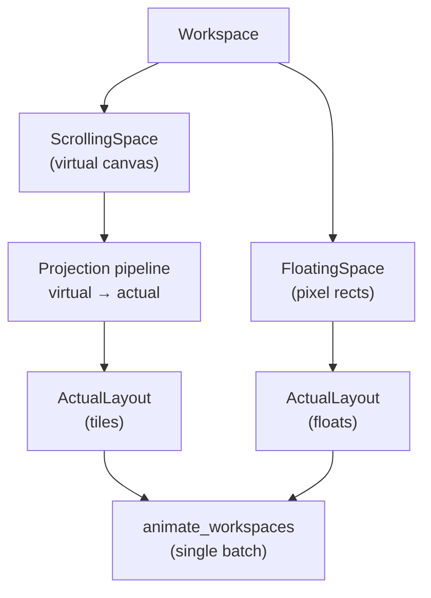
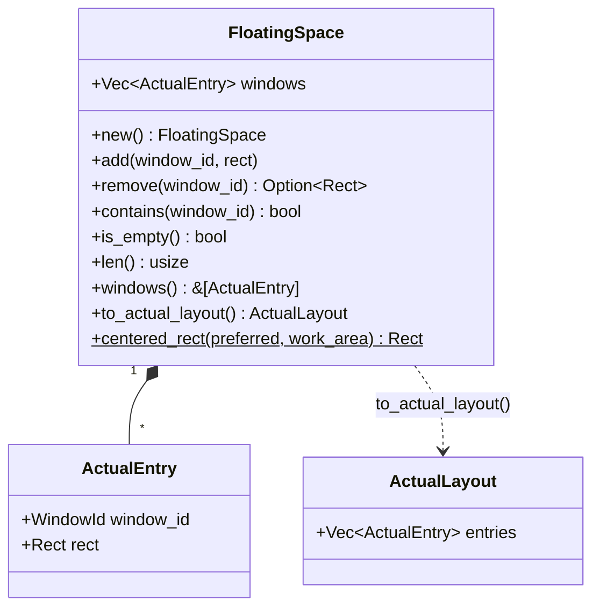
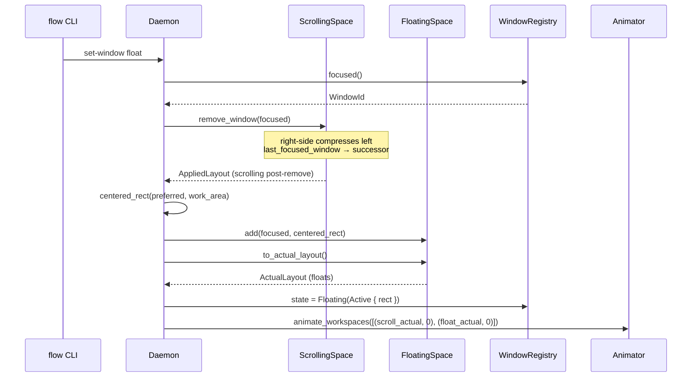
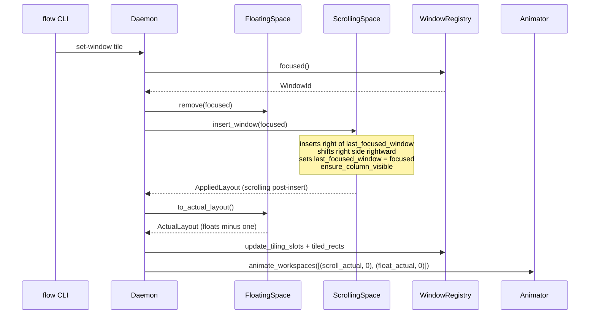
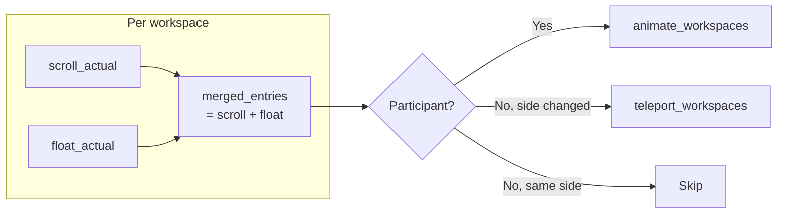
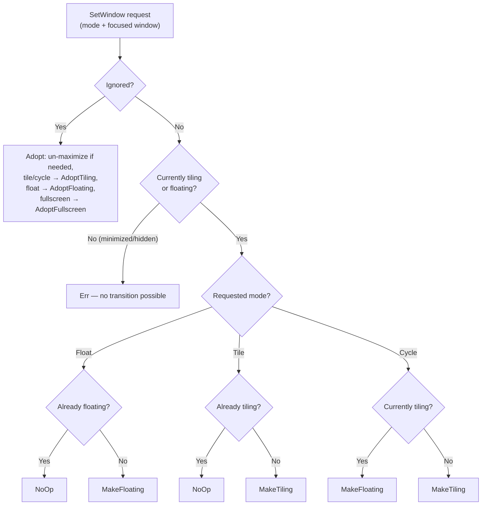

# Floating Space

Floating windows live in **literal on-screen pixel coordinates** (the *actual*
layer). Unlike `ScrollingSpace`, which models an infinite virtual canvas and
projects tiles into screen rects, `FloatingSpace` stores each window's position
directly as an `ActualEntry` — the same type the animation layer consumes. This
means floating windows never pass through the virtual-to-actual projection
pipeline; they are already where they need to be.

This chapter covers the architecture of the floating-space subsystem: its data
model, the tile-to-float and float-to-tile transitions, how animation batches
are coordinated, and how floating windows participate in workspace switching.

## Two Coordinate Spaces — Where FloatingSpace Sits

Each workspace is split between two spatial models (see [layout
overview](./layout/overview.md) for the full virtual/actual pipeline):

- **ScrollingSpace** — infinite horizontal virtual canvas. Windows live in
  columns; the projection pipeline maps virtual geometry to on-screen pixel
  rectangles. This is the tiling engine.
- **FloatingSpace** — direct on-screen pixel rectangles. No virtual canvas, no
  projection, no camera. What you store is what you animate.

The two spaces are structurally independent but share the same animation
pipeline. Every mutation that touches either side produces an `ActualLayout`
that is submitted to `animate_workspaces` in a single coordinated batch.



## Data Model

`FloatingSpace` ([`src/workspace/floating_space.rs`](../../src/workspace/floating_space.rs))
holds an ordered `Vec<ActualEntry>`. Later entries render on top (z-order). The
struct is pure data and math — no Win32, no side effects.



### Why `ActualEntry`?

`FloatingSpace` uses the same `ActualEntry` type as the projection pipeline's
output. This makes `to_actual_layout()` a trivial clone-and-wrap — no
coordinate conversion needed. The animation layer always receives the same
type regardless of whether a window is tiled or floating.

### The `centered_rect` Algorithm

When a window is floated for the first time, it needs a default position.
`centered_rect` is a pure function that computes this:

1. Clamp `preferred.width` to `[0, work_area.width]` (same for height).
2. Center horizontally: `x = work_area.x + (work_area.width - w) / 2`.
3. Center vertically: `y = work_area.y + (work_area.height - h) / 2`.

The result is a `Rect` guaranteed to fit within `work_area`. Oversized windows
are clamped rather than scaled — their dimensions are simply capped.

The *preferred* size comes from the window's `last_natural_size` (the visible
content rect measured at registration time). If that's unavailable or zero, the
config fraction fallback (`FloatingConfig.default_width/height` × work area
dimensions) is used. See [Configuration](#configuration) for the defaults.

## Tile ↔ Float Transitions

The two transitions are the heart of the floating-space subsystem. Both
operate on the **OS-focused window** (`registry.focused()`). The window that
was focused before the transition is the same window that's focused after — the
transition changes the window's *space*, not its *focus*.

### Three entry points share one float-placement primitive

The float-placement core (`register_float` in
[`src/daemon/dispatch.rs`](../../src/daemon/dispatch.rs)) — add to
`FloatingSpace`, mirror the rect into `FloatingState::Active`, and arm
`add_float_hwnd` tracking — is reached from three call sites, so a float always
ends up identically wired regardless of how it became a float:

| Entry point | Trigger | Float rect |
|-------------|---------|------------|
| **`set-window float` / `cycle`** | explicit user toggle of a tiled window | centered (`centered_float_rect`) |
| **`on_window_created` (runtime)** | a new window the rule pipeline classifies as `Float` | centered (`centered_float_rect`) — identical to a toggle |
| **startup scan** | a `Float`-classified window already open when the daemon launched | its **current on-screen position** (adopted in place, not re-centred) |

The runtime path exists because classification runs at creation time: without
it, a rule-classified float would land in the registry yet stay absent from
`FloatingSpace` (so workspace switching would strand it) and borderless until
the user toggled it. The startup path adopts in place rather than animating to
avoid interrupting the in-flight tiling init animation
(`InterruptPolicy::RetargetFromCurrent`).

### Tile → Float: Pop to Center

1. `ScrollingSpace::remove_window(focused)` — removes the tile from the
   virtual canvas. This already handles right-side compression and focus
   succession: `last_focused_window` moves to `next_available_window`.
2. Compute a centered float rect using `last_natural_size` (preferred) or
   config fraction fallback.
3. `FloatingSpace::add(focused, rect)` — appends to the floating list
   (newest on top of z-order).
4. Animate both the post-removal scrolling layout and the updated floating
   layout in a single batch.



Key point: **OS focus stays on the same window**. It pops to center while
the scrolling grid rearranges behind it. `ScrollingSpace::last_focused_window`
(see [Focus model](#focus-model-clarification)) moves to the next tile, but
the user's foreground window doesn't change.

### Float → Tile: Snap to Grid

1. `FloatingSpace::remove(focused)` — removes the window from the floating
   list, returning its old rect.
2. `ScrollingSpace::insert_window(focused)` — inserts a new column
   immediately after `last_focused_window`, shifts right-side columns
   rightward, sets `last_focused_window = focused`, and calls
   `ensure_column_visible`.
3. Animate both the post-insertion scrolling layout and the remaining
   floating layout in a single batch.



Key point: the window snaps from its floating rect into a tile slot.
`last_focused_window` is set to the newly tiled window so the next
insert will go to its right.

### Side-by-Side Comparison

| | Tile → Float | Float → Tile |
|---|---|---|
| **Moved window** | Pops to centered rect | Snaps into new tile slot right of `last_focused_window` |
| **Scrolling layout** | `remove_window`: right-side compresses left, `last_focused_window` → successor | `insert_window`: new column added right of `last_focused_window`, right side shifts right |
| **Floating space** | `add(focused, centered_rect)` — new entry appended | `remove(focused)` — entry removed |
| **OS focus** | Unchanged (same window stays foreground) | Unchanged (same window stays foreground) |
| **`last_focused_window`** | Moves to `next_available_window` via remove-window succession | Set to the moved window (it's now the most recently interacted-with tile) |
| **Registry state** | `Tiling(Active)` → `Floating(Active { rect })` | `Floating(Active)` → `Tiling(Active { col, row })` (auto-synced by `update_tiling_slots_from_layout`) |

## Animation Batch Merging

`dispatch_set_window` submits a **single** `animate_workspaces` call with two
`(ActualLayout, y_offset)` pairs at `y_offset = 0` (same workspace):

```
[(scroll_actual, 0), (float_actual, 0)]
```

This is the same pattern used by `dispatch_move_window_to_workspace`. Both the
scrolling and floating layouts are submitted together so the animator's
`RetargetFromCurrent` policy coordinates the entire transition in lockstep —
tiles slide to fill the gap while the floated window simultaneously moves to
center (or vice versa). Submitting them separately would cause a visible
desynchronisation where one side animates before the other.

## Workspace Switching with Floats

`dispatch_switch_workspace` extends naturally: for each workspace on the active
monitor, the daemon merges the scrolling `ActualLayout` and the floating
`ActualLayout` into one combined layout before partitioning into the
animate/teleport/skip buckets.



Why merge rather than submit separate batches? Two reasons:

1. **y-offset coherence** — every window in a workspace shares the same
   y-offset for the workspace switch. Separate batches could place tiles and
   their workspace's floating windows at different offsets mid-animation.
2. **Per-workspace stacking invariant** — the animator processes windows in
   batch order. Merging keeps all windows from one workspace together, which
   matters when `RetargetFromCurrent` compares current against target
   positions.

## Focus Model Clarification

Three distinct "focus" concepts exist in the codebase. Conflating them caused
bugs during early development of the floating-space feature, so the naming
was deliberately differentiated.

| Concept | Owner | Scope | Used for |
|---------|-------|-------|----------|
| **OS focus** (`registry.focused()`) | `WindowRegistry` | Global — the actual Win32 foreground window | The authoritative resolver for *which window a command acts on*: `set-window` transitions, all tiled-only layout ops (focus / swap / expand / shrink / set-column-width / toggle-monocle / center / merge / promote), and `SetForegroundWindow` calls |
| **`ScrollingSpace::last_focused_window`** | `ScrollingSpace` | Per-space — most recently interacted-with **tile** | Insert-after anchor, focus succession on removal, workspace-switch re-foreground. **Not** used to resolve command targets — tiled-only ops read OS focus instead (see [below](#tiled-only-ops-resolve-from-os-focus)) |
| **(none for floats)** | — | — | `set-window` operates on OS focus regardless of which space the window is in; tiled-only ops silently no-op when a float is foreground (future: float-aware ops such as pixel-nudge for `move-window`) |

### Why `last_focused_window` (not `focused`)

The original field was named `focused`, which implied OS-level foreground. This
caused confusion when implementing `set-window`: is "the focused window" the
OS-foreground window or the scrolling space's internal cursor? Renaming to
`last_focused_window` makes the "history cursor" semantics explicit — it tracks
the most recently interacted-with **tile within this space**, not the global
Win32 foreground.

Floating windows have no separate cursor because the OS focus is sufficient:
`dispatch_set_window` reads `registry.focused()` to find the target window, then
inspects its `WindowState` to decide what transition to apply. The scrolling
space's cursor is irrelevant for this lookup.

## Tiled-only ops resolve from OS focus

All layout operations that only make sense for tiles — `focus`, `swap-window`,
`swap-column`, `merge-column`, `promote-window`, `expand-column`,
`shrink-column`, `set-column-width`, `toggle-monocle`, `center` — resolve their
target from `registry.focused()` (the OS foreground), **not** from
`ScrollingSpace::last_focused_window`. After resolving the foreground
`WindowId`, the dispatch handler verifies
`matches!(state, WindowState::Tiling(TilingState::Active { .. }))`. If the
foreground is a float, ignored, minimized, hidden, or absent, the handler logs
at `debug!` and returns `SocketResponse::Ok` silently — a deliberate no-op, not
an error. (Matching existing no-op precedent: switch-to-self, move-to-self, and
`set-window` NoOp. There is no `Warning`/`Info` variant on `SocketResponse`.)

This prevents the bug where focusing a float left `last_focused_window` pointing
at a stale tile, and a subsequent column-resize silently acted on that tile
instead of being a no-op. `last_focused_window` is still *written* by the
`focus` op (it remains the per-space tile history cursor for insert-after and
succession purposes), but it is no longer *read* by any command handler to
decide what to act on.

The classification is inline in each dispatch handler rather than wrapped in a
helper, so each handler can emit a `debug!` message naming the specific op. When
float-specific behavior arrives (e.g. `move-window → pixel nudge`), a second
`matches!` arm for `WindowState::Floating(FloatingState::Active { .. })` will
slot in alongside the tiling arm.

## Configuration

The `[floating]` section in `flow.toml` controls default floating window
dimensions:

```toml
[floating]
# default_width = 1200    # explicit pixel width (optional)
# default_height = 800    # explicit pixel height (optional)
```

Both fields are optional explicit pixel sizes (`Option<i32>`). When omitted
(the default), the daemon uses a built-in fallback: 60% × 80% of the monitor's
work area, capped at approximately 1536 × 1152 pixels (derived from a QHD
2560×1440 reference). The cap ensures ultrawide and 4K monitors don't produce
absurdly large popups. An explicit pixel value is always respected as-is — the
cap applies only to the fallback. The fallback constants live in
[`src/daemon/dispatch.rs`](../../src/daemon/dispatch.rs).

These defaults are used as a **fallback** when a window has no
`last_natural_size`. Most windows *do* have a natural size (measured from their
DWM visible rect at registration time), so the fallback is only consulted for
edge cases where the natural size is zero or unavailable.

### Config-defaults rule

Code is the single source of truth. The `Default` impl in
[`src/config/types.rs`](../../src/config/types.rs) defines the actual runtime
defaults; `default-config.toml` is a hand-written example synced by a
compile-time test. See [config and persistence](./config-and-persistence.md)
for the full design rationale.

## IPC + CLI

### Command Surface

```
flow dispatch set-window float     # float the focused window
flow dispatch set-window tile      # tile the focused window
flow dispatch set-window cycle     # toggle based on current state
```

The IPC wire format:

```json
{"type": "set_window", "mode": "float"}
{"type": "set_window", "mode": "tile"}
{"type": "set_window", "mode": "cycle"}
```

`SocketMessage::ToggleFloat` is aliased to `dispatch_set_window(Cycle)` —
the legacy toggle name and the new cycle mode are semantically identical.

### The Decision Function

`resolve_set_window_action` is a pure `const fn` extracted from
`dispatch_set_window` so the full mode × state decision table is unit-testable
without constructing a `FlowWM` (which owns Win32 handles).



Full decision table (fullscreen aside — see below):

| mode | currently tiling | currently floating | ignored | result |
|------|------------------|--------------------|---------|--------|
| Float | true | false | false | MakeFloating |
| Float | false | true | false | NoOp |
| Tile | true | false | false | NoOp |
| Tile | false | true | false | MakeTiling |
| Cycle | true | false | false | MakeFloating |
| Cycle | false | true | false | MakeTiling |
| Tile / Cycle | false | false | true | AdoptTiling |
| Float | false | false | true | AdoptFloating |
| Fullscreen | false | false | true | AdoptFullscreen |
| *any* | false | false | false | Err (minimized / hidden) |

An adoption (`adopt_ignored_as_tile` / `adopt_ignored_as_float` in
`dispatch.rs`) asks the registry to un-maximize the window if it is maximized
and re-measure it (`WindowRegistry::adopt_ignored_window`), then seats it the
way a freshly created window is seated: a tile goes next to the focused column
of the strip on the monitor it is on (`insert_window`, the monitor's current
width preset) and a float into the floating space at its current rect
(`register_float`). A window that was maximized is flagged
`adopted_from_maximized` and maximized again by `tiling off` / `flow stop`.
See [Window Registry](./window-registry.md#state-transitions).

## Fullscreen windows

`set-window fullscreen` (`src/daemon/fullscreen.rs`) reuses the floating
space as its home: the window is removed from the layout like a float and
added to its workspace's `FloatingSpace` at the monitor's **screen rect**
(taskbar included), recorded in the registry as `Floating(Active)`, and kept
above the tiles with `HWND_TOPMOST`. A daemon-side map
(`FlowWM::fullscreen`, HWND → `FullscreenOrigin`) is what distinguishes it
from a float: no border (`border_style_for`), no float-location tracking
(`rebuild_float_hwnds` skips it), no ring inset in the animation bridge, and
`mode: "fullscreen"` in `flow query all`. The origin remembers the monitor,
workspace, column, row, width and whether the window had the column to
itself (or the float rect); the second toggle restores it through
`ScrollingSpace::restore_window_at` (same column/row when the column still
exists, else appended) or `register_float`. Minimize / hide keep the origin
and the restore hook re-asserts the screen rect and the topmost flag; destroy
drops it; `tiling off` and the shutdown rescue demote every fullscreen window
to a float inside its work area and clear the topmost flag.

## The floating layer (`[floating] always_on_top`)

niri keeps its floating windows above the tiled strip at all times. FlowWM
does the same with `[floating] always_on_top = true` (`src/daemon/top_layer.rs`):
the only z-order band above ordinary windows on Windows is the **topmost
band** (`WS_EX_TOPMOST`), so the layer's members are kept there with
`SetWindowPos(HWND_TOPMOST, SWP_NOMOVE | SWP_NOSIZE | SWP_NOACTIVATE)`. An
activated tile goes to the top of the *non*-topmost band, so the floats stay
above it.

**Membership** (`in_top_layer`, pure): a tracked `Floating(Active)` window
or a tracked `Ignored(ExplicitRule)` window (a dialog or popup the user's
rules keep out of the strip but still want to see). `layer_wanted` adds the
daemon conditions: the option on, tiling on, and not a window the daemon put
fullscreen — the fullscreen code owns that flag, so a float that goes
fullscreen leaves the layer first and re-enters through `register_float`
when it comes back; a float and a fullscreen window are both topmost and
stack by whichever was activated last. Minimized / hidden floats are out
until restored / shown; `Ignored(Maximized|Fullscreen)` windows and
untracked windows are never touched.

**Bookkeeping** lives on the `Window` record: `on_top` (the daemon holds the
window in the layer; `on_top` in `flow query all`) and `was_topmost` (the
flag the window had before it entered — a window that was topmost on its
own is left topmost when it leaves; one the daemon raised is lowered with
`HWND_NOTOPMOST`; the daemon never clears a flag it did not set).

**Transitions** all end in `FlowWM::sync_top_layer(hwnd)`, which compares
`layer_wanted` with `on_top` and applies the one step `layer_step` decides —
`Enter { raise }`, `Leave { restore_to }` or `Reassert` — reading the
ex-style only for a window that is wanted or held:

| Transition | Where | Step |
|------------|-------|------|
| Window becomes a float (toggle, rule at creation, startup adoption, adopt from ignored, restore of a float registered minimized, back from fullscreen, moved to another monitor) | `register_float` | enter |
| Window registered / recovered as `Ignored(ExplicitRule)` | `on_window_created`, `on_window_state_change`, the startup `sync_all_top_layer` | enter |
| Float restored or shown | `on_window_restored`, `on_window_shown` (after the fullscreen re-assert) | enter |
| `tiling on`, config reload turning the option on, loadout load, display change | `sync_all_top_layer` | enter |
| `set-window tile` / `cycle`, adopt an ignored window as a tile | `set_window_to_tile`, `adopt_ignored_as_tile` | leave |
| Float minimized or hidden | `on_window_minimized`, `on_window_hidden` | leave |
| Float goes fullscreen | `set_window_to_fullscreen` (before the fullscreen code raises it) | leave |
| `tiling off`, config reload turning the option off | `sync_all_top_layer` | leave |
| `flow stop`, fail-back, session end | `release_top_layer` in the shutdown rescue pass | leave, whatever the option says |
| Destroyed | — | nothing (the record goes) |
| A member Windows demoted (an app clearing the flag on activation) | `on_focus_changed` for the activated window; `reassert_top_layer` from the main loop once per `[focus] foreground_sync_interval_ms`, over the held windows only | re-assert |

The Win32 side (`is_topmost` / `set_topmost`) is behind `TopmostProbe`; the
tiling on/off probe extends it, so the pause (`released_on_top`) and the
resume (`raised_on_top`) are covered by the mock desktop. The startup-failure
rescue (`rescue_stranded_windows_with`, before a `FlowWM` exists) needs no
release: the layer is first applied after the initial layout, in `FlowWM::new`.

## Future Work

Several enhancements are planned but not yet implemented:

- **Smart placement** — cascade floating windows so they don't fully overlap,
  or offset new floats by a fixed delta from the previously floated window.
- **Per-window float size memory** — remember each window's last floating
  rect and restore it on subsequent tile→float transitions, rather than
  re-centering every time.
- **Floating gap management** — reserve padding around floating windows so
  they don't visually collide with tiled windows at workspace edges.

## Cross-References

- [Workspace Hierarchy](./workspace.md) — where `FloatingSpace` fits in the
  monitor → workspace → space tree.
- [Layout Overview](./layout/overview.md) — the virtual/actual projection
  pipeline that `FloatingSpace` deliberately bypasses.
- [Window Registry](./window-registry.md) — `WindowState::Floating`, focus
  tracking, and `last_natural_size`.
- [Animation](./animation.md) — how `animate_workspaces` processes the merged
  batch.
- [IPC & Watchdog](./ipc-and-watchdog.md) — the full `SocketMessage` catalog
  and named-pipe transport.
- [Config & Persistence](./config-and-persistence.md) — config resolution,
  the code-is-source-of-truth model, and the dual-edit rule.
