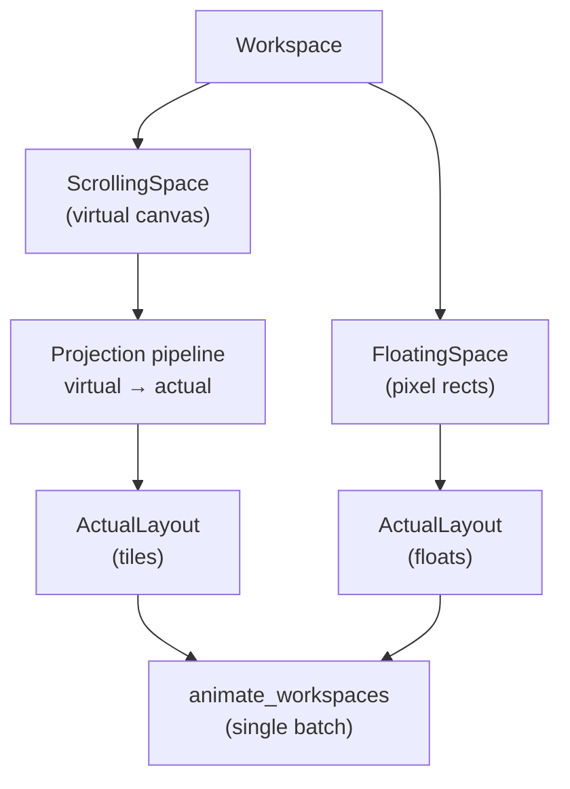
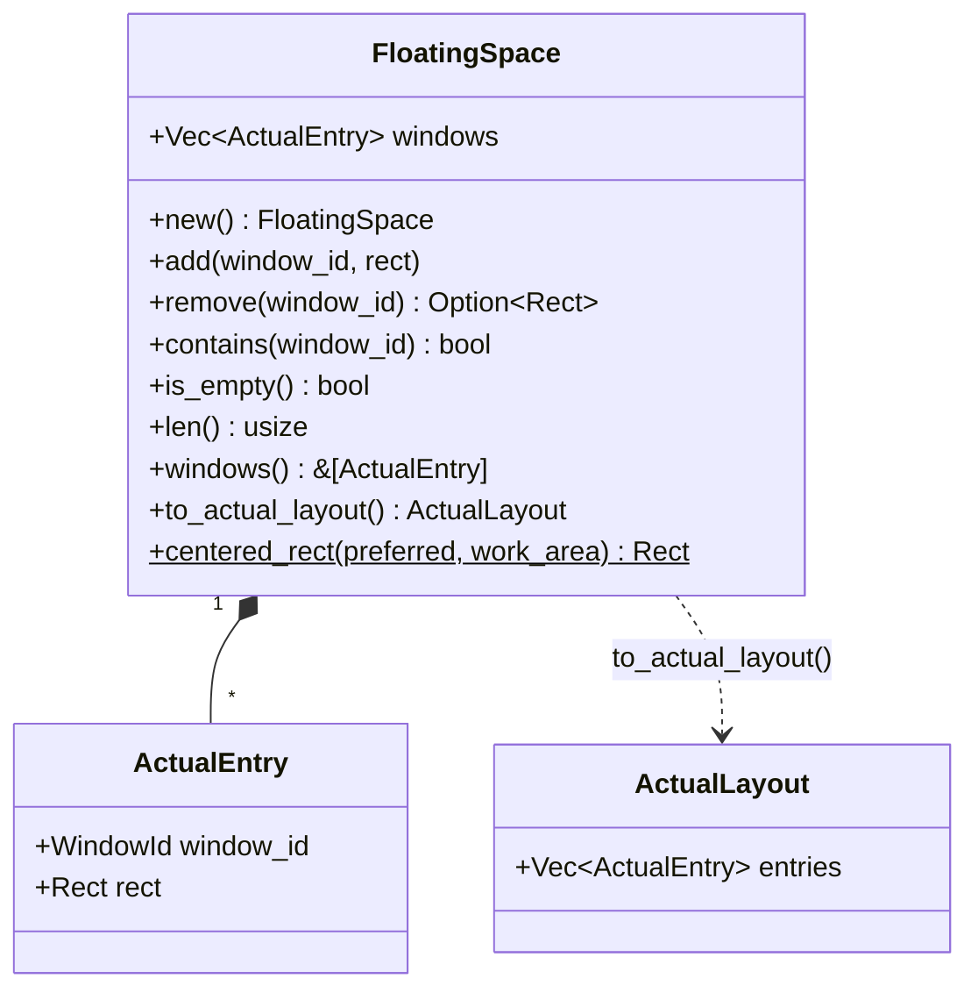
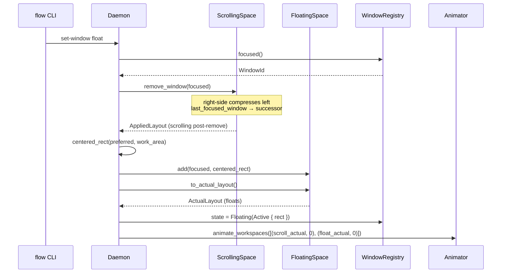
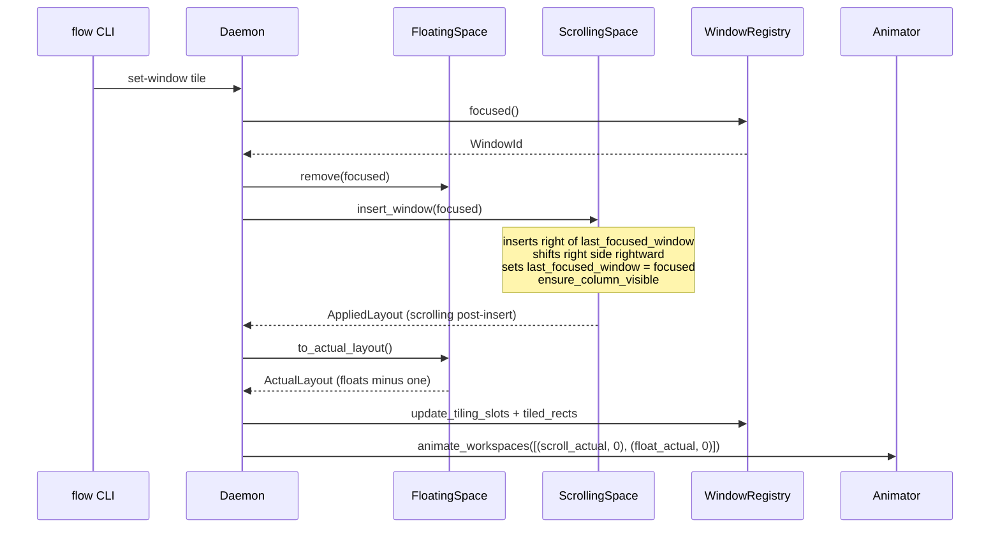
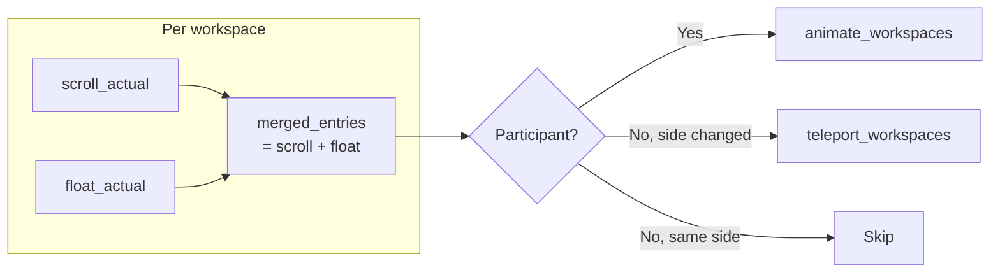
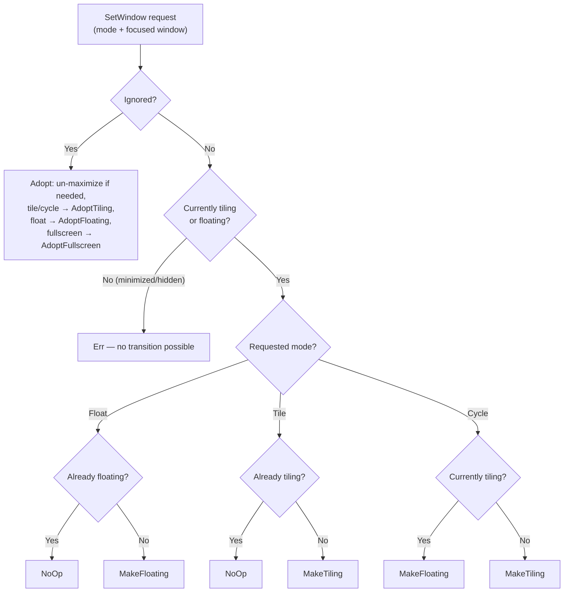

# Floating Space

Floating windows live in **literal on-screen pixel coordinates** (the *actual*
layer). Unlike `ScrollingSpace`, which models an infinite virtual canvas and
projects tiles into screen rects, `FloatingSpace` stores each window's position
directly as an `ActualEntry` — the same type the animation layer consumes. This
means floating windows never pass through the virtual-to-actual projection
pipeline; they are already where they need to be.

This chapter covers the architecture of the floating-space subsystem: its data
model, the tile-to-float and float-to-tile transitions, how animation batches
are coordinated, and how floating windows participate in workspace switching.

## Two Coordinate Spaces — Where FloatingSpace Sits

Each workspace is split between two spatial models (see [layout
overview](./layout/overview.md) for the full virtual/actual pipeline):

- **ScrollingSpace** — infinite horizontal virtual canvas. Windows live in
  columns; the projection pipeline maps virtual geometry to on-screen pixel
  rectangles. This is the tiling engine.
- **FloatingSpace** — direct on-screen pixel rectangles. No virtual canvas, no
  projection, no camera. What you store is what you animate.

The two spaces are structurally independent but share the same animation
pipeline. Every mutation that touches either side produces an `ActualLayout`
that is submitted to `animate_workspaces` in a single coordinated batch.



## Data Model

`FloatingSpace` ([`src/workspace/floating_space.rs`](../../src/workspace/floating_space.rs))
holds an ordered `Vec<ActualEntry>`. Later entries render on top (z-order). The
struct is pure data and math — no Win32, no side effects.



### Why `ActualEntry`?

`FloatingSpace` uses the same `ActualEntry` type as the projection pipeline's
output. This makes `to_actual_layout()` a trivial clone-and-wrap — no
coordinate conversion needed. The animation layer always receives the same
type regardless of whether a window is tiled or floating.

### The `centered_rect` Algorithm

When a window is floated for the first time, it needs a default position.
`centered_rect` is a pure function that computes this:

1. Clamp `preferred.width` to `[0, work_area.width]` (same for height).
2. Center horizontally: `x = work_area.x + (work_area.width - w) / 2`.
3. Center vertically: `y = work_area.y + (work_area.height - h) / 2`.

The result is a `Rect` guaranteed to fit within `work_area`. Oversized windows
are clamped rather than scaled — their dimensions are simply capped.

The *preferred* size comes from the window's `last_natural_size` (the visible
content rect measured at registration time). If that's unavailable or zero, the
config fraction fallback (`FloatingConfig.default_width/height` × work area
dimensions) is used. See [Configuration](#configuration) for the defaults.

## Tile ↔ Float Transitions

The two transitions are the heart of the floating-space subsystem. Both
operate on the **OS-focused window** (`registry.focused()`). The window that
was focused before the transition is the same window that's focused after — the
transition changes the window's *space*, not its *focus*.

### Three entry points share one float-placement primitive

The float-placement core (`register_float` in
[`src/daemon/dispatch.rs`](../../src/daemon/dispatch.rs)) — add to
`FloatingSpace`, mirror the rect into `FloatingState::Active`, and arm
`add_float_hwnd` tracking — is reached from three call sites, so a float always
ends up identically wired regardless of how it became a float:

| Entry point | Trigger | Float rect |
|-------------|---------|------------|
| **`set-window float` / `cycle`** | explicit user toggle of a tiled window | centered (`centered_float_rect`) |
| **`on_window_created` (runtime)** | a new window the rule pipeline classifies as `Float` | centered (`centered_float_rect`) — identical to a toggle |
| **startup scan** | a `Float`-classified window already open when the daemon launched | its **current on-screen position** (adopted in place, not re-centred) |

The runtime path exists because classification runs at creation time: without
it, a rule-classified float would land in the registry yet stay absent from
`FloatingSpace` (so workspace switching would strand it) and borderless until
the user toggled it. The startup path adopts in place rather than animating to
avoid interrupting the in-flight tiling init animation
(`InterruptPolicy::RetargetFromCurrent`).

### Tile → Float: Pop to Center

1. `ScrollingSpace::remove_window(focused)` — removes the tile from the
   virtual canvas. This already handles right-side compression and focus
   succession: `last_focused_window` moves to `next_available_window`.
2. Compute a centered float rect using `last_natural_size` (preferred) or
   config fraction fallback.
3. `FloatingSpace::add(focused, rect)` — appends to the floating list
   (newest on top of z-order).
4. Animate both the post-removal scrolling layout and the updated floating
   layout in a single batch.



Key point: **OS focus stays on the same window**. It pops to center while
the scrolling grid rearranges behind it. `ScrollingSpace::last_focused_window`
(see [Focus model](#focus-model-clarification)) moves to the next tile, but
the user's foreground window doesn't change.

### Float → Tile: Snap to Grid

1. `FloatingSpace::remove(focused)` — removes the window from the floating
   list, returning its old rect.
2. `ScrollingSpace::insert_window(focused)` — inserts a new column
   immediately after `last_focused_window`, shifts right-side columns
   rightward, sets `last_focused_window = focused`, and calls
   `ensure_column_visible`.
3. Animate both the post-insertion scrolling layout and the remaining
   floating layout in a single batch.



Key point: the window snaps from its floating rect into a tile slot.
`last_focused_window` is set to the newly tiled window so the next
insert will go to its right.

### Side-by-Side Comparison

| | Tile → Float | Float → Tile |
|---|---|---|
| **Moved window** | Pops to centered rect | Snaps into new tile slot right of `last_focused_window` |
| **Scrolling layout** | `remove_window`: right-side compresses left, `last_focused_window` → successor | `insert_window`: new column added right of `last_focused_window`, right side shifts right |
| **Floating space** | `add(focused, centered_rect)` — new entry appended | `remove(focused)` — entry removed |
| **OS focus** | Unchanged (same window stays foreground) | Unchanged (same window stays foreground) |
| **`last_focused_window`** | Moves to `next_available_window` via remove-window succession | Set to the moved window (it's now the most recently interacted-with tile) |
| **Registry state** | `Tiling(Active)` → `Floating(Active { rect })` | `Floating(Active)` → `Tiling(Active { col, row })` (auto-synced by `update_tiling_slots_from_layout`) |

## Animation Batch Merging

`dispatch_set_window` submits a **single** `animate_workspaces` call with two
`(ActualLayout, y_offset)` pairs at `y_offset = 0` (same workspace):

```
[(scroll_actual, 0), (float_actual, 0)]
```

This is the same pattern used by `dispatch_move_window_to_workspace`. Both the
scrolling and floating layouts are submitted together so the animator's
`RetargetFromCurrent` policy coordinates the entire transition in lockstep —
tiles slide to fill the gap while the floated window simultaneously moves to
center (or vice versa). Submitting them separately would cause a visible
desynchronisation where one side animates before the other.

### Float geometry

The animation bridge commands a float at `visible_to_window(rect)` — its
stored rect expanded by the invisible frame, never inset for the border
ring — and seats the ring around it (`float_border_rect`), the mirror image
of a tile whose content is inset inside its slot. The two must agree because
the float's rect is a **round trip**: `store_float_rect` reads
`GetWindowRect` back through `window_to_visible` on every `LOCATIONCHANGE`
and that becomes the next batch's input. With the tile inset applied to
floats, every re-animation of a floating space (a float appearing, a
workspace switch, `set-window float`) lost `2·(thickness − overlap)` px —
4 px with the default ring — and a float dragged a few times visibly shrank.
`float_geometry` (`src/daemon/animation.rs`) is the single rule, covered by
`float_geometry_tests` and the drag-session round-trip test.

During a keymap drag session on a float (`flow dispatch drag begin`, see
[Tile Drag](./tile-drag.md), *Keymap-driven sessions*) `store_float_rect`
moves only the ring: the `FloatingSpace` entry and the registry mirror are
written once, by `drag end`, and the bridge leaves the window out of every
batch meanwhile, so a float appearing mid-drag cannot snap the dragged one
back to a stale rect.

## Workspace Switching with Floats

`dispatch_switch_workspace` extends naturally: for each workspace on the active
monitor, the daemon merges the scrolling `ActualLayout` and the floating
`ActualLayout` into one combined layout before partitioning into the
animate/teleport/skip buckets.



Why merge rather than submit separate batches? Two reasons:

1. **y-offset coherence** — every window in a workspace shares the same
   y-offset for the workspace switch. Separate batches could place tiles and
   their workspace's floating windows at different offsets mid-animation.
2. **Per-workspace stacking invariant** — the animator processes windows in
   batch order. Merging keeps all windows from one workspace together, which
   matters when `RetargetFromCurrent` compares current against target
   positions.

## Focus Model Clarification

Three distinct "focus" concepts exist in the codebase. Conflating them caused
bugs during early development of the floating-space feature, so the naming
was deliberately differentiated.

| Concept | Owner | Scope | Used for |
|---------|-------|-------|----------|
| **OS focus** (`registry.focused()`) | `WindowRegistry` | Global — the actual Win32 foreground window | The authoritative resolver for *which window a command acts on*: `set-window` transitions, all tiled-only layout ops (focus / swap / expand / shrink / set-column-width / toggle-monocle / center / merge / promote), and `SetForegroundWindow` calls |
| **`ScrollingSpace::last_focused_window`** | `ScrollingSpace` | Per-space — most recently interacted-with **tile** | Insert-after anchor, focus succession on removal, workspace-switch re-foreground. **Not** used to resolve command targets — tiled-only ops read OS focus instead (see [below](#tiled-only-ops-resolve-from-os-focus)) |
| **(none for floats)** | — | — | `set-window` operates on OS focus regardless of which space the window is in; tiled-only ops silently no-op when a float is foreground (future: float-aware ops such as pixel-nudge for `move-window`) |

### Why `last_focused_window` (not `focused`)

The original field was named `focused`, which implied OS-level foreground. This
caused confusion when implementing `set-window`: is "the focused window" the
OS-foreground window or the scrolling space's internal cursor? Renaming to
`last_focused_window` makes the "history cursor" semantics explicit — it tracks
the most recently interacted-with **tile within this space**, not the global
Win32 foreground.

Floating windows have no separate cursor because the OS focus is sufficient:
`dispatch_set_window` reads `registry.focused()` to find the target window, then
inspects its `WindowState` to decide what transition to apply. The scrolling
space's cursor is irrelevant for this lookup.

## Tiled-only ops resolve from OS focus

All layout operations that only make sense for tiles — `focus`, `swap-window`,
`swap-column`, `merge-column`, `promote-window`, `expand-column`,
`shrink-column`, `set-column-width`, `toggle-monocle`, `center` — resolve their
target from `registry.focused()` (the OS foreground), **not** from
`ScrollingSpace::last_focused_window`. After resolving the foreground
`WindowId`, the dispatch handler verifies
`matches!(state, WindowState::Tiling(TilingState::Active { .. }))`. If the
foreground is a float, ignored, minimized, hidden, or absent, the handler logs
at `debug!` and returns `SocketResponse::Ok` silently — a deliberate no-op, not
an error. (Matching existing no-op precedent: switch-to-self, move-to-self, and
`set-window` NoOp. There is no `Warning`/`Info` variant on `SocketResponse`.)

This prevents the bug where focusing a float left `last_focused_window` pointing
at a stale tile, and a subsequent column-resize silently acted on that tile
instead of being a no-op. `last_focused_window` is still *written* by the
`focus` op (it remains the per-space tile history cursor for insert-after and
succession purposes), but it is no longer *read* by any command handler to
decide what to act on.

The classification is inline in each dispatch handler rather than wrapped in a
helper, so each handler can emit a `debug!` message naming the specific op. When
float-specific behavior arrives (e.g. `move-window → pixel nudge`), a second
`matches!` arm for `WindowState::Floating(FloatingState::Active { .. })` will
slot in alongside the tiling arm.

## Configuration

The `[floating]` section in `flow.toml` controls default floating window
dimensions:

```toml
[floating]
# default_width = 1200    # explicit pixel width (optional)
# default_height = 800    # explicit pixel height (optional)
```

Both fields are optional explicit pixel sizes (`Option<i32>`). When omitted
(the default), the daemon uses a built-in fallback: 60% × 80% of the monitor's
work area, capped at approximately 1536 × 1152 pixels (derived from a QHD
2560×1440 reference). The cap ensures ultrawide and 4K monitors don't produce
absurdly large popups. An explicit pixel value is always respected as-is — the
cap applies only to the fallback. The fallback constants live in
[`src/daemon/dispatch.rs`](../../src/daemon/dispatch.rs).

These defaults are used as a **fallback** when a window has no
`last_natural_size`. Most windows *do* have a natural size (measured from their
DWM visible rect at registration time), so the fallback is only consulted for
edge cases where the natural size is zero or unavailable.

### Config-defaults rule

Code is the single source of truth. The `Default` impl in
[`src/config/types.rs`](../../src/config/types.rs) defines the actual runtime
defaults; `default-config.toml` is a hand-written example synced by a
compile-time test. See [config and persistence](./config-and-persistence.md)
for the full design rationale.

## IPC + CLI

### Command Surface

```
flow dispatch set-window float     # float the focused window
flow dispatch set-window tile      # tile the focused window
flow dispatch set-window cycle     # toggle based on current state
```

The IPC wire format:

```json
{"type": "set_window", "mode": "float"}
{"type": "set_window", "mode": "tile"}
{"type": "set_window", "mode": "cycle"}
```

`SocketMessage::ToggleFloat` is aliased to `dispatch_set_window(Cycle)` —
the legacy toggle name and the new cycle mode are semantically identical.

### The Decision Function

`resolve_set_window_action` is a pure `const fn` extracted from
`dispatch_set_window` so the full mode × state decision table is unit-testable
without constructing a `FlowWM` (which owns Win32 handles).



Full decision table:

| mode | currently tiling | currently floating | fullscreen | ignored | result |
|------|------------------|--------------------|------------|---------|--------|
| Float | true | false | false | false | MakeFloating |
| Float | false | true | false | false | NoOp |
| Tile | true | false | false | false | NoOp |
| Tile | false | true | false | false | MakeTiling |
| Cycle | true | false | false | false | MakeFloating |
| Cycle | false | true | false | false | MakeTiling |
| Fullscreen | either | | false | false | MakeFullscreen |
| Fullscreen | (tiling) | | true | false | LeaveFullscreen(Origin) |
| Tile / Cycle | (tiling) | | true | false | LeaveFullscreen(Tile) |
| Float | (tiling) | | true | false | LeaveFullscreen(Float) |
| Tile / Cycle | false | false | false | true | AdoptTiling |
| Float | false | false | false | true | AdoptFloating |
| Fullscreen | false | false | false | true | AdoptFullscreen |
| *any* | false | false | false | false | Err (minimized / hidden) |

A fullscreen window is a tile of the strip (ADR-0021), so "fullscreen"
implies "currently tiling" and is checked first. `cycle` keeps its float/tile
meaning for everything else — on a fullscreen window it only ever leads back
to tiled, and on an ignored window (which has no float/tile state to flip)
it means `tile`. Adoption covers every ignore reason: maximized and
fullscreen at creation, and an explicit rule. A no-op transition is never
recorded as a learned rule (`action_to_learned` returns `None`: the window
was already in the requested mode, so there is no user intent to learn);
an adoption records the mode the window was adopted into, and adopting
into fullscreen records `Tile`, because the window entered the tiled
layout and fullscreen itself is a view, never learned.

#### Unknown foreground windows

The OS foreground is the truth about which window the user means
(`resolve_set_window_target`). When it is a window the registry never met —
the user's Outlook, minimized when the daemon started and restored behind a
cloak; a window that failed a creation gate at creation and passes it now —
it is registered through the creation pipeline first (seated as a tile or a
float by the rules, or tracked as ignored) and the requested mode is then
applied by the table above, with one adjustment (`resolve_unknown_focus`):
`cycle` on a window that was unknown a moment ago means `tile`, as it does
on an ignored window — the rules may just have seated it as a tile, and
`cycle` must not flip it straight back out. A window that cannot be
registered (a tool window, no title, cloaked, owned) is refused with the
gate it failed, in place of the old "focused window not found in registry".
Without an OS foreground the registry's tracked focus is used as before.

An adoption (`adopt_ignored_as_tile` / `adopt_ignored_as_float` in
`dispatch.rs`) asks the registry to un-maximize the window if it is maximized
and re-measure it (`WindowRegistry::adopt_ignored_window`), then seats it the
way a freshly created window is seated: a tile goes next to the focused column
of the strip on the monitor it is on (`insert_window`, the monitor's current
width preset) and a float into the floating space at its current rect
(`register_float`). A window that was maximized is flagged
`adopted_from_maximized` and maximized again by `tiling off` / `flow stop`.
See [Window Registry](./window-registry.md#state-transitions).

## Fullscreen windows

Fullscreen is a **column of the strip**, not a float (ADR-0021,
`src/daemon/fullscreen.rs`). `set-window fullscreen` flags the focused
window's column (`Column::fullscreen`); the window stays a tile
(`Tiling(Active)`) at its place in the strip:

- **Entering.** A tile's column is flagged; a window that shares a stack is
  first expelled into a column of its own right after the stack
  (`mutations::expel_to_column`). A float leaves its floating space, joins
  the strip after the focused column (`insert_window`, its float rect noted
  as its pre-tiling anchor for `tiling off`) and is flagged. The view starts
  at the column (`ScrollingSpace::enter_fullscreen`), the window goes into
  the topmost band and loses its border.
- **In view and parked.** On the canvas the column spans one screen
  (`Column::canvas_width = monitor_width − gap`). While it starts the view
  it is projected at the monitor's **screen rect** (taskbar covered) and
  every other column is parked; scrolled or focused off, it is parked at the
  screen rect's size, so the move is a pure one (ADR-0019). The animation
  bridge places it without the ring inset (`tile_geometry`). See
  [Projection](./layout/projection.md) and
  [Mutations](./layout/mutations.md).
- **Leaving.** `set-window fullscreen` again: a tile is merged back into
  its stack at its row when it came from one and the stack still has room
  (`mutations::merge_back`), else it stays a column of its own; its width
  was never touched, and the strip's `viewport_offset` from before is
  restored when it is still on that strip
  (`ScrollingSpace::leave_fullscreen`). A float-origin window floats again
  at its rect (`register_float`). `set-window tile|cycle` leave it in the
  strip; `set-window float` floats it (its old rect, else centred).
- **Bookkeeping.** `FlowWM::fullscreen` (HWND → `FullscreenOrigin`) is the
  authority; the column flag follows it. The origin remembers the monitor
  and workspace, and for a tile its row, one window of its stack (`None`
  when it had the column to itself) and the view; for a float its rect.
  `reflag_fullscreen` flags the column again whenever the window is
  re-seated: restore / show (`readd_tile_to_home_monitor`, in the same
  batch), `move-to-monitor`, `move-to-workspace`; `resync_fullscreen_columns`
  re-flags every strip after a hotplug or a loadout (which do not save the
  flag: a fullscreen window comes back as a column at its width).
  Minimize / hide take the column out of the strip and keep the origin;
  destroy forgets it.
- **Pause and exit.** `tiling off` takes every window out of fullscreen
  where it is (`leave_all_fullscreen_for_pause`: an app's own full screen
  ended, topmost cleared, a plain column) before the usual pause, so
  `tiling on` finds an ordinary tile. `flow stop`, the fail-back and session
  end (`release_all_fullscreen`) clear topmost, end an app's full screen and
  move the one in view inside its work area; a parked one is rescued like
  any stranded window.
- **What it is not.** It is not in the floating layer (`layer_wanted`
  excludes daemon-fullscreen windows, the fullscreen code owns its topmost
  flag), it is the tiling side for `focus-floating` / `focus-tiling`, and
  its column refuses width and stack commands (see the dispatch reference).
  `drag begin` refuses it; a native title-bar drag of it snaps back.

A window under a `fullscreen = "app"` rule (Remote Desktop) is put there by
the app itself: `SC_MAXIMIZE` in, `SC_RESTORE` out, with the same column
and bookkeeping plus `FlowWM::app_fullscreen` (the captioned frame's
invisible borders for the way back). The daemon never sizes such a frame:
the rect the app chose is recorded as sent and every batch skips a target
equal to it (`app_owns_rect`); parking by column or by workspace is sent as
a pure move. The app's own switches are followed through a location-change
watch (`sync_app_fullscreen`). ADR-0020.

## The floating layer (`[floating] always_on_top`)

niri keeps its floating windows above the tiled strip at all times. FlowWM
does the same with `[floating] always_on_top = true` (`src/daemon/top_layer.rs`):
the only z-order band above ordinary windows on Windows is the **topmost
band** (`WS_EX_TOPMOST`), so the layer's members are kept there with
`SetWindowPos(HWND_TOPMOST, SWP_NOMOVE | SWP_NOSIZE | SWP_NOACTIVATE)`. An
activated tile goes to the top of the *non*-topmost band, so the floats stay
above it — **while flow owns the foreground**. The moment the foreground
moves to a fullscreen app or a window flow does not manage, the members are
dropped under it; this is the upstream stacking invariant, ADR-0003
(`docs/adr/0003-float-tile-stacking-invariant.md`), which rejects
"floats always topmost" because it covers fullscreen video and borderless
games.

**Membership** (`in_top_layer`, pure): a tracked `Floating(Active)` window
or a tracked `Ignored(ExplicitRule)` window (a dialog or popup the user's
rules keep out of the strip but still want to see). `layer_wanted` adds the
daemon conditions: the option on, tiling on, the layer **raised** (below),
and not a window the daemon put fullscreen — the fullscreen code owns that
flag, so a float that goes fullscreen leaves the layer first and re-enters
through `register_float` when it comes back; a float and a fullscreen window
are both topmost and stack by whichever was activated last. Minimized /
hidden floats are out until restored / shown; `Ignored(Maximized|Fullscreen)`
windows are never touched, and neither is a tracked window whose class is a
shell surface (`SHELL_CLASSES`: the Start menu and search `CoreWindow`s the
default rules ignore explicitly would otherwise get `HWND_TOPMOST` on every
raise, ADR-0024). Untracked windows are never members; the ones owned by a
flow window ride with the layer instead (*Riders*, below).

**The decision** (`classify_foreground`, pure; `FlowWM::decide_top_layer_with`
over the daemon's view) looks at one window, the foreground, and yields one
of three owners:

| Foreground | Owner | Layer |
|------------|-------|-------|
| A registry window whose state is `Tiling(Active)`, `Floating(Active)` or `Ignored(ExplicitRule)` — a tile or a layer member — **and** not fullscreen by the live check | `Flow` | raised: members `HWND_TOPMOST` |
| An untracked window owned by a flow window (its `GW_OWNER` chain reaches a tracked window, the *anchor*): classed by the anchor's state, and by the live fullscreen check on the window and the anchor | by its anchor | `Flow`: raised, and the window rides with the layer (*Riders*) |
| Fullscreen by live geometry + style (tracked or not); an untracked window no tracked window owns; a registry window in any other `Ignored` state (`Maximized`, `Fullscreen`, …) or a minimized / hidden state | `Foreign` | dropped: members seated directly under that window |
| A shell surface (class in `SHELL_CLASSES`), no foreground, or a handle already gone | `Shell` | kept: the last decision stands |

*Fullscreen is read live, not from the stored state.* F11 in a browser, VS
Code or a terminal resizes the window — `EVENT_OBJECT_LOCATIONCHANGE`, not a
`STATECHANGE` — so `Ignored(Fullscreen)` never fires for it. The check is
`win32::is_fullscreen_on_its_monitor`: the window rect equals the full rect
(`rcMonitor`) of the monitor it is on, and the style has neither `WS_CAPTION`
nor `WS_THICKFRAME`. A maximized window keeps its chrome and so does not
count (an auto-hide taskbar causes no false positive); a borderless game, a
video player or an F11 browser does. The daemon's own `set-window
fullscreen` (Mod+F) moves the window without touching its styles, so it stays
`Flow` and keeps today's handling — the fullscreen code owns that window's
flag, both stay topmost and stack by activation; only an app that was
borderless to begin with reads as fullscreen and drops the layer.

*Where it is decided.* Three places, all ending in
`FlowWM::evaluate_top_layer` (decide, then apply to every window when the
decision flipped): the single focus sink `on_focus_changed` (every
foreground change, external or self-induced); the foreground window's own
`LOCATIONCHANGE` and `STATECHANGE` (the hook callback forwards
`LOCATIONCHANGE` for `hooks::foreground_hwnd()`, the handle the sink
recorded, on top of the floats and the dragged tile; the main loop re-decides
only when the moved window *is* the foreground, which costs one registry
lookup plus the live check — cheap enough per pixel, no debounce); and the
periodic `reassert_top_layer` pass (once per `[focus]
foreground_sync_interval_ms`), which reads `GetForegroundWindow` itself so a
dropped foreground event or a silent fullscreen switch is corrected both
ways, then re-raises any member Windows demoted. `sync_all_top_layer`
(`tiling on`, reload, loadout, display change, startup) re-decides against
the last foreground the sink saw first, so `tiling on` under a fullscreen app
stays dropped and `tiling on` after the user went back to a tile raises.

*The drop seats members under the foreground.* `HWND_NOTOPMOST` alone would
leave a float at the top of the ordinary band — above the fullscreen app that
dropped it — so a leave caused by a drop uses `SetWindowPos(float,
hwndInsertAfter = foreground)` (`win32::insert_below`), which clears the
topmost flag and places the float directly beneath that window in one call;
the tiles stay under the float. A member that was topmost on its own
(`was_topmost`) is not touched by a drop at all. Raising again is a plain
enter (`HWND_TOPMOST`), so `was_topmost` memory survives a drop / raise
cycle.

*The shell exception — a deliberate deviation from ADR-0003's "any non-flow
window".* Clicking the taskbar, opening Start or search, Alt+Tab's host and
the daemon's own surfaces (`FlowBorderOverlay`, `FlowSessionSink`) all take
the foreground for a moment and give it straight back to a flow window;
dropping and re-raising on each would flash every float on every taskbar
click. These classes (`SHELL_CLASSES` in `top_layer.rs`: `Shell_TrayWnd`,
`Shell_SecondaryTrayWnd`, `Progman`, `WorkerW`, `Windows.UI.Core.CoreWindow`,
`XamlExplorerHostIslandWindow`, `ForegroundStaging`, and the two above) leave
the decision as it was, as does a null foreground. The keymap's OSD is shown
`NoActivate` and never takes the foreground, so it needs no entry; any other
AutoHotkey window is an ordinary app. A dialog owned by a flow window (a
Save-As box, a connect dialog, an error box) is not on the list either; it
is classed by its owner (*Riders*).

*Riders — owned windows of flow windows (ADR-0024,
`docs/adr/0024-owned-windows-ride-the-floating-layer.md`).* Windows never
reach the registry when they have an owner (`creation_gates`,
`OwnedOrChild`), so a modal dialog or a message box of a flow window used to
be a foreign foreground: it dropped the layer, the drop seated its own owner
under it, and the next activation of any flow window raised every member
above it again — the SSMS error box that could not be reached (2026-11-02).
Now an untracked, visible foreground whose owner chain (at most eight
`GW_OWNER` hops, a cycle ends the walk, `anchor_of`) reaches a tracked
window is a *rider* of that *anchor*. It is classed by the anchor (shell
classes still win first; the live fullscreen check runs on the rider and on
the anchor), and while the layer is raised it is held in the topmost band
like a member: an entering rider always gets `HWND_TOPMOST`, so it lands
above the members raised before it; on a raise flip the members go first,
then the riders, owner first and the foreground window (member or rider) last; the periodic
pass re-asserts a demoted rider. A drop seats the riders under the
foreground first, then the members, and no window is ever seated under a
window on its own owner chain (`seat_below` falls back to
`HWND_NOTOPMOST`). Riders get no registry record, seat, border or learned
rule; they live in `FlowWM::riders` (`anchor`, `on_top`, `was_topmost`,
where `was_topmost` ignores a flag inherited from an owner the layer holds).
They leave with the layer (drop, `tiling off`, option off) and on `flow
stop` / fail-back (`release_top_layer`, riders first), and are forgotten
when hidden or destroyed or when every pass finds them gone, hidden or with
an untracked anchor. A modeless owned window (a Find dialog) that once had
the foreground therefore stays above flow windows until it closes or a
foreign app takes the foreground; owned windows that never take the
foreground are left to Windows' own topmost propagation. Logged as `top
layer: rider 0x.. (anchor 0x..) entered|left|forgotten`.

`flow ping` prints the state (`floating layer raised|dropped`) while the
option and tiling are on; `flow query all` keeps reporting `on_top`, which is
`false` for every member while dropped (the daemon does not hold them).

**Bookkeeping** lives on the `Window` record: `on_top` (the daemon holds the
window in the layer; `on_top` in `flow query all`) and `was_topmost` (the
flag the window had before it entered — a window that was topmost on its
own is left topmost when it leaves; one the daemon raised is lowered with
`HWND_NOTOPMOST`, or seated under the foreground on a drop; the daemon never
clears a flag it did not set) — and on `FlowWM`: `top_layer_raised` (the
decision), `foreground` (the handle the sink last saw) and `top_layer_below`
(the window a drop seats members under).

**Transitions** all end in `FlowWM::sync_top_layer(hwnd)`, which compares
`layer_wanted` with `on_top` and applies the one step `layer_step` decides —
`Enter { raise }`, `Leave { restore_to }` or `Reassert` — reading the
ex-style only for a window that is wanted or held:

| Transition | Where | Step |
|------------|-------|------|
| Window becomes a float (toggle, rule at creation, startup adoption, adopt from ignored, restore of a float registered minimized, back from fullscreen, moved to another monitor) | `register_float` | enter (while raised; a float toggled while dropped enters at the next raise) |
| Window registered / recovered as `Ignored(ExplicitRule)` | `on_window_created`, `on_window_state_change`, the startup `sync_all_top_layer` | enter |
| Float restored or shown | `on_window_restored`, `on_window_shown` | enter |
| `tiling on`, config reload turning the option on, loadout load, display change | `sync_all_top_layer` (re-decides against the last foreground first) | enter |
| Foreground moves to a tile / float / explicit-rule ignore that is not fullscreen, or that window's chrome comes back (F11 off) | `on_focus_changed`, the foreground's `LOCATIONCHANGE` / `STATECHANGE`, `reassert_top_layer` → `evaluate_top_layer` | **raise**: enter for every member |
| Foreground moves to a fullscreen / untracked / OS-ignored window, or the foreground tile goes fullscreen (F11) | the same three paths | **drop**: leave for every member, seated under the foreground |
| `set-window tile` / `cycle`, adopt an ignored window as a tile | `set_window_to_tile`, `adopt_ignored_as_tile` | leave |
| Float minimized or hidden | `on_window_minimized`, `on_window_hidden` | leave |
| Float goes fullscreen | `set_window_to_fullscreen` (before the fullscreen code raises it) | leave |
| `tiling off`, config reload turning the option off | `sync_all_top_layer` | leave |
| `flow stop`, fail-back, session end | `release_top_layer` in the shutdown rescue pass | leave, whatever the option says |
| Destroyed | — | nothing (the record goes) |
| An owned window of a flow window takes the foreground (rider) | `on_focus_changed` / `reassert_top_layer` → `decide_top_layer_with` notes it, `sync_top_layer` | enter (`HWND_TOPMOST`, after the members) |
| A rider is hidden, destroyed, gone, or its anchor is no longer tracked | `on_window_hidden`, `on_window_destroyed`, the purge of every pass | leave (flag put back) and forgotten |
| A member Windows demoted (an app clearing the flag on activation) | `on_focus_changed` for the activated window (when the decision stands); `reassert_top_layer` from the main loop once per `[focus] foreground_sync_interval_ms`, over the held windows only | re-assert |

The Win32 side (`is_topmost` / `set_topmost` / `insert_below` /
`is_fullscreen_live` / `class_name` / `owner_of` / `is_visible`) is behind
`TopmostProbe`; the tiling
on/off probe extends it, so the pause (`released_on_top`) and the resume
(`raised_on_top`) are covered by the mock desktop, and `top_layer.rs`'s own
mock scripts the foreground (an untracked game window, a taskbar, a tile
resized to fullscreen) for the decision. The startup-failure rescue
(`rescue_stranded_windows_with`, before a `FlowWM` exists) needs no release:
the layer is first applied after the initial layout, in `FlowWM::new`, after
the first decision against the desktop's real foreground.

### Reaching the other layer (`focus-floating`, `focus-tiling`, the switch)

With the layer dropped under a fullscreen or foreign foreground there was no
way to get to a float without leaving fullscreen; niri's answer is a chord
that makes the floating layer active, and the fork does the same (ADR-0016,
`docs/adr/0016-layer-focus-switch-and-one-drag-state.md`).
`SocketMessage::FocusLayer { target }` — `focus-floating`, `focus-tiling`,
`switch-focus-between-floating-and-tiling` (Mod+Shift+V in the win-niri
keymap) — acts on the **active monitor's** workspace:

- **Which side is active** (`layer_to_focus`, pure): the floating layer when
  the registry's focus is an active float of that workspace's
  `FloatingSpace`; otherwise the tiling side (a fullscreen window is a
  column of the strip, ADR-0021). `Other` goes to the side that is not active, so with nothing
  focused it goes to the floats, as in niri.
- **Candidates** (`layer_focus_candidates`, pure): floating — the
  workspace's `last_focused_float` while it is still in the space, then the
  floats top-most first; tiling — the
  strip's `last_focused_window`, then every tile in column/row order.
- **The walk** (`FlowWM::focus_layer_with`) is `focus_monitor`'s: a dead
  candidate is purged from its space, a hidden one skipped, a refused push
  skipped, the first one that takes the foreground wins. The registry focus
  and the borders are updated there (the foreground hook repeats it), a
  tile is scrolled into view, a float is recorded as `last_focused_float`.
- **Nothing to focus** answers `Data { "focused": null, "message": "no
  floating window to focus" }`, exit 0: the chord is a toggle tapped blind.

Focusing a float makes it the OS foreground, so the top-layer rule above
raises the layer at once — over an F11 browser as much as over a tile. The
per-workspace memory is written by `on_focus_changed` for any active float
and validated when read, so no removal path has to clear it; it is not part
of the loadout.

## Future Work

Several enhancements are planned but not yet implemented:

- **Smart placement** — cascade floating windows so they don't fully overlap,
  or offset new floats by a fixed delta from the previously floated window.
- **Per-window float size memory** — remember each window's last floating
  rect and restore it on subsequent tile→float transitions, rather than
  re-centering every time.
- **Floating gap management** — reserve padding around floating windows so
  they don't visually collide with tiled windows at workspace edges.

## Cross-References

- [Workspace Hierarchy](./workspace.md) — where `FloatingSpace` fits in the
  monitor → workspace → space tree.
- [Layout Overview](./layout/overview.md) — the virtual/actual projection
  pipeline that `FloatingSpace` deliberately bypasses.
- [Window Registry](./window-registry.md) — `WindowState::Floating`, focus
  tracking, and `last_natural_size`.
- [Animation](./animation.md) — how `animate_workspaces` processes the merged
  batch.
- [IPC & Watchdog](./ipc-and-watchdog.md) — the full `SocketMessage` catalog
  and named-pipe transport.
- [Config & Persistence](./config-and-persistence.md) — config resolution,
  the code-is-source-of-truth model, and the dual-edit rule.
