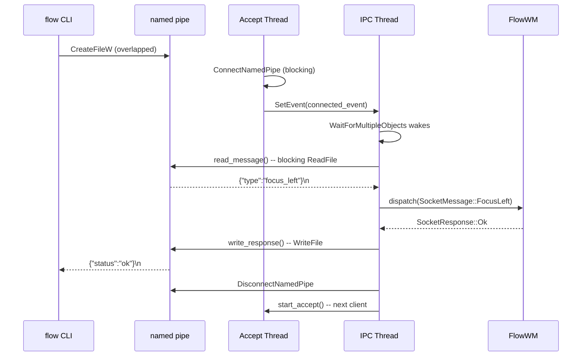
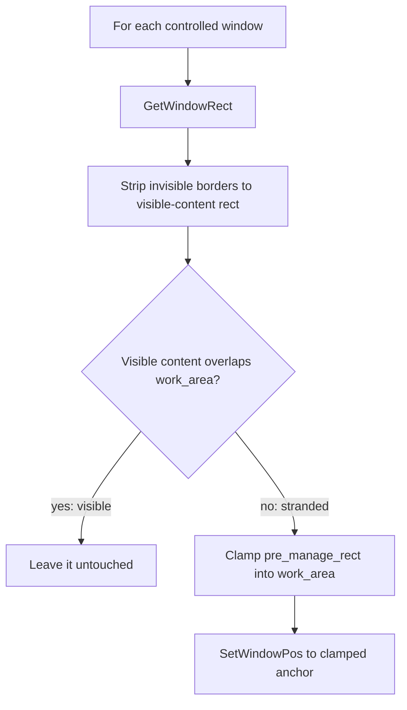

# IPC

The `flow` CLI communicates with the `flowd` daemon over a single Windows named pipe
using newline-delimited JSON. The daemon listens for one client at a time on a
background accept thread, while the main IPC thread processes hook events and
dispatches commands.

## Named-Pipe Protocol

The IPC transport uses the Windows named pipe `\\.\pipe\flow` (configurable via the
`FLOW_PIPE_NAME` environment variable for integration tests). The wire format is
newline-delimited JSON: each message is a single JSON object terminated by `\n`,
serialised by `serde_json`. The encoding and decoding helpers live in
[`src/ipc/message.rs`](../../src/ipc/message.rs).

The pipe uses byte mode (`PIPE_TYPE_BYTE | PIPE_READMODE_BYTE`) with duplex
access. The server accepts one client at a time (sequential, not concurrent).
After processing a request, the server disconnects and waits for the next
connection. The server is created with `FILE_FLAG_FIRST_PIPE_INSTANCE` so that a
second daemon instance fails fast with an address-in-use error instead of
silently replacing the first.



### Why a Named Pipe

A named pipe was chosen over TCP or Unix-domain sockets for three reasons:

- **Local-only** -- named pipes are inherently local to the machine. No network
  exposure, no firewall rules, no port conflicts.
- **Windows-native** -- `CreateNamedPipeW` / `ConnectNamedPipe` are the standard
  Win32 IPC primitives. No third-party dependency, no compatibility shim.
- **ACL-capable** -- the pipe carries its own DACL (below), so another local
  account cannot even open it.

### Pipe security

The server creates the pipe with a `SECURITY_ATTRIBUTES` whose descriptor
comes from SDDL (`transport::pipe_sddl`):

```text
D:P(A;;GA;;;SY)(A;;GA;;;BA)(A;;GRGW;;;<user SID>)
```

A protected DACL with exactly three allow entries: SYSTEM and Builtin
Administrators get full access, the user the daemon runs as gets generic
read + write (what the client's `CreateFileW` asks for; on a pipe the
write bit doubles as `FILE_CREATE_PIPE_INSTANCE`, so an ACL viewer shows
`CreateNewInstance, ReadWrite` for the user), and nobody else — no
Everyone, no Authenticated Users — gets anything, so a process under
another local account gets `Access is denied` at open. The user's SID is
read from the daemon's process token at startup (`OpenProcessToken` →
`GetTokenInformation(TokenUser)` → `ConvertSidToStringSidW`) rather than
written as the creator-owner placeholder `CO`, which is only substituted
during ACL *inheritance* and means nothing in a pipe's own DACL, or `OW`,
which would silently depend on the owner the kernel assigns. The pipe mode
also carries `PIPE_REJECT_REMOTE_CLIENTS`.

On the client side `CreateFileW` passes
`SECURITY_SQOS_PRESENT | SECURITY_IDENTIFICATION`: whoever holds the server
end may learn the CLI's identity but cannot impersonate it (the default
quality of service is *impersonation*, which an impostor server squatting
on the pipe name could abuse).

Both ends cap a line at `MAX_LINE_BYTES` (64 KiB): a peer that sends that
much with no newline gets `InvalidData` and, on the daemon, is
disconnected; the read deadline is re-checked before every chunk so a
trickle of synchronous completions cannot stretch it either. A line that
arrives but does not decode is logged with a ~200-byte preview, never in
full.

### Overlapped I/O and deadlines

A synchronous `ReadFile` on a byte-mode pipe returns only when data arrives
or the peer disconnects, with no timeout. That is dangerous on **both** ends:
a daemon that accepts a connection yet never replies hangs the CLI — or a
test's cleanup path — indefinitely, and a client that connects yet never
writes wedged the daemon's main loop (every hotkey dead until that client
went away; upstream's server used synchronous I/O on the assumption that
`flow` invocations always send immediately). Both handles are therefore
opened with `FILE_FLAG_OVERLAPPED` (`connect_to_named_pipe`,
`PipeServer::create_named`), every I/O is started asynchronously and awaited
with a deadline through a manual-reset event and `WaitForSingleObject`, and
on expiry it is cancelled. The deadlines:

| Constant | Side | Value | Bounds |
|----------|------|-------|--------|
| `IPC_TIMEOUT` | client | 30 s | the whole request/response of `send_message_to`; an unresponsive daemon yields `TimedOut` instead of a hung CLI or a stuck `DaemonGuard` drop in the tests |
| `SERVER_READ_TIMEOUT` | daemon | 2 s | a connected client's silence in `read_message`; a `flow` invocation writes its line the instant it connects, so a client still silent after this (a stuck process, a port scanner, `is_daemon_running`'s probe, which never writes) is disconnected so the next one can be served |
| `SERVER_WRITE_TIMEOUT` | daemon | — | a client that does not drain the response |
| `BUSY_CONNECT_TIMEOUT` | client | 2 s | retrying a connect that fails with `ERROR_PIPE_BUSY` (below) |

`read_line_overlapped` re-checks the deadline before every chunk, so a peer
whose reads keep completing synchronously (data trickling in with no
newline) cannot hold the call past it either.

**Cancelling.** `CancelIo` only *requests* the cancel; the operation
finishes asynchronously with `ERROR_OPERATION_ABORTED`, and until then the
kernel may still write through the `OVERLAPPED` and the buffer the I/O was
started with. `cancel_and_reap` therefore blocks in
`GetOverlappedResult(bWait = TRUE)` before either is freed (a cancel lands
within microseconds).

**Busy pipes.** The daemon serves one client at a time on a single pipe
instance. Between `DisconnectNamedPipe` of the previous client and the
re-armed `ConnectNamedPipe` (a thread spawn away), and for the whole of
another client's session, `CreateFileW` fails with `ERROR_PIPE_BUSY`. A
`flow stop` right after `flow start`'s ping, or two dispatches back to
back, land in exactly that window, so the client waits for a free instance
with `WaitNamedPipeW` and retries for up to `BUSY_CONNECT_TIMEOUT` instead
of failing; only after that does it report `ResourceBusy` ("daemon is
busy"). `is_daemon_running` applies the same reading: a pipe that exists but
has no free instance (`ERROR_PIPE_BUSY`, then `ERROR_SEM_TIMEOUT`, 121, from
`WaitNamedPipeW`) counts as **running**, because only a live daemon can hold
the pipe busy. The shipped AutoHotkey keymaps use the same rule with a cap on
consecutive busy polls (see `keymaps/win-niri/README.md`), since a wedged
daemon holds the pipe busy forever.

### Server-Side Architecture

The `PipeServer` struct in [`src/ipc/transport.rs`](../../src/ipc/transport.rs)
manages a background accept thread: `start_accept()` spawns a short-lived
thread that issues an overlapped `ConnectNamedPipe`, waits for it while
polling a `stopping` flag every `ACCEPT_POLL`, then signals a Win32 event to
wake the main thread's `WaitForMultipleObjects`. See [threading
model](threading-model.md) for how the connected event coexists with the
hook signal in the main loop.

`PipeServer::shutdown` exists because `CloseHandle` on a pipe with a pending
`ConnectNamedPipe` does not cancel that I/O — it blocks until the connect
completes. Dropping a `PipeServer` with an accept pending therefore hung
`flowd` on every exit path where no client had just connected (session end,
signals, a dead thread) until the next client happened to connect; `flow
stop` never hit it because the stopping client *was* the last connection.
The shutdown sets `stopping` (the thread exits instead of re-arming),
re-issues `CancelIoEx` on the pipe every 10 ms (to cover the window before
the thread has entered `ConnectNamedPipe`), and if the thread is still there
after a third of `ACCEPT_SHUTDOWN_TIMEOUT` connects a throwaway client to
its own pipe so the accept completes normally. If the thread cannot be
joined within the budget the pipe handle is deliberately **leaked** rather
than closed, so dropping the server can no longer block — the process is
exiting anyway.

All pipe handles are wrapped in `PipeHandle` (RAII, closes on drop) and a
similar `EventHandle` wrapper manages Win32 event handles, preventing kernel
handle leaks on early returns.

## Message Surface

### SocketMessage (CLI -> Daemon)

Commands are grouped by purpose. All variants use serde's externally-tagged enum
format with a `"type"` field and snake_case variant names.

| Group | Variants | Description |
|-------|----------|-------------|
| Control | `Stop`, `ReloadConfig`, `CheckConfig` | Daemon lifecycle and config; `CheckConfig` loads both files from disk without applying them and answers `Data { "ok", "problems": [...], "screens" }` (every problem, the `[binds]` entries one by one, the preset lists against the attached screens) |
| Liveness | `Ping` | Answered with `Pong` (version, pid, monitor count, registered hooks, tiling on/off); not layout-mutating, so it works mid-drag. Used by `flow start` and `flow ping` |
| Tiling on/off | `SetTiling { enabled }`, `ToggleTiling` | Pause / resume tiling without stopping the daemon (see [Tiling on/off](#tiling-onoff-pause-and-resume)); layout-mutating (rejected mid-drag) but the only mutating commands accepted while tiling is off. Answered with `Data { "tiling_enabled": bool }` — the resulting state |
| Keymap drag session | `DragBegin`, `DragEnd` | Bracket a drag the hotkey script performs itself (Mod + left-button drag, see [Tile Drag](./tile-drag.md), *Keymap-driven sessions*). `DragBegin` puts the focused window into the `MoveSizeStart` state and answers `Data { "drag": "tile" or "float", "hwnd" }` (error: a drag already active, nothing draggable focused, tiling off); `DragEnd` runs the `MoveSizeEnd` path and answers `Data { "ended": true, "drag" }`, or `Data { "ended": false }` with no session. Neither is layout-mutating |
| Focus | `FocusLeft/Right/Up/Down` | Move focus between windows |
| Swap (per-window) | `SwapLeft/Right/Up/Down` | Swap focused window with neighbour |
| Swap (column) | `SwapColumn { direction }` | Swap entire focused column |
| Semantic move | `MoveWindow { direction }` | Daemon resolves concrete action by state |
| Scroll | `ScrollLeft`, `ScrollRight` | Slide the viewport |
| Column resize | `ExpandColumn`, `ShrinkColumn`, `SetColumnWidth { width_px }`, `SetWidthPreset { preset }` | Adjust column widths; `SetWidthPreset` (`next`/`prev`/`cycle`/`{"preset": "1/2"}`) moves the focused monitor to a `[columns]` preset and answers `Data { "width_preset", "monitor" }` |
| Window state | `SetWindow { mode }`, `ToggleFloat`, `ToggleMonocle`, `PlaceAbove`, `Promote`, `MergeColumn`, `ConsumeOrExpel`, `CloseWindow` | Per-window operations; `SetWindow` takes `float`, `tile`, `cycle` or `fullscreen` (a toggle — see `daemon::fullscreen`); `ConsumeOrExpel { direction }` is `Promote` for a window that shares its column, `MergeColumn` for one alone in it |
| Workspace | `SwitchWorkspace { workspace_id }`, `SwapWorkspace { workspace_id }`, `MoveWindowToWorkspace { workspace_id }` | niri-style virtual desktops (`Switch`/`Move` implemented; `Swap` stub) |
| Programs | `Spawn { argv }` | Start a program with its first window on the focused screen (`flow spawn`, the keymap's spawn binds): `argv[0]` resolved like a `[startup] spawn` entry, an `.exe` started with `CreateProcessW` + `STARTF_USEPOSITION` at a point on the active monitor (`daemon::spawn`, ADR-0023 *Spawning on the focused screen*). Answers `Data { "pid", "path", "x", "y", "monitor" }` (position fields `null` when Windows decides: tiling off, `new_window_monitor = "placed"`, not an `.exe`), or an error when the program is not found or does not start. Not layout-mutating; accepted mid-drag and while tiling is off |
| Query | `QueryWindowsAll`, `QueryLayoutVirtual`, `QueryLayoutActual`, `QueryState`, `QueryBinds` | Read-only introspection; `QueryBinds` answers the resolved `[binds]` table for the hotkey script (see [Key Bindings](./keybinds.md)) |
| Config mutation | `SetConfigValue { key, value }` | Runtime config change |
| App preferences | `ForgetApp { exe }`, `ForgetAllApps` | Clear per-app learned state |

The `MoveWindow` variant is deliberately semantic: for tiled windows moving
left or right it delegates to `SwapColumn`, but the daemon owns the translation
so keybindings stay stable as floating support lands. Vertical movement
(within-column swap) and floating-window nudging are deferred — only the
tiled left/right path is wired today.

Of the three workspace variants, `SwitchWorkspace` and `MoveWindowToWorkspace`
are fully implemented (see [Workspace Hierarchy](./workspace.md) for the
vertical-packing switch animation). Only `SwapWorkspace` returns
`unimplemented_command` — its protocol shape is locked in, but its animation
model (two workspaces exchanging positions in the packed stack) is still
undecided.

### SocketResponse (Daemon -> CLI)

| Variant | Fields | When |
|---------|--------|------|
| `Ok` | -- | Command succeeded |
| `Error` | `message: String` | Command failed |
| `Data` | `payload: serde_json::Value` | Response to a query command |
| `Busy` | -- | A tile drag is in progress; layout-mutating commands are rejected for now |
| `Pong` | `version: String`, `pid: u32`, `monitors: usize`, `hooks_registered: usize`, `ahk_pid: Option<u32>`, `tiling_enabled: bool` | Reply to `Ping` — identity and health (including the pid of the hotkey script the daemon launched, if still running, and whether tiling is on; `tiling_enabled` defaults to `true` when an older daemon omits it), never touches layout |

A line the daemon cannot decode as a `SocketMessage` — typically a newer
`flow` CLI sending a command an older daemon does not know — is answered with
`Error { message: "unrecognised message (client newer than daemon?)" }` before
the daemon disconnects the client (`unrecognised_message_response` in
`src/ipc/transport.rs`), so the CLI prints a reason instead of a closed pipe.

Responses use a `"status"` tag (`"ok"`, `"error"`, `"data"`, `"busy"`,
`"pong"`), distinct from the message `"type"` tag. A response-shaped JSON will not parse as a `SocketMessage`
and vice versa -- the tests in [`src/ipc/message.rs`](../../src/ipc/message.rs)
enforce this explicitly.

## The `flow` CLI Client

The CLI ([`src/bin/flow.rs`](../../src/bin/flow.rs)) is built with `clap` and
structured into four top-level command groups. Every dispatch command sends a
single `SocketMessage` and prints a one-line success or error message. The CLI
does no layout computation -- it is a thin transport layer. See
[event pipelines](event-pipelines.md) for what happens on the daemon side after
a command arrives.

### Lifecycle

| Command | Action |
|---------|--------|
| `flow start [--config <dir>] [--log-file <path>] [--ahk] [--no-restore] [--verbose] [--log-level <lvl>]` | Run the daemon-less rescue (below), spawn `flowd.exe` detached, wait until it reports `ready` **and** answers `Ping`; `--ahk` is forwarded to the daemon, which launches `flow.ahk` inside a kill-on-close job object |
| `flow stop` | Send `Stop` via named pipe; wait (≤ 5 s) for the daemon's status file to leave `ready` (the daemon kills its own hotkey script during fail-back) and then for the daemon **process** to exit — the status flips a moment before the pipe handle is closed, and a `flow start` right after needs the pipe gone; then terminate a still-live AutoHotkey process recorded in `flow.ahk.pid`, if any (`--ahk` is still accepted and ignored) |
| `flow rescue [--force]` | Without a daemon: move every off-screen top-level window back onto a monitor and print the titles. Refuses while a daemon answers unless `--force` |
| `flow ping` | Send `Ping`; print the daemon's version, pid, monitor count, registered-hook count, the hotkey script's pid and `tiling on` / `tiling off`. Non-zero exit if nothing answers |

`flow start` locates `flowd.exe` next to the current executable, spawns it with
`CREATE_NEW_PROCESS_GROUP | CREATE_NO_WINDOW` (falling back to plain `spawn()`
under WSL interop), and **keeps the `Child` handle**. Every 100 ms, for up to
10 seconds, it checks three things in order: `child.try_wait()` (did the
daemon exit?), the daemon's status file (see below — only if its `pid` matches
the spawned child, so a stale file from an earlier run is ignored), and once
the status says `ready`, a `Ping` round-trip whose `Pong.pid` must also match.
Only then does it print

```text
flow: daemon started (pid N, M monitor(s), log: <path>)
```

If the daemon exits or its status file reports an error, `flow start` prints
exactly

```text
flow: FlowWM failed to start at step '<stage>': <reason> (log: <path>)
```

to stderr and exits with the **same exit code as the daemon** (`10 + stage
index`, table below), so a script can tell `pipe` (another daemon running)
from `hooks` (deaf hook thread) without parsing text. A timeout reports the
last stage seen and exits 1.

The `--config` flag sets `FLOW_CONFIG_DIR` in the current process before
spawning so the child inherits it; `--log-file`, `--no-restore`, `--verbose`
and `--log-level` are forwarded as CLI arguments. The rest of the environment
is inherited unchanged (so `RUST_LOG`, `FLOW_PIPE_NAME` and the test-only
`FLOW_FAIL_AT` reach the daemon).

#### Startup stages, status file and exit codes

`flowd` boots in a fixed sequence of stages
([`src/daemon/startup.rs`](../../src/daemon/startup.rs)). Each one logs
`startup: [n/11] <stage> ok` at `info`; a failure logs
`startup: FAILED at <stage>: <reason>` at `error`, rescues any windows the
daemon already moved, and exits with `10 + index`:

| # | Stage | Exit code | What it covers |
|---|-------|-----------|----------------|
| 0 | `logging` | 10 | Logger up; log file resolved under the config dir |
| 1 | `config` | 11 | Config dir initialised, `flow.toml` + rules parsed (debug: test-desktop switch) |
| 2 | `monitors` | 12 | Monitor geometry enumerated, per-monitor scrolling spaces built |
| 3 | `scan` | 13 | Registry created, existing windows scanned |
| 4 | `pipe` | 14 | Named pipe created — fails if another daemon owns it |
| 5 | `hooks` | 15 | Hook thread started **and** the mandatory hook set registered (`CREATE/DESTROY`, `FOREGROUND`, `SHOW/HIDE`, `LOCATIONCHANGE`, `MINIMIZE`); the error names the missing hooks |
| 6 | `animator` | 16 | Animator worker started |
| 7 | `initial_layout` | 17 | Initial layout submitted — **windows move from here on** |
| 8 | `borders` | 18 | Pre-existing floats adopted, border overlays attached |
| 9 | `loadout_restore` | 19 | Last loadout restored (skipped with `--no-restore`, still reported) |
| 10 | `ready` | 20 | Status file flips to `ready`; the event loop starts |

Exit code `0` is a clean stop (`flow stop`, logoff, console signal); `1` is a
generic client-side error; **`2`** is a runtime failure after which the daemon
has failed back (see [Fail-back](#fail-back-every-exit-goes-through-one-teardown)).

`pipe` and `hooks` deliberately run **before** `initial_layout`: they are the
likeliest failures, and until the initial layout runs no window has been
moved, so a failure there leaves the desktop untouched. Once windows have
moved, every later failure path — inside `FlowWM::new` (via the free function
`rescue_stranded_windows_with`, which needs no `FlowWM`) and in `main` (via
`FlowWM::rescue_stranded_windows`) — brings them back before exiting.

After every stage the daemon rewrites `<config_dir>/flowd.status`:

```json
{
  "pid": 1234,
  "stage": "hooks",
  "state": "error",
  "reason": "mandatory WinEvent hook(s) failed to register: FOREGROUND (SetWinEventHook returned NULL)",
  "log_path": "C:\\Users\\me\\.config\\flow\\logs\\flowd-2026-10-19.log",
  "tiling": "on"
}
```

`state` is `starting` (last completed stage in `stage`), `ready`, `error`
(failing stage in `stage`), or `stopped`. After boot the file keeps tracking
the daemon's life under the pseudo-stage **`runtime`**: a panic or fail-back
writes `{"stage": "runtime", "state": "error", "reason": "..."}` (the panic
hook writes `panic at <file>:<line>:<col>: <message>`), and a clean stop
writes `{"stage": "runtime", "state": "stopped"}` — so a stale `ready` can
never be mistaken for a live daemon. Readers must compare `pid` with the
process they spawned. `tiling` is `on` or `off` (`flow dispatch tiling
off` rewrites the file with `state: ready, tiling: off`, see
[Tiling on/off](#tiling-onoff-pause-and-resume)); it is runtime state only
— a restart always starts with `on`, `flow start` ignores it, and a file
from an older daemon that lacks the field reads as `on`.

**Fault injection (test-only).** Setting `FLOW_FAIL_AT=<stage name>` (e.g.
`FLOW_FAIL_AT=hooks`, `FLOW_FAIL_AT=loadout_restore`) makes the daemon fail at
that stage with the reason `injected failure (FLOW_FAIL_AT)` instead of
running the step. It is honoured in release builds too (it is only an
environment variable) so the VM test-bed can prove that every stage reports
and rescues correctly; an unknown value is ignored with a warning. `flow
start` forwards the environment, so `FLOW_FAIL_AT=borders flow start` exercises
the client-side failure line end to end. `FLOW_FAIL_AT=runtime` is different:
the daemon boots normally, reports `ready`, and then **panics** inside the
event loop, which exercises the panic hook, `catch_unwind`, the fail-back
and exit code `2`. Never set it in a real session.

**Log level.** `flow start --verbose` (or `-v`) runs the daemon at `debug`
(the release default is `info`); `--log-level <filter>` passes an explicit
`env_logger` filter such as `trace` or `flow_wm::registry=trace`. Both beat
`RUST_LOG`. The log directory honours `--config` / `FLOW_CONFIG_DIR`.

**What the log holds.** At `info` a window is identified by handle,
executable and class (`registered window: HWND(…) (code.exe) class=…`); its
**title only appears at `debug`** (`registry::core`, and the `rescue:` lines
the same way), because titles name documents, chat partners and URLs and the
daily files are kept around. `[logging] keep_days` (default 14, `0` = forever)
makes the daemon delete `logs/flowd-YYYY-MM-DD.log` files older than that at
every start (`logging::prune_old_logs`, judged by the date in the name).

#### The hotkey script is tied to the daemon

`flow start --ahk` checks that `flow.ahk` exists and forwards `--ahk` to
`flowd`. The **daemon** launches the script once it has reported `ready`
(so the first hotkey reaches a listening daemon), inside a **Job Object**
created with `JOB_OBJECT_LIMIT_KILL_ON_JOB_CLOSE`
([`src/job.rs`](../../src/job.rs), [`autostart::launch_ahk_in_job`](../../src/autostart.rs)):

1. The AutoHotkey v2 interpreter is resolved directly — `InstallDir` from
   `HKLM\Software\AutoHotkey` then `HKCU` (the machine-wide key needs
   administrator rights to write; the per-user one does not), then
   `%LOCALAPPDATA%\Programs\AutoHotkey`, `%ProgramFiles%\AutoHotkey`
   (`v2\AutoHotkey64.exe` preferred, then `v2\AutoHotkey32.exe`, then the
   root `AutoHotkey64.exe` / `AutoHotkey.exe` launcher), then `PATH`.
2. It is started with `CreateProcessW(CREATE_SUSPENDED)`, assigned to the
   job with `AssignProcessToJobObject`, then resumed — so it is a job member
   from its first instruction. The job also sets
   `JOB_OBJECT_LIMIT_SILENT_BREAKAWAY_OK`: the processes the **script**
   starts — the Mod+T terminals, everything the launcher runs — are not
   job members and survive `flow stop` and a daemon crash. (Without it they
   inherited the job and died with the daemon: a `cmd.exe` opened through
   the launcher was gone after `flow stop`.)
3. Only if no interpreter is found does the launch fall back to the `.ahk`
   shell association (`ShellExecuteExW`), with the returned process assigned
   to the job after the fact; a warning says the tie-in may not be in
   effect (a launcher that re-executes the real interpreter and exits
   leaves the child outside the job, since breakaway is allowed).

The script is started with the **config directory as its working
directory** and **`FLOW_BIN`** (the directory of the running `flowd.exe`,
`autostart::flow_bin_dir`) in its environment — an explicit
`CREATE_UNICODE_ENVIRONMENT` block, the daemon's own environment is not
modified. `CreateProcess` searches the working directory before `PATH`, and
the daemon's cwd is wherever `flow start` was run from, so a keymap that ran
`flow` by bare name could have picked up a `flow.exe` planted there. The
shipped keymaps (`keymaps/win-niri/flow-exe.ahk`, included by `flow.ahk`
and `flow-resident.ahk`) resolve `%FLOW_BIN%\flow.exe`, then
`%LOCALAPPDATA%\Programs\flow\flow.exe`, then plain `flow`, and run the
result by absolute path everywhere; the resolved path is the first line
of the `FLOW_AHK_LOG` trace. When `[logging] keymap_log` is on (default
off: the trace records launcher queries) and the user's environment does
not already set `FLOW_AHK_LOG`, the same block sets it to
`logs/flow-ahk-YYYY-MM-DD.log` under the config directory
(`autostart::ahk_log_env`, `logging::default_ahk_log_path`), so the keymap
leaves a trace next to the daemon's log; `[logging] keep_days` prunes both
whatever the switch says. The
shell-association fallback gets the working directory (`lpDirectory`) but
neither variable.

The job handle lives in `FlowWM` and is never closed explicitly: process
teardown closes it — clean stop, panic, `abort`, `taskkill /f` — and the
kernel terminates the script, releasing the Win key. The pid is also written
to `<config_dir>/flow.ahk.pid` — with the interpreter's full image path on
a second line — and reported in `Pong.ahk_pid`. The daemon's own fail-back
terminates the script **through the process handle it has held since the
launch** (`AhkProcess::stop`), never by re-opening the pid; `flow stop`,
which has only the pidfile, opens the pid and terminates it only if its
image path equals the recorded one (case-insensitively), falling back to
the older "is some AutoHotkey image" check only for a pidfile without a
second line. Either way the pidfile is removed. Two outcomes of that kill
are deliberately *not* errors: a pid that no longer runs (the job object or
the daemon's fail-back got there first — `TerminateProcess` on an exited
process fails with `Access is denied`, so liveness is checked first), and a
live pid whose image is not the recorded one (Windows reuses process ids; a
pidfile written by a daemon that died an hour ago may now name anything at
all, and killing that process would be the one unforgivable outcome of a
stale pidfile — it is treated as stale instead, with an `info` log).

##### Testing the hotkey lifecycle

`stop_ahk_script()` — the wrapper that resolves the *real* config directory
(`FLOW_CONFIG_DIR`, else `%USERPROFILE%\.config\flow`) — has no unit test on
purpose. The test suite runs in parallel threads that set and unset
`FLOW_CONFIG_DIR`; under that race a test calling the wrapper once read the
developer's live `flow.ahk.pid`, terminated their running keymap and deleted
the pidfile. Every test goes through `stop_ahk_script_in(&tempdir)`; the
wrapper is one line of path resolution over the `_in` variant. The same
isolation rule applies to the whole suite: point `FLOW_CONFIG_DIR` and
`APPDATA` at scratch directories before running it on a machine where
FlowWM is installed.
The AHK-side liveness gate in the shipped keymap remains as defence in
depth: `flow.ahk` refuses to hook the modifier until the daemon's pipe
answers (10 s at startup), re-checks it every 2 s with a 1 ms
`WaitNamedPipe`, and registers every chord under `HotIf(DaemonUp)` so that
the moment the pipe is gone the keys revert to stock Windows; after five
missed polls the script exits. A pipe that is merely *busy*
(`ERROR_SEM_TIMEOUT`, 121) counts as alive for at most five consecutive
polls — a wedged daemon holds it busy forever — and a `flow dispatch` that
exits non-zero triggers the check immediately, so a chord right after a
daemon death already falls through.

### Autostart

| Command | Action |
|---------|--------|
| `flow enable-autostart [--ahk]` | Create a single `flow.lnk` in `shell:startup` that runs `flow.exe start [--ahk]` |
| `flow disable-autostart` | Remove the `flow.lnk` shortcut (idempotent) |

The autostart shortcut targets `flow.exe start [--ahk]` rather than `flowd.exe`
directly, so login reuses the interactive startup path's pre-flight config check
and double-start guard -- there is no parallel startup code path. The `.lnk` uses
`SW_HIDE` to suppress the brief console window `flow.exe` allocates before it
spawns the detached daemon and exits. `disable-autostart` takes no `--ahk` flag
because there is only ever one shortcut.

### Config

| Command | Action |
|---------|--------|
| `flow config init` | Create config dir + write default files (no daemon contact) |
| `flow config reload` | Send `ReloadConfig` to daemon |
| `flow config edit` | Open config dir in `$EDITOR` / `VISUAL` / `notepad.exe` |
| `flow config path` | Print resolved config directory path |
| `flow config check` | Send `CheckConfig`; list every problem the daemon finds (local, screen-blind check when no daemon runs) |

All config commands except `reload` and `check` operate on local files without
contacting the daemon. The config directory resolution chain is documented in
[config and persistence](config-and-persistence.md).

### Query

| Command | Action |
|---------|--------|
| `flow query all` | Send `QueryWindowsAll`, pretty-print JSON response |
| `flow query binds [--plain]` | Send `QueryBinds`; JSON, or with `--plain` the tab-separated listing `flow.ahk` registers its hotkeys from |

The `QueryWindowsAll` payload lists every tracked window plus a `monitors`
array (index, `hmonitor`, screen rect, work area, neighbours, active
workspace) and `active_monitor`. Each window entry carries a `monitor` field:
the index of the monitor whose workspace holds it (falling back to the
owning monitor the registry remembers for a minimized or hidden window), or
`null` when it is seated nowhere.

### Dispatch

| Command | Maps to |
|---------|---------|
| `flow dispatch focus left/right/up/down` | `FocusLeft/Right/Up/Down` |
| `flow dispatch swap-column left/right` | `SwapColumn` |
| `flow dispatch move-window left/right` | `MoveWindow` |
| `flow dispatch merge-column left/right` | `MergeColumn` |
| `flow dispatch promote left/right` | `Promote` |
| `flow dispatch consume-or-expel left/right` | `ConsumeOrExpel` |
| `flow dispatch expand-column` | `ExpandColumn` |
| `flow dispatch shrink-column` | `ShrinkColumn` |
| `flow dispatch width next/prev/cycle/<preset>` | `SetWidthPreset` — prints `flow: column width <preset>` |
| `flow dispatch set-window float/tile/cycle/fullscreen` | `SetWindow { mode }` |
| `flow dispatch close-window` | `CloseWindow` |
| `flow dispatch switch-workspace <id>` | `SwitchWorkspace` |
| `flow dispatch swap-workspace <id>` | `SwapWorkspace` (stub) |
| `flow dispatch move-to-workspace <id>` | `MoveWindowToWorkspace` |
| `flow dispatch focus-monitor left/right/up/down` | `FocusMonitor` |
| `flow dispatch move-to-monitor left/right/up/down` | `MoveWindowToMonitor` |
| `flow dispatch tiling on/off` | `SetTiling { enabled }` — prints `flow: tiling on` / `flow: tiling off` |
| `flow dispatch tiling toggle` | `ToggleTiling` — prints the state it landed in |
| `flow dispatch drag begin` | `DragBegin` — prints `flow: drag begun (tile)` / `(float)`; exit 1 when refused |
| `flow dispatch drag end` | `DragEnd` — prints `flow: drag ended (tile)` / `(float)`, or `flow: no drag session to end` |

The dispatch commands that change layout flow through the daemon's 3-stage
pipeline (mutate, project, animate) as described in
[architecture](architecture.md). The `CloseWindow` command is a special case:
it only queues `WM_CLOSE` and lets the `EVENT_OBJECT_DESTROY` hook handle the
actual layout removal, avoiding a race between the synchronous IPC response
and the asynchronous window destruction.

### Spawn

| Command | Maps to |
|---------|---------|
| `flow spawn [--] <program> [args...]` | `Spawn { argv }` — prints `started <path> (pid N) at (x,y) on monitor M` (or `at the default position`; the JSON payload also carries the hint's `width` / `height`); exit 1 when the daemon does not answer or cannot start it |

Each argument stays one `argv` item from the command line to the daemon,
which quotes them again for the child's command line (MSVC CRT rules,
`job::build_command_line`). The keymap's `Launch` uses this for every
non-admin `.exe` spawn bind and falls back to its own `Run` when `flow
spawn` fails; admin spawns (`*RunAs`) keep the `Run` path.

## Tiling on/off (pause and resume)

The user's requirement: *a toggle to turn tiling on and off; when it is off
the desktop goes back to the normal Windows window manager and the apps are
moved back on screen.* The hotkey script owns the toggle key and must keep
running, so this is **not** a stop: it is a pause inside the daemon
([`src/daemon/tiling.rs`](../../src/daemon/tiling.rs)), reached through
`SetTiling { enabled }` / `ToggleTiling` (`flow dispatch tiling
on|off|toggle`, `Alt + Shift + t` in the bundled keymap). Both directions are
idempotent, and the state is never persisted: a restart always starts
tiling, and `flow start` after a crash is unaffected.

**Pause** (`FlowWM::pause_tiling`):

1. `animator.cancel_and_wait()` — no tween may land after the windows have
   been put back.
2. Every **tiled** window of every workspace of every monitor — parked
   workspaces and parked columns included, they are the "apps moved on
   screen" case — gets one **instant** target: the window rect it had when
   it was first tiled this run (`Window::pre_tiling_rect`, recorded by
   `update_tiling_slots_from_layout` from `pre_manage_rect` the first time
   a window is seated, or by `set-window tile` from the float rect; never
   refreshed by later float/tile cycles) when the registry has one, clamped
   into the work area of the monitor whose screen holds its centre, else
   its workspace-local layout rect clamped into its owning monitor's work
   area — so a visible tile stays put and a parked one comes to the nearest
   edge (`pause_target`). A **float** is left alone unless it sits off the
   virtual screen (a float of a parked workspace), then it is brought into
   its monitor's work area at its workspace-local rect. The batch has no
   border inset: the overlays are about to go.
3. Minimized windows get the stage-7B placement rescue
   (`rescue_minimized_placement`): a restore position parked beyond the
   screen is rewritten so the window comes back on-screen when restored.
4. Every border overlay is dropped (`detach_all_borders`).
5. `tiling_paused` is set, the status file flips to `tiling: off`, one
   summary line is logged:

   ```text
   tiling: off — 7 tile(s) moved on-screen (5 to their pre-tiling rect), 1 float(s) clamped, 1 minimized placement(s) fixed, 8 border(s) dropped; layout-mutating commands are refused until `flow dispatch tiling on`
   ```

   Nothing else is destroyed: monitors, workspaces, strips and floating
   spaces stay exactly as they were — they are the memory the resume
   rebuilds from.

**While paused** the daemon is inert but awake. Hook events only keep the
registry consistent: `CREATE` / `NAMECHANGE` / `SHOW` of an unknown window
classify and register it (no seat, no move, no focus push, no border);
`DESTROY` forgets it (registry and every space); minimize / restore / hide /
show / `STATECHANGE` are registry transitions only (the strip keeps the
window as the memory of its seat; the resume drops it if it is still
minimized then); `FOREGROUND` only updates the tracked focus (no workspace
switch, no scroll). Drag handling never starts, edge-scroll and the
float-location sync are no-ops. `dispatch` answers every command for which
`SocketMessage::is_rejected_while_tiling_paused` is true — every
layout-mutating one, `LoadoutLoad` included — with
`Error { "tiling is off (flow dispatch tiling on)" }`; `SetTiling` /
`ToggleTiling`, `Ping`, the queries, `Stop` and `LoadoutSave` keep working.
A display-topology change is **deferred**: `poll_topology_change` remembers
it (keeping the first report's instant for the casualty rule) and leaves the
geometry alone — a re-seat would move windows that are Windows' to arrange
— and the resume reconciles it first.

**Resume** (`FlowWM::resume_tiling`) rebuilds from the live desktop the way
startup does:

1. A deferred display change runs `reconcile_monitors` first.
2. The top-level windows are re-scanned (`scan_existing_windows`), so
   windows created during the pause are classified through the rules;
   windows that no longer exist (`IsWindow`) are dropped from the registry
   and every space; the minimized state is re-synced with `IsIconic`.
3. Every strip keeps its windows that are still live `Tiling(Active)` in
   their remembered (monitor, workspace, column, row) seats — column widths
   and row heights included — and drops the rest (`remove_window`, so the
   neighbours' heights survive). A float of an active workspace has its
   rect re-read from the desktop (the user may have dragged it); a float
   that is no longer an active float leaves its space.
4. The foreground window becomes the tracked focus; its monitor becomes
   active and, if it lives on a parked workspace, that workspace becomes
   the monitor's active one.
5. Windows seated nowhere — new ones, or ones restored from a state that
   had emptied their seat — are appended to the active workspace of the
   monitor `MonitorFromWindow` reports for them (else their remembered
   monitor, else the active one); unseated floats are seated there at their
   current rect, clamped into the work area. Step 4 runs first so a window
   that appeared during the pause lands on the workspace that is about to
   be visible.
6. Every monitor is re-projected and seated as one **instant** batch
   (`seat_all_monitors_instantly`, shared with the hotplug reconcile), the
   float-tracking set is rebuilt, the borders are reattached, the status
   file flips back to `tiling: on`, and one summary line is logged:

   ```text
   tiling: on — 2 monitor(s), 6 tile(s) kept their seat, 1 appended, 0 float(s) seated or refreshed, 1 vanished window(s) dropped, 9 target(s) seated
   ```

The Win32 questions both passes ask (`IsWindow`, `IsIconic`,
`GetWindowRect`, `GetForegroundWindow`, `MonitorFromWindow`, the re-scan,
the placement rescue) are behind the `TilingProbe` trait, so the pause
targets, the refusal gate, the registry-only hooks, the remembered-seat
re-seat with a newly discovered window, the off/on round trip and the
deferred display change are unit-tested against a mock desktop; the CLI
wiring is covered by `tests/cli/tiling.rs`.

## Fail-back: every exit goes through one teardown

The user's requirement is simple: *if a part fails, default to the normal
Windows desktop instead of a half-broken state — especially with the Win key
overrides.* `FlowWM::fail_back`
([`src/daemon/shutdown.rs`](../../src/daemon/shutdown.rs)) is the single
teardown every exit path runs, in this fixed order:

| # | Step | Why this position |
|---|------|-------------------|
| 1 | `animator.cancel_and_wait()` | Sends `Cancel` and **blocks** (≤ 500 ms) for the worker's acknowledgement, so no `SetWindowPos` from a still-running tween can land after step 2. The asynchronous `cancel()` was observed to let the initial-layout tween overwrite a rescue in the VM. |
| 2 | `rescue_stranded_windows()` | Bring parked / packed windows back (rules below). |
| 3 | Drop every border overlay | `DestroyWindow` on each; nothing of the daemon stays on screen. |
| 4 | Stop the hook thread | `WM_QUIT`; it unhooks and exits. |
| 5 | Kill the hotkey script, remove `flow.ahk.pid` | The Win key is free before the function returns; the job object is the backstop for exits that never get here. An already-exited pid (the job or `flow stop` got there first) is the normal case and only logged at `debug`. |
| 6 | `PipeServer::shutdown()` — cancel the pending accept, join its thread (≤ 1 s) | `CloseHandle` on a pipe with a pending `ConnectNamedPipe` does not cancel it — it blocks until a client connects. Without this step every exit that did not come through IPC kept `flowd` alive until the next `flow` invocation touched the pipe. The accept thread is freed with `CancelIoEx` (re-issued until it exits), with a throwaway self-connect as fallback; if it still will not exit the handle is leaked rather than closed. See [Server-Side Architecture](#server-side-architecture). |

`main` then rewrites the status file (`stopped` or `error`/`runtime`),
drops the `FlowWM`, and leaves through an explicit `std::process::exit(code)`
— never relying on destructors or helper threads winding down. The paths
that reach it:

| Trigger | `RunExit` | Status | Exit code |
|---------|-----------|--------|-----------|
| `flow stop` | `Stop` | `stopped` | 0 |
| `WM_CLOSE` / `WM_QUERYENDSESSION` / `WM_ENDSESSION` on the session-sink window or a border overlay; `CTRL_C` / `CTRL_BREAK` / `CTRL_CLOSE` / `CTRL_LOGOFF` / `CTRL_SHUTDOWN` on a console run | `ShutdownRequested` | `stopped` | 0 |
| Animator worker thread died (`WindowAnimator::is_alive()` false — its loop runs under `catch_unwind`) | `FailBack("animator thread died")` | `error` / `runtime` | 2 |
| Hook thread exited (`HookThreadHandle::is_alive()` polls its thread handle; e.g. `GetMessageW` returned −1) | `FailBack("hook thread exited")` | `error` / `runtime` | 2 |
| `MsgWaitForMultipleObjects` failed | `FailBack(...)` | `error` / `runtime` | 2 |
| Panic on the main thread (`flow.run()` is under `catch_unwind`) | — | `error` / `runtime` (written by the panic hook first) | 2 |

The event loop checks the shutdown flag and both thread liveness flags on
every wake, and again right after pumping window messages (which is where a
`WM_ENDSESSION` is dispatched), so a logoff reaches the rescue within one
loop iteration. A dead animator worker sets no event, so the loop never
sleeps longer than `LIVENESS_TICK_MS` (one second) even with nothing
scheduled and `foreground_sync_interval_ms = 0`: one wake per second is the
cost of noticing a dead helper thread. The fail-back itself runs under
`catch_unwind` too: a second panic cannot skip the status write or the exit
code.

**Signals.** The daemon's only windows are the border overlays, which exist
only while there are windows to decorate — and message-only windows never
receive session broadcasts. So the `hooks` stage also creates an invisible
top-level **session-sink** window ([`src/daemon/session.rs`](../../src/daemon/session.rs))
on the main thread; its window procedure (and the overlay's) turns
`WM_CLOSE`, `WM_QUERYENDSESSION` (answered `TRUE`, never vetoing a logoff) and
`WM_ENDSESSION` into `registry::hooks::request_shutdown()`, which sets a
static flag and signals the hook event to wake the main loop.
`SetConsoleCtrlHandler` does the same for console runs; for the events after
which Windows kills the process on return (close, logoff, shutdown) the
handler blocks up to 4 s for the fail-back to finish.

**Panics.** `flowd` installs a panic hook that logs
`panic at <file>:<line>:<col>: <message>` and rewrites `flowd.status` with
`stage: runtime, state: error` before unwinding — on any thread. A panic in
a Win32 callback (`extern "system"`, the hook thread) still aborts the
process after the hook has run; the job object then kills the hotkey script.

**Daemon-less rescue.** When none of the above could run (power loss,
`taskkill /f`, an older build), `flow rescue`
([`src/rescue.rs`](../../src/rescue.rs)) brings every off-screen top-level
window back without a daemon: it enumerates the windows the daemon's scan
would consider (visible, titled, Alt-Tab-visible, unowned), strips the
invisible borders, and clamps any window whose visible content does not
overlap the virtual screen into the work area of its home monitor — the one
sharing the most of the window's horizontal or vertical band (a window parked
left/right keeps its monitor's y-range, one parked above/below keeps its
x-range), nearest-by-centre as the tie-breaker. `flow start` runs the same
pass before spawning the daemon so a crashed previous run is cleaned up on
the next start.

## Graceful-Shutdown Window Rescue

`flow stop` sends the `Stop` command, the event loop exits, and then -- as
step 2 of the fail-back above -- [`FlowWM::rescue_stranded_windows`]
runs once. Its job is to bring windows that became **physically inaccessible**
during this flow session back onto the screen, without disturbing anything the
user can currently see.

### Why rescue is needed

flow parks non-active workspaces off-screen (one monitor height above or below
the active one) and scrolls windows horizontally across the infinite tiling
canvas. If the daemon simply exited, every window on a non-active workspace --
plus any window scrolled into the off-screen packing region of the active
workspace -- would be left stranded where flow put it: visible to Win32 (so a
future flow run would re-classify them as already-tiled) but unreachable to the
user, who has no way to scroll to a workspace that no longer exists.

### The visibility rule

The rescue pass treats the **operating system as ground truth**, not flow's own
bookkeeping. For each controlled window it calls `GetWindowRect` to find the
window's current rect, then asks: does the window's **visible content** overlap
the active monitor's `work_area`?

- **Yes (visible)** -- the user can see this window right now. Leave it exactly
  where it is. The user has almost certainly rearranged things by hand since flow
  started; rewinding their work would be hostile.
- **No (stranded)** -- the window is off-screen purely because flow moved it.
  Bring it back.

The visible-content rect is the raw `GetWindowRect` rect with the window's
invisible borders stripped (`InvisibleBounds::window_to_visible`). This step is
not cosmetic: `GetWindowRect` includes the ~7px invisible borders Windows 10/11
draw for drop shadows, while the layout engine parks columns flush against the
`work_area` edge in **visible** coordinates. Without the conversion, a window
parked exactly at the edge would bleed a few pixels of invisible border into the
`work_area` and read as "visible" -- so the rescue pass would leave it stranded
in the packing region of the active workspace. Stripping the borders recovers
the true visible rect, which only *touches* the edge and is correctly treated as
stranded. See `roadmap.md` ("GetWindowRect Includes Invisible Borders") for
background.

Touching edges do not count as overlapping, matching Win32 `IntersectRect`
semantics (see `Rect::overlaps`).



### The rescue target: `pre_manage_rect`

Each controlled window remembers the rect it had **when flow first noticed it**
(stored as `pre_manage_rect` at registration time). The rescue moves stranded
windows back to that anchor, then clamps the anchor into the `work_area` in case
the anchor itself is off-screen (e.g. the window came from a now-detached
monitor, or the work area changed because the taskbar moved).

Clamping shrinks-and-shifts rather than discards: a window larger than the work
area collapses to the work area's size; otherwise the original size is preserved
and only the position is nudged on-screen.

### Tiles and floats are unified

There is no special-casing between tiling and floating: every window flow is
actively positioning -- a `Tiling(Active)` or `Floating(Active)` window -- goes
through the same loop. `Minimized`, `Hidden`, and `Ignored` windows never reach
it. Minimized windows get their restore placement re-anchored instead, and
hidden tiles are sent home (below).

### Hidden tiles go home

A tile that hides (`SW_HIDE`, tray-hide, cloaking) leaves the layout as
`Tiling(Hidden)` but stays at the slot rect the daemon last gave it, and
Windows shows a hidden window again exactly there. The fail-back and
`tiling off` therefore move every hidden tile to its pre-tiling rect (else its
`pre_manage_rect`), clamped into the work area of the screen holding that
rect; the move carries no `SWP_SHOWWINDOW`, so the window stays hidden, and it
is a pure move when the size is unchanged (ADR-0019). Visible tiles keep the
rules above: the fail-back leaves a visible tile where it is, `tiling off`
puts it back at its pre-tiling rect.

Found on 2026-11-01: the shell's search host (`SearchHost.exe`), tiled by a
learned rule (see `classification.md`, *Shell Surfaces Are Never Learned*),
was hidden when the daemon stopped; its CoreWindow persists hidden between
uses and kept the right-half slot, so every later search opened there, even
under a daemon that ignores it. A position left that way by an older build is
not repaired by a newer one (registration cannot know the rect a window had
before an earlier run); restarting the shell process once does it
(`SearchHost.exe` / `StartMenuExperienceHost.exe` are relaunched by Windows on
the next Win key).

### The "pre-this-run" contract

`pre_manage_rect` is the position the window held **before this flow run**, not
before the very first flow run in history. Consequences:

- If the previous flow session was killed **uncleanly** (crash, `taskkill /f`,
  Ctrl-C), windows it had tiled remain at their tiled positions. The next run
  captures *those* as the new baseline. The desktop self-heals after **one
  clean** `flow stop`.
- Minimized/hidden windows are out of scope entirely (see above); float windows
  lose any in-run drag history (acceptable for v1), restoring to their
  registration-time anchor.

The unclean-shutdown case -- where the daemon process is gone and cannot run the
rescue pass -- is covered by `flow rescue` (and the pre-start pass in `flow
start`), which needs no daemon state: it only looks at where windows are now.
A watchdog that restores from an on-disk snapshot is still planned (see the
[Roadmap](./roadmap.md)).

### Code path

| Step | Location |
|------|----------|
| Wired after the event loop exits | [`src/main.rs`](../../src/main.rs) -- `flow.run()` under `catch_unwind`, then `flow.fail_back(reason, clean)` |
| Wired on startup failure after windows moved | [`src/daemon/new.rs`](../../src/daemon/new.rs) (free function `rescue_stranded_windows_with`, before `FlowWM` exists) and `main.rs` (`loadout_restore` / `ready` stages, via `fail_back`) |
| The rescue loop | [`src/daemon/shutdown.rs`](../../src/daemon/shutdown.rs) -- `rescue_stranded_windows_with`; `FlowWM::rescue_stranded_windows` cancels the animator synchronously and wraps it; `FlowWM::fail_back` is the full teardown |
| Daemon-less rescue | [`src/rescue.rs`](../../src/rescue.rs) -- `rescue_target` (pure geometry) and `rescue_offscreen_windows` (`flow rescue`, `flow start`) |
| Which windows are controlled | `WindowRegistry::restorable_windows` in [`src/registry/core.rs`](../../src/registry/core.rs) |
| Clamp geometry | `Rect::clamped_into` in [`src/common/types.rs`](../../src/common/types.rs) |

## Monitor hotplug

The daemon enumerates monitors once at startup, and every parked column and
parked workspace is positioned relative to that enumeration (beyond the
virtual screen, one monitor height away). Attaching or detaching a display,
changing a resolution or moving the taskbar invalidates all of it: before this
pass the daemon kept animating windows to a dead rect, and a slot that used to
be "off every monitor" could sit inside a new neighbour. The handling lives in
[`src/daemon/hotplug.rs`](../../src/daemon/hotplug.rs) and runs in three
steps.

**Detect.** The session-sink window and the border overlays receive
`WM_DISPLAYCHANGE` (display attached / detached / re-configured) and
`WM_SETTINGCHANGE` with `wParam == SPI_SETWORKAREA` (taskbar moved, resized
or set to auto-hide). Each one calls `registry::hooks::request_topology_refresh()`,
which sets a static flag and signals the hook event — the same pattern as
`request_shutdown`. Windows sends several of these per change, so the main loop
only takes the flag on each wake and re-arms a settle deadline
(`TOPOLOGY_SETTLE`, 300 ms); the deadline is folded into the loop's wait
timeout like the float-resume and foreground-sync deadlines, and the reconcile
runs once, after the last message. The instant of the *first* report is kept
(`topology_first_report`) for the casualty test below. A reconcile that falls
inside a tile drag is postponed by one settle period; one requested after a
shutdown is skipped, so the fail-back rescues with the geometry it has instead
of fighting a re-seat. A reconcile that fails (enumeration error, or the empty
enumeration Windows reports transiently mid-switch) re-arms the settle timer
and retries up to `MAX_RECONCILE_RETRIES` (5) times before logging an error
and giving up until the next report.

**Reconcile** (`FlowWM::reconcile_monitors`). The animator is cancelled and
joined first — a batch in flight would keep steering windows to the old parked
slots. Then the desktop is re-enumerated and the old monitors are matched to
the new ones (`match_monitors`): by `HMONITOR`, then by identical screen rect
(Windows hands out a fresh handle when a display is re-attached at the same
position), then the old primary to the new primary (a resolution change on a
single display keeps its workspaces). Every survivor gets its rects and handle
updated and all ten of its workspaces are re-projected in place — new
`MonitorInfo` (work area, virtual screen, neighbour flags), re-derived layout
parameters, row heights rescaled proportionally into a changed row budget
(`mutations::refit_heights` — the work-area height *or* the gap, which the
per-column budget depends on), because row heights are the layout's source of
truth and projection never rescales them, and column widths clamped to the new
`abs_max_width` when the work area narrowed (a column wider than the work area
would be parked by the overhang rule whenever a neighbour sits on that side —
projection no longer exempts wide columns from that rule). A survivor's floats
on every workspace are clamped into its new work area like migrated ones. An
added display gets a fresh `Monitor` with ten empty workspaces. The enumeration
failing (or coming back empty) leaves the monitor list untouched and is retried
as described above.

**Migrate** (`plan_migration`). Every window of a vanished monitor — tiles and
floats on all ten workspaces — moves to the *active* workspace of its fallback
monitor: the one `MonitorFromWindow` now reports for it, else the primary.
Tiles are appended as columns; floats are clamped into the fallback's work
area. The registry's owning-monitor memory is remapped for every tracked
window with the same rule (`remap_owner`: the survivor's new index, else
`MonitorFromWindow`, else the primary), including the minimized and hidden
windows that live in no space, so loadout snapshots (built live from the
monitor list) and the restore path both see the new indices. A window is never
seated twice: the migration, the restore/show hooks
(`readd_tile_to_home_monitor`) and `ScrollingSpace`'s own insert methods all
skip a window that already has a seat.

**Restore casualties.** Windows minimizes every window whose *nearest* display
vanished: the vanished monitor's whole strip, but also a surviving monitor's
columns parked beyond that neighbour (`MonitorFromWindow` resolves a far-parked
rect to the display that is gone). Those `MINIMIZESTART` hooks are processed
before the settle timer fires, so by reconcile time the windows are
`Minimized`, out of their strips (a tile is removed from the workspace that
actually holds it, parked or active) and stamped with
`Window::minimized_at`. A casualty is any tracked window minimized at or after
the first topology report (`is_hotplug_casualty`, with a one-second grace
before it, since the hooks can beat the broadcast) that is still iconic; a
window the user minimized before the change is left minimized. Casualties are
restored with `ShowWindow(SW_SHOWNOACTIVATE)` — never `SW_RESTORE`, which would
bounce the foreground (and the active monitor) through every one of them — and
**seated by the reconcile itself**, in their old `(monitor, column, row)`
order: a column whose strip survived goes back into its old column slot
(`ScrollingSpace::seat_window_at`, which moves neither focus nor viewport), one
from a vanished monitor is appended in order behind the migrated tiles. The
later `MINIMIZEEND` hook finds the window seated and only re-syncs its registry
slot. The active monitor follows the focused window, else stays where it was
if that monitor survived, else moves to the primary.

Finally every monitor's workspaces are re-seated as **instant** animator
targets (`instant_seating_targets`: the active workspace at its projected
rects, the others at their new `WorkspaceParking` slots), recorded as every
window's last submitted rect, the registry's slots and rects are synced from
every workspace, the float-tracking set is rebuilt and the border overlays
refreshed. Instant because the windows' previous positions belong to a
geometry that no longer exists; a tween from an old parked slot would sweep
across the screen. If anything was restored, OS focus is pushed once to the
registry's focused window. The pass ends with one summary line:

```text
hotplug: 1 monitor(s) (+0 -1), 4 window(s) migrated, 1 restored
```

`flow ping` (`Pong.monitors`) and `flow query all` (`monitors`,
`active_monitor`, per-window `monitor`) read the live list, so they reflect the
new topology immediately. The Win32 questions the reconcile asks are behind the
`TopologyProbe` trait, so the whole pass — removal with migration, addition
with neighbour updates, work-area-only change, restore order, a survivor's
parked column returning to its slot, a user-minimized window staying put, no
duplicate column when the restore hook follows — is unit-tested against a mock
desktop.

## Watchdog

A separate watchdog process is planned for crash recovery — restoring windows
from an on-disk snapshot when the daemon dies unexpectedly. It is not yet
implemented and is deliberately deferred until `flow`/`flowd` are
feature-complete. See the [Roadmap](./roadmap.md) for the full design,
including why it is a separate process rather than a Windows service.

## Cross-References

- [Threading model](threading-model.md) -- the IPC thread's `WaitForMultipleObjects`
  loop and how pipe connections coexist with hook events
- [Event pipelines](event-pipelines.md) -- the IPC command dispatch path through
  the 3-stage layout pipeline
- [Architecture](architecture.md) -- subsystem overview showing where the IPC
  server fits inside the daemon
