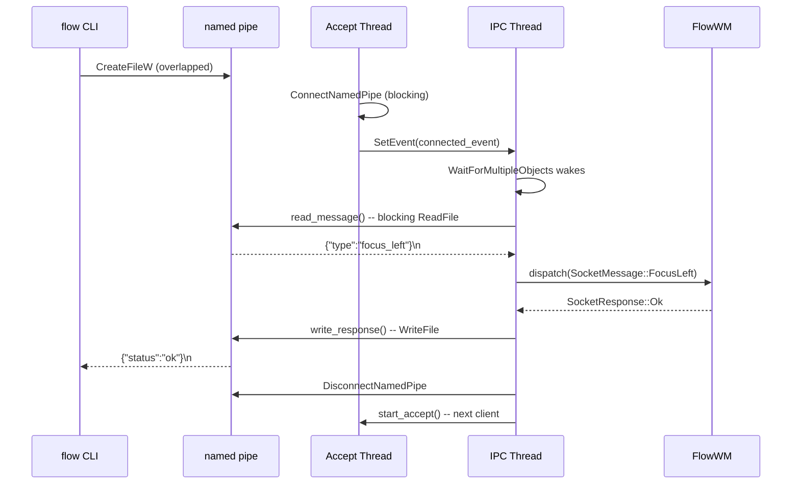
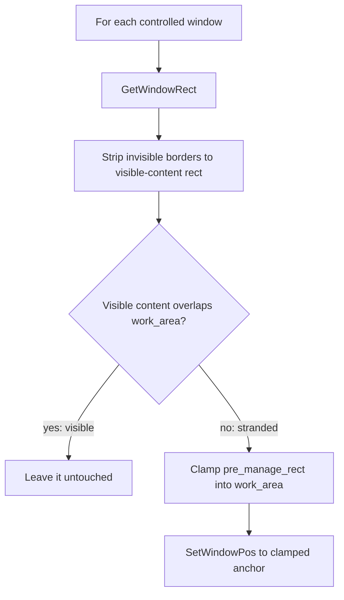

# IPC

The `flow` CLI communicates with the `flowd` daemon over a single Windows named pipe
using newline-delimited JSON. The daemon listens for one client at a time on a
background accept thread, while the main IPC thread processes hook events and
dispatches commands.

## Named-Pipe Protocol

The IPC transport uses the Windows named pipe `\\.\pipe\flow` (configurable via the
`FLOW_PIPE_NAME` environment variable for integration tests). The wire format is
newline-delimited JSON: each message is a single JSON object terminated by `\n`,
serialised by `serde_json`. The encoding and decoding helpers live in
[`src/ipc/message.rs`](../../src/ipc/message.rs).

The pipe uses byte mode (`PIPE_TYPE_BYTE | PIPE_READMODE_BYTE`) with duplex
access. The server accepts one client at a time (sequential, not concurrent).
After processing a request, the server disconnects and waits for the next
connection. The server is created with `FILE_FLAG_FIRST_PIPE_INSTANCE` so that a
second daemon instance fails fast with an address-in-use error instead of
silently replacing the first.



### Why a Named Pipe

A named pipe was chosen over TCP or Unix-domain sockets for three reasons:

- **Local-only** -- named pipes are inherently local to the machine. No network
  exposure, no firewall rules, no port conflicts.
- **Windows-native** -- `CreateNamedPipeW` / `ConnectNamedPipe` are the standard
  Win32 IPC primitives. No third-party dependency, no compatibility shim.
- **ACL-capable** -- the pipe can (and will, in a future hardening pass) accept a
  `SECURITY_ATTRIBUTES` structure to restrict access to the current user session.
  Currently any local process can connect (acceptable for the single-user MVP).

### Client-Side Timeout

The client opens the pipe with `FILE_FLAG_OVERLAPPED` so every read/write is
bounded by a 30-second deadline (`IPC_TIMEOUT` in
[`src/ipc/transport.rs`](../../src/ipc/transport.rs)). If the daemon accepts the
connection but never replies, `CancelIo` fires and the CLI returns a `TimedOut`
error instead of hanging forever. Each overlapped operation uses a Win32 manual-
reset event and `WaitForSingleObject` to await completion or cancellation. This
prevents integration tests from stalling when the daemon is stuck in layout
computation.

### Server-Side Architecture

The server side in [`src/ipc/transport.rs`](../../src/ipc/transport.rs) uses
synchronous (blocking) I/O -- appropriate because the daemon's clients are one-
shot `flow` invocations that always send immediately. The `PipeServer` struct
manages a background accept thread: `start_accept()` spawns a short-lived thread
that blocks in `ConnectNamedPipe`, then signals a Win32 event to wake the main
thread's `WaitForMultipleObjects`. See [threading model](threading-model.md) for
how the connected event coexists with the hook signal in the main loop.

All pipe handles are wrapped in `PipeHandle` (RAII, closes on drop) and a
similar `EventHandle` wrapper manages Win32 event handles, preventing kernel
handle leaks on early returns.

## Message Surface

### SocketMessage (CLI -> Daemon)

Commands are grouped by purpose. All variants use serde's externally-tagged enum
format with a `"type"` field and snake_case variant names.

| Group | Variants | Description |
|-------|----------|-------------|
| Control | `Stop`, `ReloadConfig`, `CheckConfig` | Daemon lifecycle and config |
| Liveness | `Ping` | Answered with `Pong` (version, pid, monitor count, registered hooks); not layout-mutating, so it works mid-drag. Used by `flow start` and `flow ping` |
| Focus | `FocusLeft/Right/Up/Down` | Move focus between windows |
| Swap (per-window) | `SwapLeft/Right/Up/Down` | Swap focused window with neighbour |
| Swap (column) | `SwapColumn { direction }` | Swap entire focused column |
| Semantic move | `MoveWindow { direction }` | Daemon resolves concrete action by state |
| Scroll | `ScrollLeft`, `ScrollRight` | Slide the viewport |
| Column resize | `ExpandColumn`, `ShrinkColumn`, `SetColumnWidth { width_px }` | Adjust column widths |
| Window state | `ToggleFloat`, `ToggleMonocle`, `PlaceAbove`, `Promote`, `CloseWindow` | Per-window operations |
| Workspace | `SwitchWorkspace { workspace_id }`, `SwapWorkspace { workspace_id }`, `MoveWindowToWorkspace { workspace_id }` | niri-style virtual desktops (`Switch`/`Move` implemented; `Swap` stub) |
| Query | `QueryWindowsAll`, `QueryLayoutVirtual`, `QueryLayoutActual`, `QueryState` | Read-only introspection |
| Config mutation | `SetConfigValue { key, value }` | Runtime config change |
| App preferences | `ForgetApp { exe }`, `ForgetAllApps` | Clear per-app learned state |

The `MoveWindow` variant is deliberately semantic: for tiled windows moving
left or right it delegates to `SwapColumn`, but the daemon owns the translation
so keybindings stay stable as floating support lands. Vertical movement
(within-column swap) and floating-window nudging are deferred — only the
tiled left/right path is wired today.

Of the three workspace variants, `SwitchWorkspace` and `MoveWindowToWorkspace`
are fully implemented (see [Workspace Hierarchy](./workspace.md) for the
vertical-packing switch animation). Only `SwapWorkspace` returns
`unimplemented_command` — its protocol shape is locked in, but its animation
model (two workspaces exchanging positions in the packed stack) is still
undecided.

### SocketResponse (Daemon -> CLI)

| Variant | Fields | When |
|---------|--------|------|
| `Ok` | -- | Command succeeded |
| `Error` | `message: String` | Command failed |
| `Data` | `payload: serde_json::Value` | Response to a query command |
| `Busy` | -- | A tile drag is in progress; layout-mutating commands are rejected for now |
| `Pong` | `version: String`, `pid: u32`, `monitors: usize`, `hooks_registered: usize` | Reply to `Ping` — identity and health, never touches layout |

Responses use a `"status"` tag (`"ok"`, `"error"`, `"data"`, `"busy"`,
`"pong"`), distinct from the message `"type"` tag. A response-shaped JSON will not parse as a `SocketMessage`
and vice versa -- the tests in [`src/ipc/message.rs`](../../src/ipc/message.rs)
enforce this explicitly.

## The `flow` CLI Client

The CLI ([`src/bin/flow.rs`](../../src/bin/flow.rs)) is built with `clap` and
structured into four top-level command groups. Every dispatch command sends a
single `SocketMessage` and prints a one-line success or error message. The CLI
does no layout computation -- it is a thin transport layer. See
[event pipelines](event-pipelines.md) for what happens on the daemon side after
a command arrives.

### Lifecycle

| Command | Action |
|---------|--------|
| `flow start [--config <dir>] [--log-file <path>] [--ahk] [--no-restore] [--verbose] [--log-level <lvl>]` | Spawn `flowd.exe` detached, wait until it reports `ready` **and** answers `Ping`; with `--ahk`, also launch `flow.ahk` via its shell association |
| `flow stop [--ahk]` | Send `Stop` via named pipe; with `--ahk`, also terminate the AutoHotkey process launched by `start --ahk` |
| `flow ping` | Send `Ping`; print the daemon's version, pid, monitor count and registered-hook count. Non-zero exit if nothing answers |

`flow start` locates `flowd.exe` next to the current executable, spawns it with
`CREATE_NEW_PROCESS_GROUP | CREATE_NO_WINDOW` (falling back to plain `spawn()`
under WSL interop), and **keeps the `Child` handle**. Every 100 ms, for up to
10 seconds, it checks three things in order: `child.try_wait()` (did the
daemon exit?), the daemon's status file (see below — only if its `pid` matches
the spawned child, so a stale file from an earlier run is ignored), and once
the status says `ready`, a `Ping` round-trip whose `Pong.pid` must also match.
Only then does it print

```text
flow: daemon started (pid N, M monitor(s), log: <path>)
```

If the daemon exits or its status file reports an error, `flow start` prints
exactly

```text
flow: FlowWM failed to start at step '<stage>': <reason> (log: <path>)
```

to stderr and exits with the **same exit code as the daemon** (`10 + stage
index`, table below), so a script can tell `pipe` (another daemon running)
from `hooks` (deaf hook thread) without parsing text. A timeout reports the
last stage seen and exits 1.

The `--config` flag sets `FLOW_CONFIG_DIR` in the current process before
spawning so the child inherits it; `--log-file`, `--no-restore`, `--verbose`
and `--log-level` are forwarded as CLI arguments. The rest of the environment
is inherited unchanged (so `RUST_LOG`, `FLOW_PIPE_NAME` and the test-only
`FLOW_FAIL_AT` reach the daemon).

#### Startup stages, status file and exit codes

`flowd` boots in a fixed sequence of stages
([`src/daemon/startup.rs`](../../src/daemon/startup.rs)). Each one logs
`startup: [n/11] <stage> ok` at `info`; a failure logs
`startup: FAILED at <stage>: <reason>` at `error`, rescues any windows the
daemon already moved, and exits with `10 + index`:

| # | Stage | Exit code | What it covers |
|---|-------|-----------|----------------|
| 0 | `logging` | 10 | Logger up; log file resolved under the config dir |
| 1 | `config` | 11 | Config dir initialised, `flow.toml` + rules parsed (debug: test-desktop switch) |
| 2 | `monitors` | 12 | Monitor geometry enumerated, per-monitor scrolling spaces built |
| 3 | `scan` | 13 | Registry created, existing windows scanned |
| 4 | `pipe` | 14 | Named pipe created — fails if another daemon owns it |
| 5 | `hooks` | 15 | Hook thread started **and** the mandatory hook set registered (`CREATE/DESTROY`, `FOREGROUND`, `SHOW/HIDE`, `LOCATIONCHANGE`, `MINIMIZE`); the error names the missing hooks |
| 6 | `animator` | 16 | Animator worker started |
| 7 | `initial_layout` | 17 | Initial layout submitted — **windows move from here on** |
| 8 | `borders` | 18 | Pre-existing floats adopted, border overlays attached |
| 9 | `loadout_restore` | 19 | Last loadout restored (skipped with `--no-restore`, still reported) |
| 10 | `ready` | 20 | Status file flips to `ready`; the event loop starts |

Exit code `0` is a clean `flow stop`; `1` is a generic client-side error.

`pipe` and `hooks` deliberately run **before** `initial_layout`: they are the
likeliest failures, and until the initial layout runs no window has been
moved, so a failure there leaves the desktop untouched. Once windows have
moved, every later failure path — inside `FlowWM::new` (via the free function
`rescue_stranded_windows_with`, which needs no `FlowWM`) and in `main` (via
`FlowWM::rescue_stranded_windows`) — brings them back before exiting.

After every stage the daemon rewrites `<config_dir>/flowd.status`:

```json
{
  "pid": 1234,
  "stage": "hooks",
  "state": "error",
  "reason": "mandatory WinEvent hook(s) failed to register: FOREGROUND (SetWinEventHook returned NULL)",
  "log_path": "C:\\Users\\me\\.config\\flow\\logs\\flowd-2026-10-19.log"
}
```

`state` is `starting` (last completed stage in `stage`), `ready`, or `error`
(failing stage in `stage`). Readers must compare `pid` with the process they
spawned.

**Fault injection (test-only).** Setting `FLOW_FAIL_AT=<stage name>` (e.g.
`FLOW_FAIL_AT=hooks`, `FLOW_FAIL_AT=loadout_restore`) makes the daemon fail at
that stage with the reason `injected failure (FLOW_FAIL_AT)` instead of
running the step. It is honoured in release builds too (it is only an
environment variable) so the VM test-bed can prove that every stage reports
and rescues correctly; an unknown value is ignored with a warning. `flow
start` forwards the environment, so `FLOW_FAIL_AT=borders flow start` exercises
the client-side failure line end to end. Never set it in a real session.

**Log level.** `flow start --verbose` (or `-v`) runs the daemon at `debug`
(the release default is `info`); `--log-level <filter>` passes an explicit
`env_logger` filter such as `trace` or `flow_wm::registry=trace`. Both beat
`RUST_LOG`. The log directory honours `--config` / `FLOW_CONFIG_DIR`.

The `--ahk` flag launches the user's `flow.ahk` **after** the daemon is ready, so
the first hotkey always reaches a listening daemon. AutoHotkey is resolved via
`ShellExecuteExW` on the `.ahk` file (Windows' shell association handles
interpreter lookup); the launched PID is written to `flow.ahk.pid` in the config
directory so `flow stop --ahk` can terminate exactly that process. `stop --ahk`
runs **after** the daemon has stopped, so a live daemon never loses its
keybindings mid-dispatch.

### Autostart

| Command | Action |
|---------|--------|
| `flow enable-autostart [--ahk]` | Create a single `flow.lnk` in `shell:startup` that runs `flow.exe start [--ahk]` |
| `flow disable-autostart` | Remove the `flow.lnk` shortcut (idempotent) |

The autostart shortcut targets `flow.exe start [--ahk]` rather than `flowd.exe`
directly, so login reuses the interactive startup path's pre-flight config check
and double-start guard -- there is no parallel startup code path. The `.lnk` uses
`SW_HIDE` to suppress the brief console window `flow.exe` allocates before it
spawns the detached daemon and exits. `disable-autostart` takes no `--ahk` flag
because there is only ever one shortcut.

### Config

| Command | Action |
|---------|--------|
| `flow config init` | Create config dir + write default files (no daemon contact) |
| `flow config reload` | Send `ReloadConfig` to daemon |
| `flow config edit` | Open config dir in `$EDITOR` / `VISUAL` / `notepad.exe` |
| `flow config path` | Print resolved config directory path |
| `flow config check` | Validate config files locally |

All config commands except `reload` operate on local files without contacting the
daemon. The config directory resolution chain is documented in
[config and persistence](config-and-persistence.md).

### Query

| Command | Action |
|---------|--------|
| `flow query all` | Send `QueryWindowsAll`, pretty-print JSON response |

### Dispatch

| Command | Maps to |
|---------|---------|
| `flow dispatch focus left/right/up/down` | `FocusLeft/Right/Up/Down` |
| `flow dispatch swap-column left/right` | `SwapColumn` |
| `flow dispatch move-window left/right` | `MoveWindow` |
| `flow dispatch expand-column` | `ExpandColumn` |
| `flow dispatch shrink-column` | `ShrinkColumn` |
| `flow dispatch close-window` | `CloseWindow` |
| `flow dispatch switch-workspace <id>` | `SwitchWorkspace` |
| `flow dispatch swap-workspace <id>` | `SwapWorkspace` (stub) |
| `flow dispatch move-to-workspace <id>` | `MoveWindowToWorkspace` |
| `flow dispatch focus-monitor left/right/up/down` | `FocusMonitor` |
| `flow dispatch move-to-monitor left/right/up/down` | `MoveWindowToMonitor` |

The dispatch commands that change layout flow through the daemon's 3-stage
pipeline (mutate, project, animate) as described in
[architecture](architecture.md). The `CloseWindow` command is a special case:
it only queues `WM_CLOSE` and lets the `EVENT_OBJECT_DESTROY` hook handle the
actual layout removal, avoiding a race between the synchronous IPC response
and the asynchronous window destruction.

## Graceful-Shutdown Window Rescue

`flow stop` sends the `Stop` command, the event loop exits, and then -- before the
daemon process tears down -- [`FlowWM::rescue_stranded_windows`]
runs once. Its job is to bring windows that became **physically inaccessible**
during this flow session back onto the screen, without disturbing anything the
user can currently see.

### Why rescue is needed

flow parks non-active workspaces off-screen (one monitor height above or below
the active one) and scrolls windows horizontally across the infinite tiling
canvas. If the daemon simply exited, every window on a non-active workspace --
plus any window scrolled into the off-screen packing region of the active
workspace -- would be left stranded where flow put it: visible to Win32 (so a
future flow run would re-classify them as already-tiled) but unreachable to the
user, who has no way to scroll to a workspace that no longer exists.

### The visibility rule

The rescue pass treats the **operating system as ground truth**, not flow's own
bookkeeping. For each controlled window it calls `GetWindowRect` to find the
window's current rect, then asks: does the window's **visible content** overlap
the active monitor's `work_area`?

- **Yes (visible)** -- the user can see this window right now. Leave it exactly
  where it is. The user has almost certainly rearranged things by hand since flow
  started; rewinding their work would be hostile.
- **No (stranded)** -- the window is off-screen purely because flow moved it.
  Bring it back.

The visible-content rect is the raw `GetWindowRect` rect with the window's
invisible borders stripped (`InvisibleBounds::window_to_visible`). This step is
not cosmetic: `GetWindowRect` includes the ~7px invisible borders Windows 10/11
draw for drop shadows, while the layout engine parks columns flush against the
`work_area` edge in **visible** coordinates. Without the conversion, a window
parked exactly at the edge would bleed a few pixels of invisible border into the
`work_area` and read as "visible" -- so the rescue pass would leave it stranded
in the packing region of the active workspace. Stripping the borders recovers
the true visible rect, which only *touches* the edge and is correctly treated as
stranded. See `roadmap.md` ("GetWindowRect Includes Invisible Borders") for
background.

Touching edges do not count as overlapping, matching Win32 `IntersectRect`
semantics (see `Rect::overlaps`).



### The rescue target: `pre_manage_rect`

Each controlled window remembers the rect it had **when flow first noticed it**
(stored as `pre_manage_rect` at registration time). The rescue moves stranded
windows back to that anchor, then clamps the anchor into the `work_area` in case
the anchor itself is off-screen (e.g. the window came from a now-detached
monitor, or the work area changed because the taskbar moved).

Clamping shrinks-and-shifts rather than discards: a window larger than the work
area collapses to the work area's size; otherwise the original size is preserved
and only the position is nudged on-screen.

### Tiles and floats are unified

There is no special-casing between tiling and floating: every window flow is
actively positioning -- a `Tiling(Active)` or `Floating(Active)` window -- goes
through the same loop. `Minimized`, `Hidden`, and `Ignored` windows never reach
it. flow does not actively place minimized/hidden windows, so their position is
the OS's and the user's responsibility; leaving them alone on shutdown avoids
surprising the user by moving windows they intentionally hid.

### The "pre-this-run" contract

`pre_manage_rect` is the position the window held **before this flow run**, not
before the very first flow run in history. Consequences:

- If the previous flow session was killed **uncleanly** (crash, `taskkill /f`,
  Ctrl-C), windows it had tiled remain at their tiled positions. The next run
  captures *those* as the new baseline. The desktop self-heals after **one
  clean** `flow stop`.
- Minimized/hidden windows are out of scope entirely (see above); float windows
  lose any in-run drag history (acceptable for v1), restoring to their
  registration-time anchor.

The unclean-shutdown case -- where the daemon process is gone and cannot run the
rescue pass -- is what the planned watchdog process is for: restoring from an
on-disk snapshot without needing the daemon alive (see the
[Roadmap](./roadmap.md)).

### Code path

| Step | Location |
|------|----------|
| Wired after the event loop exits | [`src/main.rs`](../../src/main.rs) -- `flow.run()` then `flow.rescue_stranded_windows()` |
| Wired on startup failure after windows moved | [`src/daemon/new.rs`](../../src/daemon/new.rs) (free function `rescue_stranded_windows_with`, before `FlowWM` exists) and `main.rs` (`loadout_restore` / `ready` stages) |
| The rescue loop | [`src/daemon/shutdown.rs`](../../src/daemon/shutdown.rs) -- `rescue_stranded_windows_with`; `FlowWM::rescue_stranded_windows` is a thin wrapper |
| Which windows are controlled | `WindowRegistry::restorable_windows` in [`src/registry/core.rs`](../../src/registry/core.rs) |
| Clamp geometry | `Rect::clamped_into` in [`src/common/types.rs`](../../src/common/types.rs) |

## Watchdog

A separate watchdog process is planned for crash recovery — restoring windows
from an on-disk snapshot when the daemon dies unexpectedly. It is not yet
implemented and is deliberately deferred until `flow`/`flowd` are
feature-complete. See the [Roadmap](./roadmap.md) for the full design,
including why it is a separate process rather than a Windows service.

## Cross-References

- [Threading model](threading-model.md) -- the IPC thread's `WaitForMultipleObjects`
  loop and how pipe connections coexist with hook events
- [Event pipelines](event-pipelines.md) -- the IPC command dispatch path through
  the 3-stage layout pipeline
- [Architecture](architecture.md) -- subsystem overview showing where the IPC
  server fits inside the daemon
