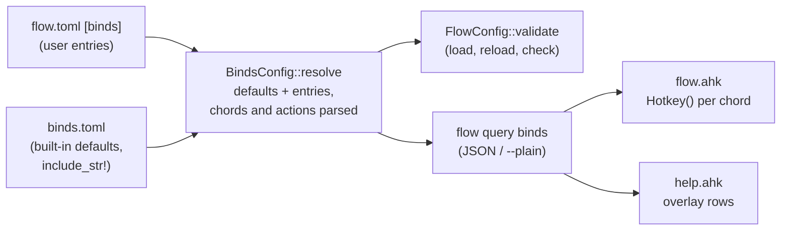

# Key Bindings

The chords are configuration, not code. `flow.toml` carries a `[binds]`
table in niri's spelling (`"Mod+Shift+Left" = "move-column-left"`); the
daemon parses and validates it, lays it over the keymap's built-in table,
and hands the result to the hotkey script, which registers the chords at
runtime and draws its help overlay from the same list. This chapter is the
pipeline from the TOML to the registered hotkey. The grammar and the action
table a user sees are in the [Config Reference](../user-guide/config-reference.md#binds--key-bindings);
the decision record is [ADR-0015](design-decisions.md#decisions-made-in-the-multi-monitor-fork).

## The pipeline

1. **Parse.** `[binds]` deserialises into
   [`BindsConfig`](../../src/config/binds.rs): the `defaults` switch and the
   entries as written. A value is either an action line (a string) or a
   `{ spawn = [...], admin, help }` table; the deserialiser names an
   unknown field in the table rather than failing the whole value.
2. **Resolve.** `BindsConfig::resolve` starts from the built-in table
   (`keymaps/win-niri/binds.toml`, compiled in with `include_str!`) unless
   `defaults = false`, then lays the user's entries over it: a chord already
   in the table is replaced, a new one added, `"none"` removes one. Every
   problem is collected, not just the first, and named by its key
   (`binds."Mod+Bogus": unknown key "Bogus" (...)`), so `flow config check`
   lists them all. Two spellings of one chord in the same table
   (`Mod+Shift+Left`, `shift+mod+left`) are an error rather than a silent
   last-wins.
3. **Order.** TOML tables are unordered and the parser sorts their keys, so
   the resolved list is put in a canonical order instead: by group (focus,
   move, monitors, workspaces, the column actions, then raw dispatches,
   the launcher, programs, help, pause, quit), then by modifier set, then
   by key (arrows in niri's Left/Down/Up/Right order, Space, digits with
   `0` last, letters, the other named keys). A chord a user adds lands next
   to its siblings in the overlay whatever line it was written on.
4. **Validate.** `FlowConfig::validate` calls `BindsConfig::validate`, so a
   bad table is refused wherever the config is loaded: at start (stage
   `config`), on `flow config reload`, by the file watcher (the running
   config is kept), and by `flow config check`.
5. **Report.** `flow query binds` answers with `config::binds::report`: one
   record per bind (canonical chord, AutoHotkey hotkey string, action text,
   kind, argv, admin flag, scope, help line), the overlay rows with
   consecutive binds of one group and modifier set collapsed
   (`Mod+Left/Down/Up/Right`, `Mod+1..9, Mod+0`, `Alt+H/J/K/L`), the
   hardwired chords, and the source (`defaults` or `flow.toml`). `--plain`
   turns the JSON into the tab-separated listing the script parses
   (`config::binds::plain_text`); the conversion runs in the CLI, which the
   keymap always runs from the daemon's own directory (`FLOW_BIN`), so the
   two never disagree on the format.
6. **Register.** `flow.ahk` runs `flow query binds --plain` after its
   startup gate (through a temp file, not `WScript.Shell.Exec`, so the
   output is read as UTF-8 and no console window flashes) and calls
   `Hotkey(hotkey, callback, "On")` for each `bind` record under the
   criterion its scope names: `TilingGate` (daemon up and tiling on) for
   window-management chords, `AlwaysGate` (daemon up) for the launcher, the
   overlay, programs, the pause and quit actions. The callback is built from
   the record's kind: `dispatch` runs `flow dispatch <argv>` through the
   script's non-blocking `D()`, `spawn` resolves and starts the program,
   `launcher` / `help` / `quit` / `toggle-tiling` call the script's own
   functions. The gates are named functions so a chord registered under one
   can be found again: a reload turns every registered chord off under the
   gate it was registered with before registering the new set.

## What stays in the script

Three things are hardwired in `flow.ahk` and refused by the table
(`Chord::is_reserved`): the Mod + left-button drag (a mouse hotkey with its
own move loop, see [Tile Drag](tile-drag.md)), Mod+Ctrl+T (FlowWM off, and
on again through `flow-resident.ahk`, which has no daemon to ask) and
Mod+Ctrl+Shift+T (the tiling pause, which flips the script's own
`TilingOn`). The liveness gate, the OSD and `D()` are plumbing, not
bindings. A `toggle-tiling` *action* exists so a second chord can be bound
to the pause; the reserved one is the fallback that works even when the
table is broken.

The script also carries a baked copy of the default listing
(`DefaultBindsText`) for a daemon too old to answer `query binds`. The test
`the_keymaps_baked_fallback_matches_the_defaults` in `src/config/binds.rs`
compares it with the listing the daemon would give and prints the block to
paste when the defaults change.

## Chords and keys

`Chord::parse` splits on `+`; the last word is the key, the rest modifiers
(`Mod` / `Super` / `Win`, `Ctrl` / `Control`, `Alt`, `Shift`, any order and
case). The AutoHotkey string is the modifiers' prefixes (`#`, `^`, `!`,
`+`) and the key's AutoHotkey name. Letters, digits and `F1`..`F24` map to
themselves; the named keys are a table in `binds.rs` (`BracketLeft` → `[`,
`Page_Up` → `PgUp`, `WheelScrollDown` → `WheelDown`, ...); `vkXX` / `scXXX`
pass through for anything else. `Slash` maps to `vkBF`, not `/`, because
`#+/` never fires in AutoHotkey v2 (the keymap README, *AutoHotkey
lessons*). A bare key needs a modifier unless it is `Print` or `Pause`, and
mouse buttons are not accepted at all.

## Actions

`resolve_action` turns an action line into an [`Action`](../../src/config/binds.rs):
the fixed niri names are a table of `(name, dispatch argv, help, group)`;
`focus-workspace N`, `move-column-to-workspace N` and `set-column-width ±N%`
take an argument; `dispatch <args>` passes anything the CLI accepts; the
keymap's own actions (`launcher`, `show-hotkey-overlay`, `toggle-tiling`,
`quit`) and `spawn` have no dispatch argv. Two niri names have only a near
equivalent and say so in their help text: `consume-window-into-column` is
our `merge-column right` (the focused window joins the column to its right
rather than pulling that column's window in) and `expel-window-from-column`
is `promote right`.

The same table gives the CLI its aliases: `flow dispatch focus-column-left`
is rewritten to `flow dispatch focus left` before clap parses it
(`config::binds::niri_alias`), so a bind line can be tried in a terminal
as written. Our own names stay primary.

## Live reload

The daemon looks at `flow.toml` and `flow-rules.toml` once a second from
the event loop ([`daemon::config_watch`](../../src/daemon/config_watch.rs)):
a changed modification time that is seen unchanged on the next look runs
the ordinary `ReloadConfig` path, with its validate-before-apply rule, so a
broken save leaves the running config (and the registered chords) as they
were. The keymap polls the same file's time on its two-second liveness
timer and asks `query binds` again ~2.5 s after a change, by which time the
daemon has applied or refused it; it re-registers only when the listing
differs and shows a one-line OSD. The design choice (polling over
`ReadDirectoryChangesW`) is in
[Config & Persistence](config-and-persistence.md#live-reload-the-file-watcher).

## `flow config check`

The CLI asks the running daemon (`CheckConfig`), which loads both files from
disk without applying them and lists every problem: the parse error, each
`[binds]` entry's error, the rest of the validation, and the preset lists
against the attached screens, which a daemon-less check cannot see.
Without a daemon the CLI falls back to the local check and says so.

## Tests

`src/config/binds.rs`: chord spellings and their AutoHotkey strings, the
error messages, the reserved chords, every action form, spawn tables,
the built-in table (every default chord and the count), layering with
`none` and `defaults = false`, duplicate spellings, the collected error
list, the TOML round trip, overlay-row collapsing, the report and plain
listing, the CLI aliases, the baked fallback. `src/config/startup.rs`: the
program lookup against a fake disk. `src/daemon/config_watch.rs`: the
debounce. `src/daemon/width_preset.rs`: `CheckConfig` over a real
directory and `query binds` over a loaded config. The VM driver
`test-stage21.ps1` edits `flow.toml` in the guest and checks the daemon's
and the keymap's reaction with real key presses.
