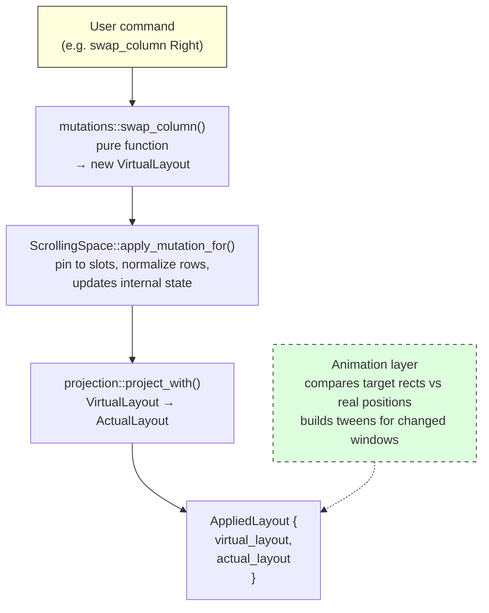
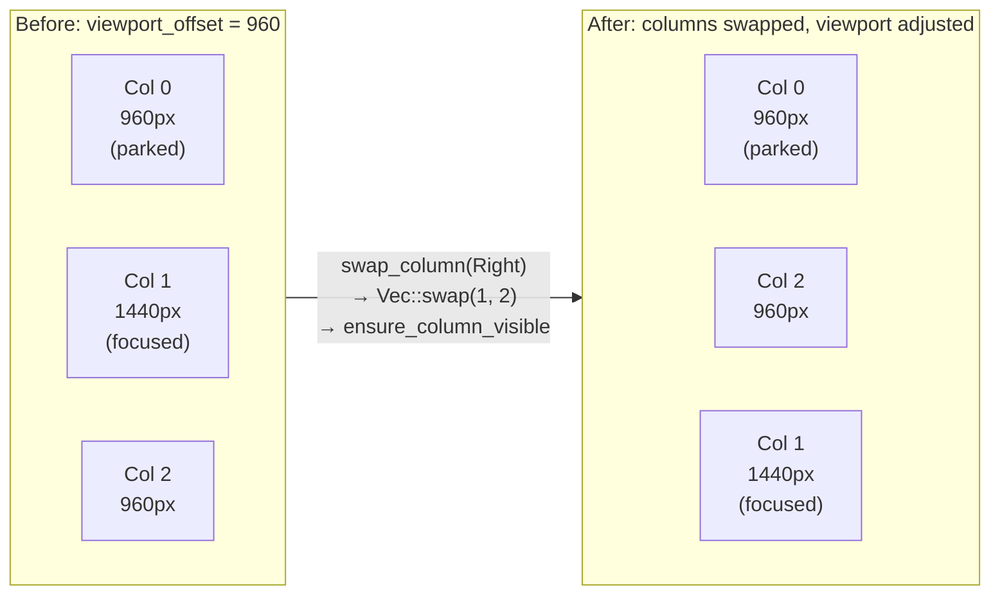

# The Mutation Pipeline

Every layout change in FlowWM follows the same three-stage pipeline: **mutate**, **project**, then **animate**. A pure mutation function transforms the current `VirtualLayout` into a new one; the projection function converts that virtual layout into pixel-accurate screen rectangles; and the animation layer tweens windows from their current on-screen positions to their new targets. This functional, declarative approach means there is no mutable "update position, propagate, re-render" loop — each stage is a single deterministic function with no side effects.



## The glue: `apply_mutation`

`ScrollingSpace` (`src/workspace/scrolling_space.rs`) — the orchestrator in `src/workspace/` — owns the current `VirtualLayout` and the last-projected `ActualLayout`. There is one per workspace, and every monitor has its own workspaces (ADR-0007), so a pipeline run is always local to one monitor. Every public method on `ScrollingSpace` (scroll, focus, swap, resize, add/remove) follows the same internal pattern: call a pure mutation function from `src/layout/mutations.rs` to get a new `VirtualLayout`, pass it to `apply_mutation` (or `apply_mutation_for`, which names the window to keep visible — a swap or merge target — instead of the strip's focus), which applies the two rules that live one layer up, calls `projection::project_with` to produce the new `ActualLayout`, then wraps both into an `AppliedLayout` and returns it.

```rust
fn apply_mutation(&mut self, new_layout: VirtualLayout) -> AppliedLayout {
    self.apply_mutation_for(new_layout, self.last_focused_window)
}

fn apply_mutation_for(&mut self, mut new_layout: VirtualLayout, window: Option<WindowId>) -> AppliedLayout {
    // Width pattern: re-pin the run of screen slots from the left-edge column.
    let _ = self.pin_to_slots(&mut new_layout, window);
    // An empty strip goes home.
    if new_layout.columns.is_empty() {
        new_layout.viewport_offset = 0;
    }
    // Row viewports: clamp every row_offset and reveal `window`.
    let new_layout = mutations::normalize_row_viewports(&new_layout, window, &self.config);
    let new_actual = projection::project_with(
        &new_layout,
        &self.monitor,
        &self.config.padding,
        self.config.visible_rows,
        self.config.layout_mode,
    );
    let result = AppliedLayout {
        actual_layout: new_actual.clone(),
        virtual_layout: new_layout,
    };
    self.virtual_layout = result.virtual_layout.clone();
    self.actual = new_actual;
    result
}
```

`apply_mutation_for` is the single state-update point for **mutations**. It swaps in the new virtual and actual layouts together and returns the `AppliedLayout` for the caller (the daemon) to pass to the animation layer. Because the mutation functions are pure and every mutation goes through this one function, there is no risk of partial or inconsistent layout state. The other writers of `virtual_layout` / `actual` are the configuration and geometry paths — `set_row_limits`, `reconfigure` / `set_monitor_info` (through `refit_to_config`, which clamps widths, re-pins slots and refits row heights) and similar — which rewrite the layout in place and re-project with `reproject()`. The slot pin and the row normalization are described in [Mutations](./mutations.md#width-patterns-pin-columns-to-screen-slots).

## Why `AppliedLayout` carries both virtual and actual

`AppliedLayout` bundles the new `VirtualLayout` *and* the new `ActualLayout` together. The animation layer needs the full actual layout — every window's target rect — because it diffs each target against the window's *real* on-screen position (which may be mid-flight from a previous animation). If the engine emitted only the windows whose *target* changed, a rapid second mutation during an in-flight animation would miss windows that are physically mid-tween, stranding them mid-screen.

By returning the full `ActualLayout`, the animation layer always sees every window and makes its own no-op filtering decision. The virtual layout is included because the orchestrator stores it as the new authoritative canvas state (and callers sometimes need it for query purposes).

## No logical diff inside the engine

An earlier design had the layout engine compute a `Vec<WindowMove>` — a diff between old and new actual layouts — and hand that to the animation layer. That approach failed under rapid mutation bursts: a window animating toward its old target would be absent from the diff on the next mutation, and the animation layer would drop it. The current design pushes the diff responsibility outward. The engine produces a complete snapshot of the desired end state; the animation layer compares that snapshot against real-world positions (which include in-flight windows) and decides what to tween. This keeps the layout engine pure and stateless — it has no opinion about what is or is not currently animating.

See `AppliedLayout` in `src/layout/types.rs` for the full design decision rationale.

## Worked example: `swap_column(Right)`

Tracing a column swap from user input through the full pipeline makes the data flow concrete. Consider a canvas with three columns — widths 960, 1440, 960 — with the viewport showing columns 1 and 2. Focus is on a window in column 1.



**Step 1 — Mutation.** The daemon receives a `SwapColumn(Right)` command, resolves the target window (normally the OS-foreground tile) and calls `ScrollingSpace::swap_column(target, Direction::Right)` on the active monitor's strip (at the strip's edge the daemon instead carries the window to the neighbouring monitor when `[navigation] edge_hop` allows it). That method calls `mutations::swap_column(&virtual_layout, focused, Right, &config)`, which finds the focused window's column index (1), swaps columns 1 and 2 in the `Vec<Column>`, then calls `mutations::ensure_column_visible` to adjust `viewport_offset` if the focused window's new column would be off-screen. The result is a new `VirtualLayout` with columns reordered and the camera offset updated.

**Step 2 — Projection.** `apply_mutation_for(new_layout, Some(target))` pins the slots (when the screen has a width pattern), normalizes the row viewports and passes the new `VirtualLayout` to `projection::project_with`. The projection function computes prefix-sum column left edges, determines which columns overlap the viewport `[offset, offset + monitor_width]`, computes row rects for visible columns, and parks off-screen columns just beyond the virtual screen's left or right edge (in book mode it piles them behind the edge columns instead). The output is a complete `ActualLayout` — every window has a pixel `Rect`.

**Step 3 — Animation.** `apply_mutation_for` wraps both layouts into an `AppliedLayout` and returns it to the daemon. The daemon passes it to the animation bridge (`animate_layout`, i.e. `animate_layout_on(active_monitor, …)` in `src/daemon/animation.rs`), which translates each target from visible-rect to window-rect space (invisible borders, re-measured on placement per ADR-0028), decides per window whether the move is instant (a slide that would cross a neighbouring monitor, or a window going into a book-mode pile) or tweened, and submits the batch to the `WindowAnimator`; the animator reads each window's real on-screen position and skips windows already at their target. The swapped windows animate to their new positions; the parked window moves to its off-screen parking spot (or stays parked if already there). Every `SetWindowPos` goes through one helper that sends a pure move without a size and does not offer a resize into a parking slot to the app (ADR-0019).

Mutation, projection and batch submission complete in a single synchronous call on the main thread — no deferred updates, no stale state windows. Only the animation frames themselves run on the animator's worker thread (see [Threading Model](../threading-model.md)).

## Focus: a special case

The `focus` method on `ScrollingSpace` has a slight variation on the standard pipeline. It calls `mutations::focus`, which returns a `FocusResult` containing the newly focused window ID and a potentially-modified `VirtualLayout` (the camera may have shifted if the target was off-screen). `ScrollingSpace::focus` checks whether the new layout differs from the current one — the camera moved (left/right) or a stacked column's row viewport shifted (up/down): if it did, it calls `apply_mutation` to project and return the `AppliedLayout`; if not, it returns `None` for the layout, since no windows moved and no animation is needed. This optimization avoids running projection when the user is just moving focus between two on-screen windows.

See [Mutations](./mutations.md) for the catalog of all mutation functions and their algorithms.
