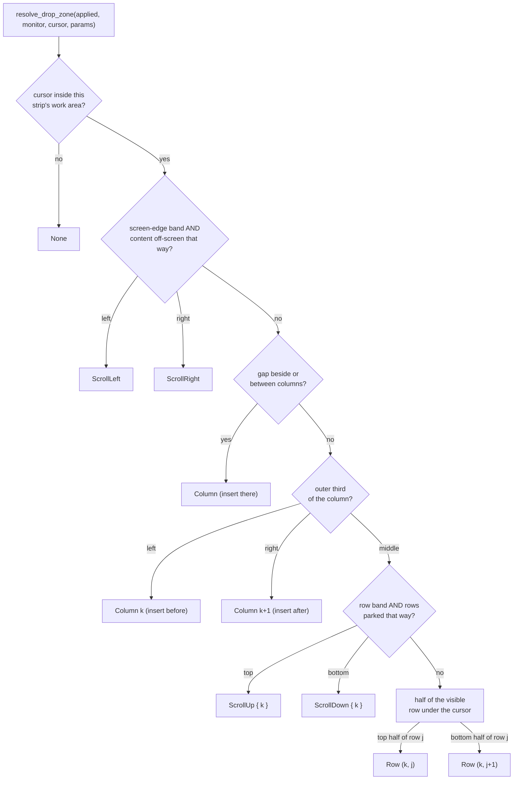

# Tile Drag

FlowWM lets the user reposition a tiled window by dragging its title bar. As
the cursor moves, the *other* windows reflow in real time to show where the
dragged window will land; on release the layout commits and the dragged
window snaps into its tile.

The drag works **entirely within the tiling model**. A tile never becomes a
float mid-drag, and a float never becomes a tile. A floating window being
dragged holds the same `drag_state` as a tile (`DragMode::Float`, see *Floats
in the drag state* below) but is only followed — its rect is stored on every
move through the ordinary `store_float_rect`. There is no config flag — the
feature is always on.

This is a deliberate departure from the earlier design, which converted the
dragged window to a float for the duration of the drag and converted it back
to a tile on release. That round-trip pulled in a `DragSource` enum, a center
"promotion" region, a dwell timer, an animation lock, and several
cancel-path hazards — none of which bought any structural capability the
cursor→layout map cannot express directly. The rationale is laid out at the
end of this chapter.

## Drag Lifecycle

The drag is driven by Win32's built-in move/resize system. Grabbing a title
bar fires `EVENT_SYSTEM_MOVESIZESTART`; releasing fires
`EVENT_SYSTEM_MOVESIZEEND`; between them, a stream of
`EVENT_OBJECT_LOCATIONCHANGE` events reports every pixel of movement.

```mermaid
stateDiagram-v2
    [*] --> Idle
    Idle --> Dragging: MoveSizeStart (Tiling::Active)
    Dragging --> Dragging: LocationChange
    Dragging --> Committing: MoveSizeEnd
    Committing --> Idle: commit zone, animate (incl. dragged)
    Dragging --> Idle: window destroyed (clean cancel)
```

Each `LocationChange` while dragging does three things — follow the dragged
window's border to the mouse, resolve the drop zone under the cursor, and
re-submit a non-committing preview of how the *other* windows would reflow.
Details in *Continuous Preview & Commit-on-Release* below.

The `Dragging` state is `Option<DragState>` on the `FlowWM` struct.
`DragState` (`src/daemon/drag.rs`) holds only three fields:

- `dragged_id: WindowId` — the dragged window's layout-engine identity.
- `dragged_hwnd: isize` — its Win32 HWND, used for `GetWindowRect` and for
  the `DRAGGED_HWND` global that bridges the hook thread and the main loop.
- `current_zone: Option<DropZone>` — the drop zone currently under the
  cursor. `None` until the first `on_drag_move`; this is the value committed
  on release.
- `zone_monitor: Option<usize>` — the monitor whose strip `current_zone`
  belongs to (another monitor than the window's own makes the drop a
  cross-screen move), and `touched`, the other monitors the drag previewed
  on (see *Cross-screen drop*).

There is no `DragSource`, no dwell timer, no animation lock, no center-preview
flag — those belonged to the float-conversion and dwell models and are gone.

Three handlers on `FlowWM` (`src/daemon/drag.rs`) respond to the three hook
events:

- `on_drag_start` — only a `Tiling::Active` window enters `DragState`. Any
  other window state causes an early return. This single guard is the entire
  reason floating drags need no special routing (see *Event Pipeline* below).
- `on_drag_move` — follows the border, resolves the zone, submits a
  non-committing preview. Never mutates the committed layout's window
  placement.
- `on_drag_end` — the **sole** point at which window placement is committed.
  Runs the final `preview_move`, calls `ensure_column_visible` to scroll the
  dropped window's column into view if it landed off-screen, commits the
  resulting virtual layout, and animates — this time *including* the dragged
  window, which snaps from its mouse-following position into its tile.

**Abort paths.** If the dragged window is destroyed mid-drag (closed from the
taskbar, monitor detached, etc.), `on_drag_end` finds it absent from the
registry and returns early — after `clear_dragged_hwnd` has already released
the global, so the `DRAGGED_HWND` bridge never leaks. `MoveSizeEnd` always
`take()`s the `DragState`, so a duplicate or spurious end event is harmless.

## Event Pipeline

The drag rides on Win32's standard move/resize mechanism — the same events
that let the OS draw the moving window also drive FlowWM's layout preview. No
low-level mouse hook is involved.

**Hook registration.** The hook thread registers an
`EVENT_SYSTEM_MOVESIZESTART` (0x000A) through `EVENT_SYSTEM_MOVESIZEEND`
(0x000B) range hook, producing two `HookEvent` variants: `MoveSizeStart` and
`MoveSizeEnd`. These fire for every window — tiled or floating — and route to
`on_drag_start` / `on_drag_end`, which gate internally on window state.

**`DRAGGED_HWND`.** A static `AtomicIsize` (default 0) that bridges the hook
thread and the main thread without sharing mutable state through the callback.
The daemon sets it (`set_dragged_hwnd`, `Release` store) on `MoveSizeStart`
and clears it (`clear_dragged_hwnd`, writes 0) on `MoveSizeEnd`. The hook
callback reads it with an `Acquire` load.

**`LOCATIONCHANGE` forwarding.** The existing `EVENT_OBJECT_LOCATIONCHANGE`
hook forwards an event when either condition is true:

- `(is_float_hwnd(hwnd) && FLOAT_TRACKING_ACTIVE)` — the pre-existing
  float-sync filter (float windows outside a drag).
- `hwnd == DRAGGED_HWND.load(Acquire)` — the dragged tile.

All other `LOCATIONCHANGE` events are dropped. The callback remains
stateless.

```mermaid
sequenceDiagram
    participant Win as Win32
    participant Hook as Hook Thread
    participant Chan as mpsc Channel
    participant Loop as FlowWM Main Loop

    Win->>Hook: EVENT_SYSTEM_MOVESIZESTART
    Hook->>Chan: HookEvent::MoveSizeStart
    Chan->>Loop: drain
    Loop->>Loop: on_drag_start(hwnd)

    loop every pixel of movement
        Win->>Hook: EVENT_OBJECT_LOCATIONCHANGE
        Hook->>Hook: DRAGGED_HWND == hwnd?
        Hook->>Chan: HookEvent::LocationChange
        Chan->>Loop: drain
        Loop->>Loop: on_drag_move(hwnd)
    end

    Win->>Hook: EVENT_SYSTEM_MOVESIZEEND
    Hook->>Chan: HookEvent::MoveSizeEnd
    Chan->>Loop: drain
    Loop->>Loop: on_drag_end(hwnd)
```

**Main-thread routing.** `process_hook_events` dispatches the drained events.
For `LOCATIONCHANGE`, the router (`src/daemon/run.rs`) is exclusive on
`is_dragged`:

```text
if drag_state.dragged_hwnd == hwnd { on_drag_move(hwnd)              }
else                               { on_float_location_changed(hwnd) }
```

`MoveSizeStart` routes to `on_drag_start`; `MoveSizeEnd` to `on_drag_end`.

### Floats in the drag state

`on_drag_start` on a `Floating(Active)` window installs `DragMode::Float
{ id, hwnd }` and sets `DRAGGED_HWND`, exactly as a tile's `MoveSizeStart`
installs `Classifying`. The router above therefore sends the float's
`LOCATIONCHANGE` events to `on_drag_move`, whose `Float` arm calls the same
`store_float_rect` the passive path uses: the rect is stored live, the ring
re-seated, nothing previewed or committed. `on_drag_end` stores the rect once
more (a keymap session's last `WinMove` can still be in the hook queue when
`drag end` is read from the pipe) and refreshes the border.

Why a float occupies `drag_state` at all, when the passive path would move
it just as well: every consumer that must leave a dragged window alone — the
animation bridge's exclusion, the busy gate, the keymap sessions — reads that
one field. Stage 18 kept float sessions out of it and gave the animation
bridge and the float-sync path a second flag to check; that is the "twin of
`drag_state`" upstream's "floats enter `DragMode`" record rejects, and
ADR-0016 (`docs/adr/0016-layer-focus-switch-and-one-drag-state.md`) moved
the fork to the single field. A native title-bar drag of a float gets the
same state, so the animator leaves it alone for the gesture too.

For the general hook pipeline architecture — how the hook thread, the mpsc
channel, and `WaitForMultipleObjects` interact — see *Event Pipelines*
(`docs/src/dev-guide/event-pipelines.md`).

## The Drop-Zone Map: `resolve_drop_zone`

The core of the drag is a **pure function** that maps the cursor position to a
target drop zone, given the current layout. It lives in `src/layout/preview.rs`
alongside `preview_move` (which goes the other way — zone → layout); it reads
only its arguments and touches no live state or Win32 API.



The function returns a `DropZone` (`src/layout/preview.rs`):

- `Row { col, row }` — insert as row `row` of column `col`.
- `Column { col }` — insert a new single-row column at index `col`.
- `ScrollLeft` / `ScrollRight` — scroll the strip's viewport one column.
- `ScrollUp { col }` / `ScrollDown { col }` — scroll column `col`'s row
  viewport one row.

Its knobs come in one `ZoneParams` (the `[drag]` table plus the strip's
`visible_rows`). The map is layered, highest priority first
(ADR-0018, `docs/adr/0018-drop-zones-by-window-halves.md`):

```text
 screen                                                         screen
 edge                                                           edge
 |<band>|  col k-1  |gap|        column k (middle third)  |gap|  |<band>|
 |      |           |   | third | row band (rows parked) | third|  |      |
 |      |           |   |       | top half of row j  ->j  |      |  |      |
 |      |           |   |Column | bottom half of j ->j+1  |Column|  |      |
 |      |           |   | {k}   | top half of row j+1->j+1| {k+1}|  |      |
 |      |           |   |       |  ... visible rows ...   |      |  |      |
 |      |           |   |       | row band (rows parked) |      |  |      |
```

**0. Work area.** A cursor outside the strip's work area — on a monitor
beside, above or below it, in a gap between monitors, over the taskbar —
is no zone of this strip (`None`). The drag asks the strip of the monitor
under the cursor instead (*Cross-screen drop* below).

**1. Screen-edge scroll.** A band on each side of the work area,
`max(edge_scroll_width, edge_scroll_ratio · work-area width)` wide — a
twelfth of the screen by default. On an edge shared with a neighbouring
monitor the band is only `edge_scroll_width` pixels, so a drag crossing to
the neighbour does not sweep through a wide band (entering a band scrolls
at once). The cursor in the left band maps to `ScrollLeft` only if content
is scrolled off to the left (`viewport_offset > 0`); `ScrollRight` only if
the column content extends past the right edge. The right-edge check uses
`content_right = canvas_width − gap`, because `canvas_width` includes a
trailing gap that is not scrollable content.

**2. Gaps.** Left of the first visible column maps to a new column before
it; right of the last, to append; the gap between two columns, to a new
column at the right neighbour.

**3. Outer thirds → column insert.** For the column under the cursor,
`band = col_edge_ratio · column_width` (`0.33`: a third), capped by
`col_edge_max_px` when that is positive (`0`, the default, is no cap), at
least one pixel. The left band maps to `Column { col: k }` (insert
*before*), the right band to `Column { col: k + 1 }` (insert *after*).

**4. Row-scroll bands.** In the middle third of a column that holds more
rows than `visible_rows`, a band at the top of its visible rows maps to
`ScrollUp { col: k }` while rows are parked above, one at the bottom to
`ScrollDown { col: k }` while rows are parked below. The band height is
`max(edge_scroll_width, edge_scroll_ratio · work-area height)`. At the end
of the content the band is not offered and the area is an ordinary row
half again, so the user can drop above all or below all.

**5. Per-window halves.** The rest of the middle third is split by the
**visible rows** of the column (the ones in its row viewport, not the
parked ones): the top half of row `j` maps to `Row { col: k, row: j }`
(above it), the bottom half to `Row { col: k, row: j + 1 }` (below it). So
in a stack the bottom half of one window and the top half of the next give
the same slot, the top half of the top window is "above all" and the bottom
half of the bottom window "below all". A cursor in the gap between two rows
belongs to the lower row's top half.

**A fullscreen column** (ADR-0021) in view covers the work area, so the
whole map is its column: its outer bands insert a new column beside it, and
a row zone in its middle is refused by `insert_at_zone` (a fullscreen
column holds one window) — the drop is a no-op and the tile snaps back. The
dragged tile is under the fullscreen window (topmost) while it crosses it;
accepted. `drag begin` on a fullscreen window is refused, and a native
title-bar drag of a frame-fullscreen tile is never promoted from
`Classifying` (`on_drag_move_with`), so it shows nothing and snaps back on
release.

**Book mode: top cards** (ADR-0022). `build_visible_columns` skips the
entries of a book-mode pile (they lie under their top), and before the
outer bands a visible edge column whose pile has a member is resolved as one
zone, `DropZone::Card { col, side }` (`card_side`): the left top inserts the
window right after it, the right top right before it, and the drag code
re-aims the camera so the window is that edge of the view
(`FlowWM::card_camera` → `ScrollingSpace::edge_layout`, pinned to the
slots under a pattern) — in the preview and in the commit. The dropped
window is the new top card and the old top lies right behind it. A lone
visible column tops both piles; the half under the cursor picks the side.
An edge column with an empty pile, the middle columns and a fullscreen
column keep the zones above, and the screen-edge bands keep scrolling,
which in book mode flips the book while the window is held there. A card
drop that keeps the strip order is not a no-op (the camera still moves).
The dragged window is left out of the pile ordering while the drag lasts,
so an edge-scroll flip never puts it under a top.

**Totality.** Every cursor position in the work area maps to a zone,
including an empty strip (`Column { col: 0 }`, the target of a cross-screen
drop onto an empty monitor) and a strip whose columns are all off screen
(append).

**A lone window over its own column** (either half of its middle third)
is a no-op in `preview_move`: its column is its slot. **Own-column allowed.** The dragged window's own column is *not* excluded
from the map. This enables within-column reordering (drag a window down past
its sibling to swap their rows) and makes totality trivial to guarantee.
No-op drops — where the resolved zone is the window's current position — are
harmless: `preview_move` returns `None` and the preview simply resets to the
committed layout (see *Continuous Preview & Commit-on-Release* below).

## Continuous Preview & Commit-on-Release

The behavioral contract that makes the drag feel responsive without ever
corrupting the layout:

- **Window placement is frozen during the drag.** `on_drag_move` never mutates
  the committed `ScrollingSpace` layout. The *other* windows see only
  animation targets — they slide around to preview where the dragged window
  would land, but the layout engine's committed state is untouched.
- **The sole placement commit is on release.** `on_drag_end` runs
  `preview_move` one final time with the stored `current_zone`, then calls
  `ensure_column_visible` so a drop that lands off-screen auto-scrolls the
  viewport to bring the dropped column into view, commits the resulting
  virtual layout via `ScrollingSpace::commit_layout`, and calls
  `animate_layout` — which this time *includes* the dragged window (because
  `drag_state` has been `take()`n). The dragged window visibly snaps from its
  mouse-following position into its tile.

### `on_drag_move`: preview on zone change, never commit

On each `LOCATIONCHANGE`, `on_translate_move` (`src/daemon/drag.rs`):

1. Reads the window's rect and sets its border geometry directly (see *Border
   Following* below).
2. Reads the cursor position and finds the monitor under it.
3. Snapshots that monitor's committed strip and resolves the drop zone via
   `resolve_drop_zone`.
4. Updates `DragState::current_zone` and `zone_monitor` (so `on_drag_end`
   knows where to commit).
5. Acts only when `(monitor, zone)` changed since the previous move:
   - entering a scroll band (`ScrollLeft` / `ScrollRight` / `ScrollUp` /
     `ScrollDown`) scrolls once at once and arms the repeat timer; leaving
     it cancels the timer. The scroll commits live — see *Edge Scroll
     During Drag* below.
   - `Row` / `Column` → `preview_move` (own strip) or `preview_insert`
     (another strip) + `animate_previews_on` (non-committing), with the
     other strips the drag touched at their committed layout in the same
     batch. If the preview is a no-op, the *committed* layout is submitted
     instead, resetting any stale reflow from a prior zone.
   - `None` → the strips the drag touched settle at their committed layout.

The gate is on the zone, not on the move: the animator's
`RetargetFromCurrent` policy restarts a batch from the windows' current
positions on every submit, so resubmitting an unchanged target on every
pixel of movement would keep resetting the reflow and it would never
finish. A scroll band is a distinct zone value, so passing through one
always re-arms the next preview; the cumulative scroll inside a band runs
off the timer, not off repeated moves.

### Why dwell is gone

The previous model used a dwell timer (`dwell_time_ms`) that required the
cursor to rest in a zone before it "fired," and directional zones **committed
on fire**. That model existed to gate mid-drag commits. Once nothing commits
mid-drag, every justification for dwell dissolves:

- **Anti-jitter.** Re-submitting the same preview is free (animator no-op).
- **Anti-accident.** A fast sweep across the layout commits nothing, because
  nothing *can* commit until release, dwell or no dwell.
- **Mid-drag commit gating.** Moot — the only commit is on release.

Removing dwell also retired the animation lock, the center "promotion"
machinery, and a class of "did the timer fire before or after the zone
changed?" race bugs.

## The Animator's Two Properties

Two animator properties make the gateless continuous-preview design work.

### The drag-exclusion filter

`submit_animation` (`src/daemon/animation.rs`) builds the per-window animation
target list. Near its top it checks `self.drag_state`: if it is `Some`, it
extracts the dragged window's `WindowId` and its border HWND and **skips
both** when building the target list. The dragged window's border keeps
following the mouse via the direct `set_geometry` call; the animator never
tries to tween it back to a tiled slot.

This filter exists because `animate_layout` is called during a drag by *other*
code paths too — a `Created`, `Destroyed`, or `MinimizeStart` event for a
different window still arrives and triggers a reflow. Without the filter, those
reflows would submit a target for the dragged window at its committed tile
position, fighting the user's mouse.

The filter is lifted automatically by `on_drag_end`'s `drag_state.take()`,
which runs *before* the final `animate_layout`. On release `DragState` is
gone, the filter does not trigger, and the dragged window is included in the
batch that snaps it into its tile.

> `animate_preview` (the non-committing preview path, renamed from the old
> `animate_gap_close_preview`) goes through the same `submit_animation`, so the
> exclusion filter applies there too — the dragged window keeps following the
> mouse while the other tiles animate to the preview.

### No-op filtering — why "always submit" is free

The animator's `build_tweens` (`src/animation/batch.rs`) drops every window
whose `from == to` position, and `start_batch` (`src/animation/animator.rs`)
early-returns when the resulting tween list is empty — no batch is started,
no `animating` flag is set, nothing is rendered.

That means submitting a layout whose windows are already at their targets is
genuinely zero-cost. Which is why `on_drag_move` can re-submit the preview on
every move without a zone-change gate: if the cursor hasn't actually changed
the outcome, the animator filters the batch down to nothing and returns. The
animator is the natural dedupe point — it already compares `from`/`to` to
build tweens — so pushing the dedupe into the drag controller would just
duplicate that work, and would risk staleness (if a viewport scroll shifted
the visible rects while the zone label stayed the same, a controller-side gate
would skip the re-preview the animator would have caught).

## Border Following — The Fourth Movement Path

(borders.md) documents three ways a border overlay moves: the animator path
(for tiled windows), the float-hook path (for floating drags), and the
teleport path (for workspace switch). Tile-drag adds a fourth.

During a drag, `on_drag_move` reads the window's current screen rect via
`GetWindowRect`, translates it to a visible rect, and calls
`border.set_geometry(float_border_rect(...))` directly — one `SetWindowPos`
per `LOCATIONCHANGE`. The border follows the mouse in real time, bypassing
the animator entirely for the dragged window.

Why bypass the animator? Because the dragged window's position is controlled
by the user's mouse, not by the layout engine. Sending it through the animator
would fight the user: the animator would tween it back toward a tiled slot
while the mouse is actively pulling it away. The direct `set_geometry` call
hands the position over to Win32's own drag loop, exactly as it does for
floating windows. (This is the same reason the exclusion filter of the
previous section exists — the two mechanisms cooperate: the filter keeps the
animator from targeting the dragged window, and the direct `set_geometry`
puts the border where the mouse actually is.)

| Path | When | How |
|------|------|-----|
| Animator | Tiled window animates to a new slot | Flattened into `Vec<WindowTarget>` alongside the window |
| Float hook | Floating window dragged (outside a tile drag) | `set_geometry(visible_rect)` after registry update |
| Teleport | Bystander during a workspace switch | `set_geometry(visible_rect)` directly |
| **Tile drag** | **Tiled window being dragged** | **`set_geometry(float_border_rect)` directly** |

## Cross-screen drop

A tile can be dropped onto another monitor's strip (ADR-0018). On every
move `on_translate_move` finds the monitor under the cursor
(`monitor_index_for_rect_opt` with a 1×1 rect at the cursor, against the
screen rects) and resolves the zone against **that** strip; `DragState`
stores it as `zone_monitor` beside `current_zone`, and every monitor other
than the source that got a zone is added to `touched`.

- **Preview.** On the source strip the preview is `preview_move` as
  before; on another strip it is `preview_insert`, which inserts the window
  that is not in that layout at the zone. The other strips the drag
  touched — the source included — are shown at their committed layout
  **in the same animator batch** (`animate_previews_on`): the animator
  supersedes an in-flight batch, so a source strip settling back and a
  target strip opening a gap must travel together. The preview gate keys
  on `(monitor, zone)`, because column 0 of one strip is not column 0 of
  another.
- **Scroll.** A screen-edge or row band on the other strip scrolls *that*
  strip (`perform_edge_scroll` acts on the zone monitor) with the same
  scheduler; the other touched strips are re-settled in the scroll's batch.
- **Release.** The drop is decided by the last move's
  `(zone_monitor, current_zone)`, never by the cursor at release (a
  keymap session's final `WinMove` can still be queued when `drag end`
  arrives). A placement zone on another monitor runs `drop_on_other_monitor`:
  `preview_insert` against the target (a full column refuses, and the
  window snaps back), `remove_window` from the source, the target's focus
  set to the window, `ensure_column_visible`, `commit_layout`, then the
  shared tail `finish_tiled_monitor_move` that `move-to-monitor` also uses
  (remember the owner, make the target active, animate both strips and the
  other touched ones in one batch, foreground, border). Anything else —
  the cursor back on the source, a scroll band, no zone, a gap between
  monitors, the taskbar — commits on the source strip or snaps back.
- **Stacked monitors.** A cursor above or below the source work area that
  lies on the other display is a cross-screen drag like a side-by-side one;
  a cursor on no display is no zone.
- **Native title-bar drags** take the same path (the classifier promotes
  them to `Translate` like a keymap session).

## Edge Scroll During Drag

Dragging the window against the left or right monitor edge scrolls the
viewport so the user can reach columns that are currently off-screen; in a
column holding more rows than `visible_rows`, the top and bottom bands of
its middle third scroll its row viewport (`ScrollUp` / `ScrollDown`,
`ScrollingSpace::scroll_column_rows`) so the user can reach a row that is
parked off the screen and drop next to it. Both kinds commit live and run
on the same scheduler (immediate scroll on entering the band, then the
timed repeat while the cursor stays in it), one column or one row per
step; the row scroll does not pull the strip's focused window back into
view, and the drop then focuses the dropped window, whose row
`insert_row_at` revealed, so the window that was on top moves off screen
and Mod+Up reaches it. This is
a **live commit**: `scroll_left` / `scroll_right` mutate `viewport_offset`
immediately, then `animate_layout` animates the *other* windows to their
scrolled slots. The dragged window's border keeps following the mouse (the
exclusion filter skips it); only the background canvas moves.

This is the one intentional exception to "the committed layout is frozen
during the drag." The freeze applies to **window placement** — which windows
sit in which columns and rows. The viewport offset is a **view** parameter:
the user expects the canvas to scroll when they drag to the edge, and they
expect it to stay scrolled. Treating viewport scroll as committed-live
matches that expectation, and matches Niri's behavior.

A column scroll that would overshoot the end of the strip stops at the end
(`scroll_right` clamps to the last offset), so the band always reaches the
last column. The scroll is **bounded by content**. `layout::mutations::scroll_left` /
`scroll_right` (`src/layout/mutations.rs`) return `None` once there is nothing
left to reveal (their own `viewport_offset <= 0` / `new_offset > max_offset`
checks), so holding the window at the edge scrolls until the content runs out
and then stops — no runaway.

A cursor held still in a band keeps scrolling: the repeat runs off the
`EdgeScrollScheduler` timer (`src/daemon/edge_scroll.rs`), not
off `LOCATIONCHANGE`.

## The Busy Gate

During a drag the layout is in a transient state — the committed virtual
layout does not reflect the user's intent until they release. Layout-mutating
IPC commands are rejected to prevent them from racing the drag.

At the top of `dispatch()`, before matching on the `SocketMessage` variant,
the daemon checks (`src/daemon/dispatch.rs`):

```rust
if self.drag_state.is_some() && msg.is_layout_mutating() {
    return SocketResponse::Busy;
}
```

`SocketMessage::is_layout_mutating()` returns `true` for commands that touch
window positions, focus, layout state, or workspace assignment — focus moves,
swaps, scroll, column resize, mode toggles, workspace switch, promote/merge,
`set-window`, `close-window`, and `reload-config`. Read-only queries
(`query-*`, `get-*`) and daemon lifecycle commands (`ping`, `stop`) pass
through normally. The client receives `{"status":"busy"}` and may retry once
the drag ends.

A keymap drag session (next section) is gated the same way — `manual_drag`
counts like `drag_state` — with one difference: `tiling off|on|toggle` and
`stop` end the session first (committing it) instead of being refused,
because they take the desktop away from it anyway. `drag begin` / `drag
end` are not layout-mutating themselves: they *are* the drag.

## Config

The `[drag]` section (`DragConfig` in (`src/config/types.rs`)) has these
knobs:

| Field | Default | Meaning |
|-------|---------|---------|
| `edge_scroll_width` | `30` | Minimum pixel width of the screen-edge scroll bands; the whole band on an edge shared with another monitor |
| `edge_scroll_ratio` | `0.0833` | Screen-edge band as a fraction of the work-area width (a twelfth: 160 px on 1920); also the height of the row-scroll bands as a fraction of the work-area height (90 px on 1080). `0` = pixels only |
| `col_edge_ratio` | `0.33` | Fraction of a column's width, each side, that inserts a new column (clamped to `0.5`) |
| `col_edge_max_px` | `0` | Pixel cap on that band; `0` = no cap |
| `edge_scroll_initial_delay_ms` | `500` | Gap from the immediate scroll on entering a band to the first repeat |
| `edge_scroll_repeat_interval_ms` | `240` | Gap between repeats (column or row) while the cursor stays in a band |

Per the project's config-defaults rule, **code is the single source of
truth**: the `Default` impl on `DragConfig` holds the authoritative defaults,
and `default-config.toml` is a hand-written example kept in sync by the
`default_config_toml_matches_compiled_defaults` test in (`src/config/types.rs`).

The three knobs removed in this redesign — `dwell_time_ms`,
`left_right_zone_ratio`, `upper_lower_zone_ratio` — belonged to the old
dwell-timer + Area2D-stripes model and have no role under `resolve_drop_zone`:
dwell is gone because nothing commits mid-drag, and the Area2D strips were a
different (and more ambiguous) cursor-partition than the layered
edge → column-edge → (n+1)-body map.

## Why This Design

A few words on the load-bearing decisions, since most of the complexity the
drag *could* have is complexity it deliberately does not have.

**No tile↔float conversion.** The cursor→layout map is sufficient to express
every tile-repositioning outcome (move, swap, column insert, column reorder,
edge-scroll). Letting a drag cross the tile/float boundary would add a mode
switch — a `DragSource` enum, float bookkeeping for the duration of the drag,
a center "promotion" region, and a cancel path that has to remember which
side to return to — for no structural capability the map cannot already
express. Floats already have their own real-time sync path; reusing it for
float drags is cheaper than special-casing them.

**Per-window halves, not (n+1) regions.** A column of `n` rows has `n+1`
insertion slots. The first map split the column height into `n+1` equal
regions — a bijection, but one whose boundaries do not line up with the
windows (in a two-row stack the top third of the column, not the top half
of the top window, meant "above all"), and it measured the whole column
including rows parked off screen. Halves of the visible windows keep the
bijection (each slot is the union of the two halves that border it) and put
every boundary where the user sees one: the middle of a window. ADR-0018.

**Always-submit + animator no-op, instead of a controller-side gate.** The
alternative — gating `on_drag_move` on "did the zone change?" — would save one
`preview_move` + projection per move but would introduce a latent bug: after a
viewport scroll the visible column rects shift even though the zone label has
not, so a gated preview would be stale. Pushing the dedupe into the animator
(which already compares `from`/`to` to build tweens) is both cheaper (no
duplicate work) and correct-by-construction. It also makes the scroll arms
trivially correct — a scroll zone is *cumulative*, and a gate that suppressed
re-entry into the same zone would cap scrolling at one column per band entry.

**Commit on release, not mid-drag.** The dragged window's screen position is
not on the layout grid while the user is moving it — it is wherever the mouse
is. Treating that as layout state would force the layout engine to reason
about a "free" window, which is exactly the complexity the no-conversion rule
exists to avoid. A single discrete commit on release is the only mutation
point, which makes the drag trivially atomic: either the layout changed
exactly once, in the way the preview promised, or it did not change at all.

## Keymap-driven sessions (`drag begin` / `drag end`)

niri's Mod + left-button drag grabs a window anywhere, not just by its title
bar. On Windows a hook hotkey (`#LButton`) swallows the button-down, and
nothing starts Windows' own move loop afterwards: `WM_NCLBUTTONDOWN` /
`HTCAPTION`, `WM_SYSCOMMAND SC_MOVE`, a re-injected button-down and a decoy
window taking the click were all tried and the loop ends before the first
movement. So the keymap moves the window itself (`WinMove` at ~10 ms while
the button is held) and the daemon is told where the gesture begins and
ends — `src/daemon/drag_session.rs`:

- **`drag begin`** acts on the focused window (the keymap activates it
  first; the OS foreground is read like `set-window` does) and enters
  exactly the state a `MoveSizeStart` would give it. A tile goes through
  `on_drag_start` — `Classifying`, `DRAGGED_HWND` set, the border recolored
  — and the keymap's `WinMove`s arrive as the same `LOCATIONCHANGE` stream a
  native drag produces, so classification, border following, drop-zone
  preview and edge-scroll are untouched. A float goes through the same
  `on_drag_start` and enters `DragMode::Float` (*Floats in the drag state*):
  its rect is stored on every move and the animation bridge leaves the
  window out of every batch because `drag_state` names it.
- **`drag end`** runs the `MoveSizeEnd` path: a tile commits its zone or
  snaps back (`on_drag_end`), a float records its final rect once more and
  the ring is re-seated.
- **The keymap waits 8 px.** Since ADR-0016 the keymap sends `drag begin`
  only once the cursor has left an 8 px circle around the press point with
  the button still held (niri's grab threshold); a release inside it is a
  plain Mod+click that activated the window, and the daemon never hears of
  it.
- **Rules.** `drag begin` while any drag is active (native `drag_state` or
  a session) is an error, as is a focus that is not an active tile or float
  (minimized, hidden, fullscreen, ignored, untracked) or tiling off. `drag
  end` without a session answers `{"ended": false}` — a no-op, not an
  error, because the keymap always sends it. A native `MoveSizeStart` /
  `MoveSizeEnd` for the session's own window is ignored (the keymap owns
  that lifecycle). A window destroyed, minimized or hidden mid-session
  abandons the session (drag state and `DRAGGED_HWND` released, nothing
  committed). `tiling off`, `flow stop` and the fail-back end it too — the
  dispatch path commits first, `pause_tiling` and `fail_back` abandon.

The decisions are pure (`decide_begin`, `native_event_is_shadowed`,
`ends_manual_drag`) and the Win32 reads of the drag and float-sync handlers go
through the `DragProbe` trait (`window_rect`, `cursor_pos`, `is_iconic`;
`Win32Drag` on the live desktop), so the tests in `drag_session.rs` script
a desktop and run begin → location changes → end on a tile (the strip
reorders on release, nothing commits before) and on a float (`Float` state
entered, rect stored on every move, final rect kept, size kept across
repeated empty sessions), and a native float `MoveSizeStart` through the same
state.

The keymap side — window under the cursor, Win-key masking, the move loop —
is described in `keymaps/win-niri/README.md`.

## Cross-References

- (event-pipelines.md) — the general Win32 hook pipeline and the IPC command
  pipeline that the drag hooks into.
- (borders.md) — the first three border movement paths and the overlay
  architecture; this chapter documents the fourth.
- (animation.md) — the `RetargetFromCurrent` policy that smooths rapid
  retargets, and the batch/tween pipeline the exclusion filter and no-op
  filter live inside.
- (layout/pipeline.md) — how `AppliedLayout` is produced by the
  mutate-then-project pipeline that `resolve_drop_zone` reads and
  `preview_move` writes.
- (floating-space.md) — the float-sync path (`store_float_rect`) that the
  `Float` drag arm shares with passive float moves, and the floating layer
  the focus switch (`switch-focus-between-floating-and-tiling`) reaches.
