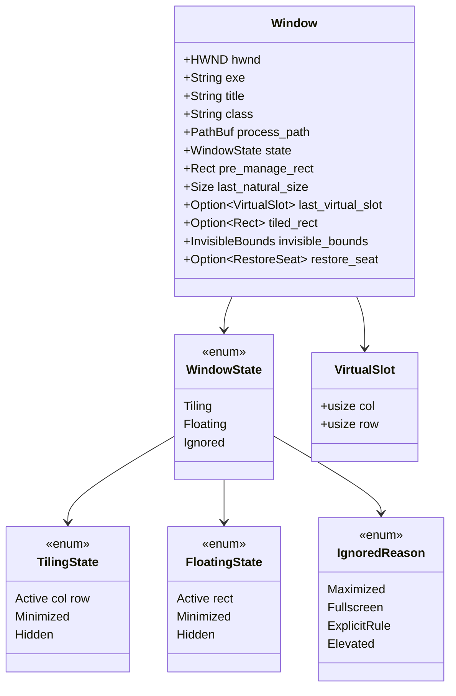
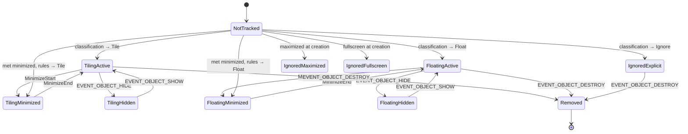
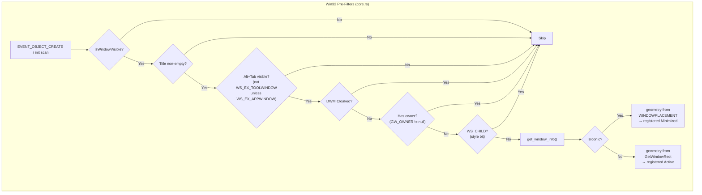
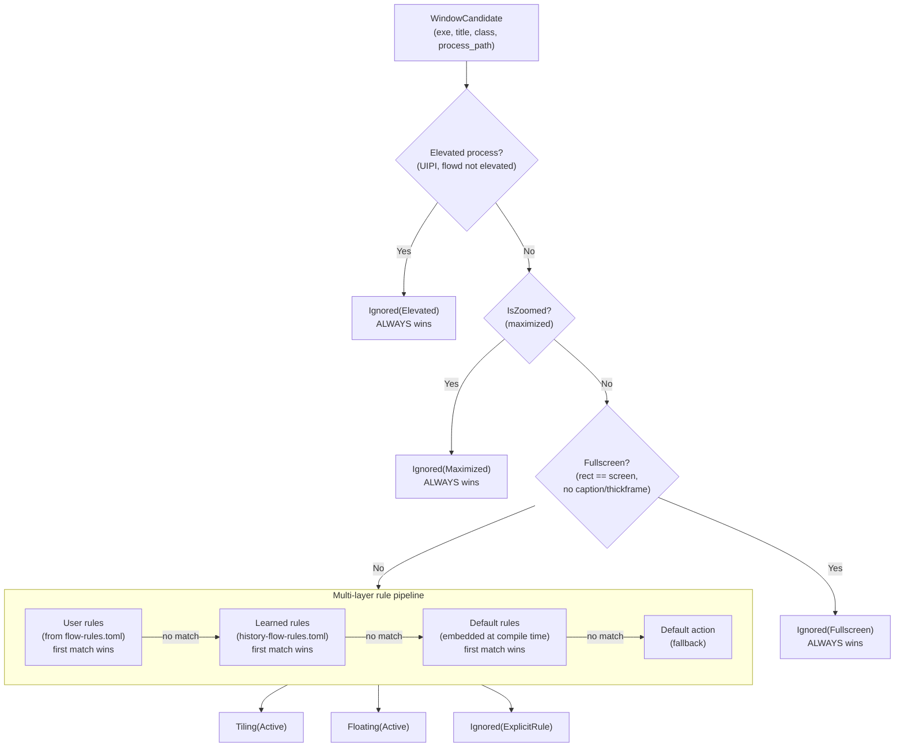

# Window Registry

The window registry is the bridge between the Windows OS and flow's internal
layout model. It hooks into Win32's `SetWinEventHook` system, classifies every
window as `Tiling`, `Floating`, or `Ignored`, and maintains per-window state
throughout the entire window lifecycle. All classification logic is pure Rust
with no Win32 dependencies, making it fully unit-testable.

## What the Registry Owns

`WindowRegistry` ([`src/registry/core.rs`](../../src/registry/core.rs)) is a
single struct that owns:

- A `HashMap<isize, Window>` — the authoritative map of HWND values (as `isize`
  for `Send` safety) to per-window metadata: exe name, title, class, process
  path, classification state, pre-manage rect, invisible bounds, virtual-slot
  position, and the floating-layer bookkeeping (`on_top`: the daemon holds the
  window in the topmost band for `[floating] always_on_top`; `was_topmost`:
  the flag it had before, put back when it leaves — see
  [Floating Space](./floating-space.md#the-floating-layer-floating-always_on_top)).
- A `ClassificationPipeline` — pre-compiled user rules, default rules, and a
  fallback action, used to classify every new window.
- A `focused` field tracking the currently focused window.

The registry is owned directly by `FlowWM` on the IPC thread. The
hook thread never touches it — it only sends typed `HookEvent`s through an
`mpsc` channel. See [threading model](./threading-model.md) for the full
threading picture.

## Window State Model

The `Window` struct ([`src/registry/types.rs`](../../src/registry/types.rs)) is the
single record for every tracked window. Its `state` field determines how the
layout engine and animation layer interact with it. `VirtualSlot` bridges the
registry to the layout engine — when a tiled window is minimized or hidden, its
column/row position is saved here. A minimized tile also records its full seat
in `restore_seat` (`RestoreSeat`: monitor, workspace, column, row, alone, width), which the
restore hook takes to put it back there (ADR-0027); a float minimized or hidden
keeps its rect in `last_float_rect`. The diagram shows the core fields only.

### State Transitions

User-driven tile ↔ float transitions **are** implemented via
`flow dispatch set-window float|tile|cycle` — see [Floating Space](./floating-space.md)
for the full transition table and animation. An `Ignored` window leaves that
state three ways (none drawn above):

- **OS-driven recovery** — an `Ignored(Maximized|Fullscreen)` window the user
  restores is re-classified into the layout via `STATECHANGE`, or via a
  foreground / show / move-size-end event on it when the `STATECHANGE` never
  arrived (see [Event Pipelines](./event-pipelines.md)).
- **`adopt_maximized`** (config key, default `false`) — the daemon
  un-maximizes an `Ignored(Maximized)` window itself (`SW_SHOWNOACTIVATE`)
  and classifies it through the rules: in the startup scan once the pipe and
  hooks are up, at creation, on `tiling on`, and in the recovery paths above.
  A window the rules would ignore is left maximized; fullscreen windows are
  never adopted. `WindowRegistry::set_adopt_maximized` is the switch —
  registration itself never un-maximizes, so a maximized window is always
  `Ignored(Maximized)` first and the daemon decides when it may move (the
  daemon turns the switch on at the start of `initial_layout` and off while
  tiling is paused).
- **`set-window tile|float|cycle|fullscreen`** — adopts any ignored window,
  explicit rule included (`WindowRegistry::adopt_ignored_window`). Mod+V on
  a rule-ignored window is explicit intent, so the rules are *not*
  re-consulted, and the learned rule the daemon records afterwards outranks
  a bundled ignore rule for the app's next window (not a user rule in
  `flow-rules.toml`, which always wins — see
  [Classification](./classification.md)).

Whichever path un-maximizes a window, the registry re-measures its rect,
natural size and invisible borders afterwards (`refresh_geometry`): the
values measured at registration describe the *maximized* frame — a rect the
size of the work area and the thick off-screen borders Windows gives a
maximized window — and would mis-size the column, the float and the border
overlay.

A window the daemon un-maximized carries `Window::adopted_from_maximized`
and is maximized again (`SW_MAXIMIZE`) wherever the daemon gives windows
back: `tiling off`, the shutdown rescue (`flow stop`, session end) and the
fail-back; `tiling on` un-maximizes it again before seating it. The flag is
never cleared. `SW_MAXIMIZE` activates the window — `ShowWindow` has no
non-activating maximize — so every pass that re-maximizes a batch puts the
previous foreground back afterwards, and a minimized or hidden adopted
window is left alone (maximizing it would un-minimize it).

The one direction that remains unimplemented is **Tiling →
`Ignored(Maximized)`** — a tiled window the user then maximizes is not
reclassified out of the layout. The state diagram above has no
`TilingActive → IgnoredMaximized` edge.

## The Classification Algorithm — Deep Dive

Classification is the central decision pipeline that runs every time a window
appears. It determines whether the window participates in tiling, floats freely,
or is ignored entirely. The algorithm has two phases: **Win32 pre-filters**
(checked in the registry before any classification) and the **rule pipeline**
(pure logic in the `classification` module).

### Phase 1: Win32 Pre-Filters

Before the classification pipeline sees a window, the registry runs a series of
cheap Win32 checks. These are ordered from cheapest to most expensive to avoid
unnecessary process queries:

The gate sequence is one function, `WindowRegistry::creation_gates`, shared
by the startup scan, `handle_created` and the `set-window` path that registers
an unknown focused window; it returns the first failing gate as a
`CreationSkip` (so the log line, and the `set-window` error, name it). Each
filter exists for a specific reason:

1. **Visibility** (`IsWindowVisible`) — invisible windows have no place in the
   layout. Note that minimized windows pass this check (`WS_VISIBLE` stays set);
   being iconic is deliberately **not** a gate — see *Windows met minimized*
   below.

2. **Non-empty title** (`GetWindowTextLengthW`) — titleless windows are
   typically internal containers or splash screens. This is the gate that causes
   late-titling apps (Windows Terminal) to be dropped on creation and recovered
   later via `NAMECHANGE`.

3. **Alt+Tab visibility** — a two-part check. First, the `WS_EX_TOOLWINDOW`
   extended style: windows with this style are hidden from Alt+Tab (tool
   windows, tray icons, floating toolbars). However, `WS_EX_APPWINDOW` forces
   visibility even if `WS_EX_TOOLWINDOW` is set. Second, a DWM cloak check
   (`DWMWA_CLOAKED`) filters out suspended UWP background frames like
   `ApplicationFrameHost.exe` that are technically "visible" to Win32 but not
   rendered on screen.

4. **No owner** (`GetWindow(GW_OWNER)`) — owned windows are dialogs or popups
   that belong to their owner. They should not be independently tiled.
5. **Not a child window** (`WS_CHILD` style bit via `GetWindowLongW(GWL_STYLE)`) —
   child windows are embedded controls (buttons, labels, the Inno Setup `TNew*`
   family, the Win32 `Button`/`Static` controls) that live inside another
   window's client area. They have no independent frame and cannot be tiled.
   This check catches them structurally, without needing per-class rules in
   `default-flow-rules.toml`.

   The check is deliberately narrow: it does not catch reparented popups
   (`WS_POPUP` + `SetParent`) or owned top-level windows, both of which may be
   legitimate tiling candidates (e.g. a DAW's MIDI editor). Reparented popups
   are rare and better handled by `WS_EX_TOOLWINDOW` (via `is_alt_tab_visible`)
   or explicit rules.

   Why not `GetAncestor(GA_PARENT)`? That API returns the **desktop** window
   handle for top-level windows, not null — so a naive "parent != null" check
   would flag every window. Comparing against `GetDesktopWindow()` works but is
   strictly broader than the `WS_CHILD` bit: it also catches reparented popups,
   which risks false positives on legitimate application windows. The
   `WS_CHILD` style bit is the precise Win32 definition of "child window."

### Phase 2: Rule Pipeline

Windows that survive the pre-filters enter the classification pipeline
([`src/registry/classification.rs`](../../src/registry/classification.rs)). The
pipeline is platform-independent — it receives a `WindowCandidate` (a plain Rust
struct with no HWND) and returns a `WindowState`.

An elevated window comes first of all: when its process runs elevated (or its
token cannot be read) and flowd does not, UIPI refuses every move, z-order change
and activation flowd would send, so the registry records it `Ignored(Elevated)`
at arrival and never looks again (elevation is fixed for a process's life). It
gets no seat, no border, no learned rule and no floating-layer membership;
`set-window` on it is refused. See ADR-0025 and
[Classification](classification.md#elevated-windows-are-unmanaged).

Maximized and fullscreen overrides always take precedence over rules. A window
that is maximized will always be `Ignored(Maximized)` even if a config rule says
to tile it — maximized and fullscreen windows have their own management behavior
that conflicts with tiling. With `adopt_maximized` the daemon resolves the
conflict the other way round: it un-maximizes the window and *then* lets the
rules decide (see [State Transitions](#state-transitions)); fullscreen stays
an unconditional ignore.

### Rule Matching Details

Within each rule layer, rules are evaluated top-to-bottom with first-match-wins
semantics. Each rule has a `match` section with zero or more fields:

| Field | Match mode | Case sensitivity |
|-------|-----------|-----------------|
| `exe` | Exact | Case-insensitive |
| `exe_regex` | Regex (full string) | Case-insensitive |
| `title` | Exact | Case-sensitive |
| `title_contains` | Substring | Case-sensitive |
| `title_regex` | Regex (full string) | Case-sensitive |
| `class` | Exact | Case-sensitive |
| `class_regex` | Regex (full string) | Case-sensitive |
| `process_path` | Exact | Case-insensitive |
| `process_path_regex` | Regex (full string) | Case-insensitive |

AND logic applies: every specified (non-`None`) field in a rule must match. If a
regex pattern fails to compile, it logs a warning and treats the field as
non-matching rather than crashing the daemon. Inline regex flags like `(?i)` and
`(?-i)` let users override the default case sensitivity for specific patterns.

All regex patterns are pre-compiled at pipeline construction time into
`CompiledRule` structs, so the per-classification cost is pure matching with zero
allocations.

### Notable Default Rules

The embedded default rules (from
[`default-flow-rules.toml`](../../default-flow-rules.toml)) catch several
well-known Windows edge cases:

**Chromium Legacy Window filtering.** Every Chromium-based application (Chrome,
Edge, VS Code/Electron, Slack, Discord) spawns an invisible helper window with
class `Chrome_RenderWidgetHostHWND` and title "Chrome Legacy Window". This window
passes all Win32 pre-filters — it is "visible", titled, not tool-window, and not
cloaked — yet it is never shown to the user. Without an explicit ignore rule,
it would enter the tiling layout and cause layout churn every time Chromium opens
or closes a tab. The default rule matches on `class` (identical across all
Chromium hosts) rather than `exe` (which differs per application), so a single
rule covers every Chromium-based app. Class matching is also race-free — the
class is assigned at creation time, while the title may arrive milliseconds later.

**Taskbar, search, and system UI.** Windows like `Shell_TrayWnd` (the taskbar),
`Windows.UI.Core.CoreWindow` (Settings), and various system overlay windows are
ignored by default rules. These windows are either always-on-top or interact with
the shell in ways that conflict with tiling.

## The `InvisibleBounds` Concept

`GetWindowRect` returns the full window rectangle, but on Windows 10/11 this
includes invisible borders — typically ~7px on the left, right, and bottom
edges — used for drop shadows and resize hit-testing. This means `GetWindowRect`
is **not** the visual rect of the window.

The registry measures each window's invisible borders once at registration time
by comparing `GetWindowRect` against `DwmGetWindowAttribute(DWMWA_EXTENDED_FRAME_BOUNDS)`,
which returns the rect that the user actually sees. The difference is stored as an
`InvisibleBounds` struct (`{left, top, right, bottom}`) in the `Window`. If either
query fails (DWM unavailable, window destroyed mid-query), the bounds default to
zero (fail-open — the window may have slightly larger gaps, but this is preferable
to crashing).

The animation bridge later uses `InvisibleBounds` to translate between the
layout engine's visible-rect coordinates (what the user sees) and Win32's
window-rect coordinates (what `SetWindowPos` expects). See
[animation](./animation.md) for how this translation works.

## Hooks Used

The registry listens to eleven Win32 events (nine hooks) registered via `SetWinEventHook` on a
dedicated background thread:

| Hook | Win32 event | Meaning | Action |
|------|-----------|---------|--------|
| Create/Destroy range | `EVENT_OBJECT_CREATE` / `EVENT_OBJECT_DESTROY` | Window lifecycle | Classify and register, or remove from registry |
| Foreground | `EVENT_SYSTEM_FOREGROUND` | Focus changed | Register the window if untracked, then update `focused` field |
| Minimize range | `EVENT_SYSTEM_MINIMIZESTART` / `EVENT_SYSTEM_MINIMIZEEND` | Minimize/restore | Transition Active to/from Minimized, save/restore virtual slot (`MINIMIZEEND` registers the window first if untracked) |
| Show/Hide range | `EVENT_OBJECT_SHOW` / `EVENT_OBJECT_HIDE` | Visibility | Reconcile visibility (tray-hide, DWM cloak, re-show) |
| StateChange | `EVENT_OBJECT_STATECHANGE` | State bits changed | Recovery: re-classify `Ignored(Maximized/Fullscreen)` windows when the user restores them |
| NameChange | `EVENT_OBJECT_NAMECHANGE` | Title changed | Recovery: re-attempt registration for windows not yet tracked (late-titling apps like Windows Terminal) |
| Cloak range | `EVENT_OBJECT_CLOAKED` / `EVENT_OBJECT_UNCLOAKED` | DWM cloaking | `UNCLOAKED`: register an untracked window (UWP frames are created cloaked and never `SHOW`n), re-show a tracked hidden one; `CLOAKED`: reconcile a tracked window to `Hidden` |

`EVENT_OBJECT_LOCATIONCHANGE` is hooked separately and callback-filtered to
tracked floats and the dragged tile — it fires on every pixel of window
movement and would otherwise flood the event channel. Maximize/restore is
covered by `STATECHANGE`.

`STATECHANGE` and `NAMECHANGE` are registered as single-event hooks (min == max)
so the intervening `LOCATIONCHANGE` (which sits between them numerically) is
excluded from the range.

### Recovery Hooks

Two hooks exist specifically to recover windows that `EVENT_OBJECT_CREATE`
misses. `CREATE` fires very early in the Win32 lifecycle — before a window is
visible, titled, or has finalized its styles. The recovery hooks give flow a
second chance:

- **NAMECHANGE recovery**: apps like Windows Terminal set their title
  asynchronously, often more than 500ms after creation. When the title finally
  lands, `NAMECHANGE` fires and the daemon re-attempts registration — but only
  for windows not already tracked, to avoid re-classifying every window on every
  title change.

- **STATECHANGE recovery**: a window that starts maximized is classified
  `Ignored(Maximized)`. When the user restores it, `WS_MAXIMIZE` flips and
  `STATECHANGE` fires. The daemon re-classifies the window (now not maximized)
  and adds it to the layout. Only windows currently `Ignored(Maximized|Fullscreen)`
  are re-evaluated, so the common-case cost is a single `HashMap` lookup.
  The `STATECHANGE` for an un-maximize does not always arrive (observed with
  Firefox and Alacritty), so the same re-classification also runs when such a
  window takes the **foreground**, is **shown**, or finishes a **move/size**
  (dragging a maximized title bar un-maximizes) — gated by the same
  `is_os_ignored` lookup. With `adopt_maximized` on, the re-classification
  un-maximizes a still-maximized window itself.

- **Untracked-window recovery on restore / foreground / show**: the
  `MINIMIZEEND`, `FOREGROUND` and `SHOW` handlers all give a window the
  registry does not track a run through the creation pipeline before their
  own bookkeeping (`FlowWM::register_if_untracked`). This is what picks up a
  window the scan could not classify (a minimized UWP frame is cloaked
  until restored; a window created while the daemon was not listening) the
  moment the user restores or focuses it. The fast path is one `HashMap`
  miss plus the creation gates, which reject the taskbar, menus and dialogs
  before any process query.

### Windows met minimized

A window that is iconic when the registry meets it — in the startup scan,
the `tiling on` re-scan or at creation — is **not** skipped (it used to be,
and a window minimized when the daemon started then stayed unmanaged until
its app was reopened). Its `GetWindowRect` is the icon's (-32000, -32000)
rect and `IsZoomed` is false, so `get_window_info` takes the geometry from
its `WINDOWPLACEMENT` instead: `rcNormalPosition` (workspace coordinates,
converted to screen coordinates with the primary monitor's work-area offset
by `win32::normal_position_to_screen`) is the rect it restores to, and
`WPF_RESTORETOMAXIMIZED` says whether it restores maximized. The usual gates
and the rule pipeline run on that, and the window is registered in the
**minimized** variant of its class — `Tiling(Minimized)` or
`Floating(Minimized)`, `minimized_at` stamped, no virtual slot — exactly the
record a window minimized *after* being managed has, so `MINIMIZEEND`
seats it the same way (a tile is appended to its owning monitor's strip at
that monitor's preset width; a float is placed where it reappears). A window
the rules ignore is `Ignored(ExplicitRule)` as usual; one that restores to
maximized is `Ignored(Maximized)` and goes through the maximized recovery
once it is back on screen (`reclassify_os_state` waits while the window is
iconic, since its OS state cannot be read). The owning-monitor memory is
set from the restore rect (the daemon does this in the startup scan and at
creation), so `flow query all` reports the window on the right monitor
while it is still minimized. DWM cannot measure the invisible borders of an
icon, so the record carries `Window::geometry_from_placement`: the first
`restore_window` re-measures the rect, natural size and borders from the
now-visible frame before the daemon seats the window.

One more Win32 quirk guards that re-measure: `IsIconic` flips **before the
frame has left the icon**. At `EVENT_SYSTEM_MINIMIZEEND`, and briefly after
a style change on an iconic window, `GetWindowRect` can still report the
icon rect — at (-32000, -32000) for a window with a taskbar button, at the
bottom-left of the desktop for one without. Registering or re-measuring
from that rect would make the icon the window's pre-manage rect, and
`tiling off` would later hand the window back icon-sized. Every reader
therefore checks `win32::is_iconic_rect` and waits (the restore handler
leaves an untracked window to the pending-creation retry or the activation
that follows a restore) instead of recording it.

## Recovery Snapshot (Planned)

A separate watchdog process is planned to restore windows if the daemon
crashes, reading a `flow-recovery.json` snapshot written by the daemon on
every state mutation and calling `SetWindowPos` for each entry to put
windows back at their pre-manage positions. This is not yet implemented and
is gated on `flow`/`flowd` being feature-complete; the `Window` struct
already carries `pre_manage_rect` for this purpose. See the
[Roadmap](./roadmap.md) for the full design.

## Cross-References

- [Event pipelines](./event-pipelines.md) — how the daemon routes hook events
  to registry handlers and coordinates with the layout engine.
- [Config and persistence](./config-and-persistence.md) — the `flow-rules.toml`
  format for user-defined classification rules.
- [Animation](./animation.md) — how the `InvisibleBounds` on each `Window` are
  used to translate visible rects to window rects for `SetWindowPos`.
- [Workspace hierarchy](./workspace.md) — where classified windows end up
  (in the active workspace's `ScrollingSpace`).
