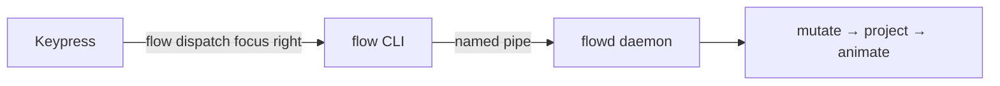

# Command Reference

This is the complete, annotated list of every `flow` command — what it does,
what arguments it takes, and (where relevant) the default hotkey it's bound to in
`flow.ahk`. For the guided tour, see the README's
[*Getting started*](https://github.com/CCpcalvin/flow-wm#getting-started).

## How a keypress reaches the daemon

Every hotkey in `flow.ahk` is a thin wrapper: it runs `flow dispatch <command>`,
which sends a single message over a Windows named pipe to the `flowd` daemon.
The daemon owns the whole layout pipeline (mutate → project → animate); the CLI
only chooses which message to send. So anything that can run a command on a
keypress — AutoHotkey, [whkd](https://github.com/LGUG2Z/whkd), PowerToys — can
drive FlowWM.



> **The modifier is configurable.** The default `flow.ahk` holds every chord with
> `Alt`. That's a single `ModKey` line at the top of the file — change it
> and every chord below follows. The hotkey column below assumes the default
> `Alt`; your setup may differ. (If `Alt` clashes with an app's menu shortcuts, see the README's *Can I use the Win key?* section.)

## Default hotkey map (quick reference)

| Hotkey (default) | Command |
|---|---|
| `Alt + h` / `j` / `k` / `l` | `focus left` / `down` / `up` / `right` |
| `Alt + Shift + h` / `j` / `k` / `l` | `move-window left` / `down` / `up` / `right` |
| `Alt + Ctrl + h` / `l` | `merge-column left` / `right` |
| `Alt + Ctrl + Shift + h` / `l` | `promote left` / `right` |
| `Alt + ,` | `shrink-column` |
| `Alt + .` | `expand-column` |
| `Alt + c` | `center` |
| `Alt + t` | `set-window cycle` |
| `Alt + Shift + t` | `tiling toggle` (tiling on/off) |
| `Alt + q` | `close-window` |
| `Alt + 1`…`9`, `0` | `switch-workspace 1`…`10` |
| `Alt + Shift + 1`…`9`, `0` | `move-to-workspace 1`…`10` |
| `Alt + [` / `]` | `focus-monitor left` / `right` |
| `Alt + Shift + [` / `]` | `move-to-monitor left` / `right` |
| `Alt + p` | `flow stop` (shuts the daemon down) |

Commands with **no default hotkey** (run them from the terminal, or bind them
yourself): `swap-column`, `swap-workspace`, `width`.

---

## Focus & navigation

### `focus <direction>`

Move focus to the neighbouring window.

- `focus left` / `focus right` — move focus to the **adjacent column** (or to the
  first/last window when at the canvas edge).
- `focus up` / `focus down` — move focus to the **window above/below** within the
  current column. In a stacked column taller than `[columns] visible_rows`,
  focusing a row that is parked off-screen scrolls the column's row viewport
  by one row so the focused window is visible (see
  [Stacked columns](./config-reference.md#stacked-columns-visible_rows-and-max_rows)).
  At the first/last row there is no window to focus and the command reports
  that.

At the end of a strip, `focus` hops to the monitor in that direction when
there is one (see [Monitors](#monitors)); set `[navigation] edge_hop = false`
in `flow.toml` to make it stop at the edge instead.

```powershell
flow dispatch focus right
flow dispatch focus up
```

Default hotkey: `Alt + h/j/k/l` (vim-style: h=left, j=down, k=up, l=right).

## Moving & rearranging windows

### `move-window <direction>`

A semantic "move" — the daemon decides the concrete effect from the focused
window's state and the direction:

- tiled, **left/right** → swap the focused column with its neighbour;
- tiled, **up/down** → swap the focused window with the one above/below inside the
  same column — in a stacked column with a row viewport the viewport follows
  the moved window;
- floating → pixel nudge (deferred).

At the end of a strip, `move-window left/right` carries the window to the
monitor in that direction when there is one (see [Monitors](#monitors)); with
`[navigation] edge_hop = false` it stops at the edge.

```powershell
flow dispatch move-window left
flow dispatch move-window down
```

Default hotkey: `Alt + Shift + h/j/k/l`.

### `swap-column <direction>`

Swap the entire focused column with its left or right neighbour. `direction` is
`left` or `right` only (columns are a horizontal axis).

```powershell
flow dispatch swap-column right
```

No default hotkey — bind it if you use it. (For single windows, prefer
`move-window`.)

### `merge-column <direction>`

The signature scroll move. Detach the focused window from its column and append it
as a new **bottom row** of the adjacent column, then redistribute both columns'
row heights. This is how you stack several windows into one column — the niri /
Hyprland move that makes scrolling feel better than a fixed grid.

With `[columns] max_rows` set, a neighbour that already holds that many rows
is not refused: the window **moves past** it — a window alone in its column
swaps columns with it (exactly `move-window <direction>`), one that shares
its column is pulled out into a new column on the far side of it — so
repeated presses walk the window along the strip. With `visible_rows` set,
the merged window becomes the bottom row and the destination's row viewport
scrolls down to it.

```powershell
flow dispatch merge-column right
```

Default hotkey: `Alt + Ctrl + h` (left) / `Alt + Ctrl + l` (right).

### `promote <direction>`

Pull the focused window out of its column and place it as a new, single-window
column on the chosen side. No-op when the window is already alone in its column.

```powershell
flow dispatch promote right
```

Default hotkey: `Alt + Ctrl + Shift + h` (left) / `Alt + Ctrl + Shift + l` (right).

### `consume-or-expel <direction>`

The niri move in one key: if the focused window **shares its column** with
other windows, this is [`promote <direction>`](#promote-direction) — the window
is expelled into a column of its own on that side. If it is **alone** in its
column, this is [`merge-column <direction>`](#merge-column-direction) — the
window is consumed into the neighbouring column as its new bottom row. Pressing
it twice therefore toggles a window in and out of a stack. `direction` is `left`
or `right`.

It is an error when there is no neighbouring column to consume into (the
window is alone at the end of the strip), or when the expel is refused. A
neighbouring column that is full (`[columns] max_rows`) is walked past, as
with [`merge-column`](#merge-column-direction).

```powershell
flow dispatch consume-or-expel left
```

No default hotkey in `flow.ahk` — bind it yourself.

## Column sizing & the viewport

### `expand-column`

Widen the focused column to the next `column_width` boundary and animate. Every
column to its right slides further along the canvas.

```powershell
flow dispatch expand-column
```

Default hotkey: `Alt + .`

### `shrink-column`

Narrow the focused column to the previous `column_width` boundary and animate.

```powershell
flow dispatch shrink-column
```

Default hotkey: `Alt + ,`

### `width <preset|next|prev|cycle>`

Switch the **focused monitor** to another column width preset. Presets come
from the `[columns]` section of `flow.toml` (see the
[Config Reference](./config-reference.md#columns--column-width-presets)); the
command is refused with an error when that section is absent.

- `width next` / `width cycle` — the next preset in the list, wrapping around
  after the last one.
- `width prev` — the previous preset, wrapping the other way.
- `width 1/2` — a named preset (any fraction equal to a configured one works:
  `2/4` selects `1/2`).

Every column on **every workspace** of that monitor takes the new width — the
active workspace animates, parked workspaces are re-laid out and slide in at
their new widths on the next switch — and every column created on that monitor
from then on (a new window, `set-window tile`, a window arriving by
`move-to-monitor` or an edge hop) starts at it. Other monitors keep their own
preset. `expand-column` / `shrink-column` keep working: their ladder starts
from the monitor's current preset width, so one `expand-column` from `1/3`
spans two thirds. `min_column_width_px` is a floor: a preset narrower than it
on a small display is widened to the minimum.

```powershell
flow dispatch width cycle     # flow: column width 1/1
flow dispatch width 1/2       # flow: column width 1/2
```

The command prints the preset the monitor landed on. `flow query all` reports
each monitor's `width_preset`, and the loadout remembers it per monitor across a
restart. No default hotkey in `flow.ahk` — bind it yourself (`Mod+R` →
`width cycle` is the natural choice).

### `center`

Slide the viewport so the focused column lands at the monitor midpoint. Uses the
variable-width prefix sum, so it stays correct even with expanded or shrunk
columns.

```powershell
flow dispatch center
```

Default hotkey: `Alt + c`

## Window mode (float ↔ tile)

### `set-window <mode>`

Change the focused window's tiling mode. `mode` is one of:

- `float` — detach the window from the layout and let it float freely.
- `tile` — insert the window into the scrolling column layout.
- `cycle` — toggle between float and tile (the most common choice). On a
  fullscreen window it goes back to tiled.
- `fullscreen` — toggle fullscreen (see below).

FlowWM **remembers** your decision: it writes the app's tile/float choice to
`history-flow-rules.toml`, and the next time you open that app it tiles (or
floats) automatically. See
[*Classification & Learned Rules*](../dev-guide/classification.md).

```powershell
flow dispatch set-window tile
flow dispatch set-window cycle
```

Default hotkey: `Alt + t` (cycle).

With [`[floating] always_on_top = true`](./config-reference.md#floating--floating-windows)
a floated window sits **above the tiled windows** from then on, even while a
tile has the focus; `set-window tile` puts it back in the normal z-order (a
window that was "always on top" by itself keeps that).

**Ignored windows are adopted.** A window FlowWM is not managing — because it
was maximized or fullscreen when FlowWM met it (`flow query all` shows
`Ignored::Maximized` / `Ignored::Fullscreen`), or because a rule ignores it
(`Ignored::ExplicitRule`, e.g. File Explorer through a bundled rule) — is
taken over by `set-window` instead of refused: `tile` and `cycle` (which means
`tile` here, there is no float/tile state to flip) un-maximize it and tile it
exactly like a window that just opened tiling — on the screen it is on, next
to the focused column, at that screen's current width preset, with a border;
`float` un-maximizes it and floats it where it is; `fullscreen` adopts it as a
tile and then puts it fullscreen. The choice is learned like any other: the
next window of that app is tiled (or floated) automatically. For an app a
**bundled** rule ignores the learned rule wins, so the next window is managed
too; a rule in your own `flow-rules.toml` outranks learned rules and keeps
ignoring new windows until you change it. A window that was maximized is
maximized again when FlowWM hands the desktop back (`tiling off`, `flow
stop`). To have every maximized window adopted automatically, set
[`adopt_maximized = true`](./config-reference.md#top-level-fields). Only a
minimized or hidden window cannot be changed.

**Unknown windows are registered first.** `set-window` acts on the window
that has the keyboard focus right now. If FlowWM has never met it (`flow
query all` does not list it — a window it could not classify when it
appeared, e.g. a minimized UWP app, or one that opened while FlowWM was not
listening), it is put through the normal window pipeline first — tiled or
floated by your rules exactly like a window that just opened — and the
requested mode is then applied: `tile`, `float` and `fullscreen` do what
they say, and `cycle` means `tile` here (the window had no float/tile state
to flip a moment ago). A window that fails one of FlowWM's gates — a tool
window, an untitled window, a hidden or cloaked one, a dialog owned by
another window — is refused with an error that names the gate, e.g.
`focused window is not managed and cannot be registered: not Alt+Tab visible
(tool window or DWM-cloaked)`. Windows that are minimized when FlowWM starts
are registered as minimized and tiled (or floated) the moment you restore
them, so this path is mostly for windows FlowWM never saw at all.

#### `set-window fullscreen`

Put the focused tiled or floating window over its monitor's **whole screen**
— the full screen rect, not the work area, so it covers the taskbar — kept
above the tiles and without a border. FlowWM remembers where it came from:
the monitor, workspace, column, row and column width of a tile, or the rect
of a float. Issuing `set-window fullscreen` again puts it back there — into
the same column and row when that column still exists (else appended at the
end of the strip; with `[columns]` presets the column takes the monitor's
current preset width), or back to its float rect.

While fullscreen the window still belongs to its workspace: switching
workspaces parks and unparks it with the workspace like a float, and
`move-to-monitor` carries it fullscreen to the other monitor (leaving
fullscreen there appends it to that strip). The tiled-only commands (`focus`,
`move-window`, `expand-column`, …) ignore it. `set-window tile` or `cycle`
on a fullscreen window tiles it; `set-window float` floats it (at its old
rect if it was a float, else centred). Closing it forgets it; minimizing and
restoring brings it back fullscreen. `flow dispatch tiling off` hands it back
as a plain float inside the work area, and `tiling on` keeps it a float.
`flow query all` lists it with `"mode": "fullscreen"`. The choice is not
learned (it never changes an app's tile/float rule). A fullscreen window is
topmost by itself; with `[floating] always_on_top` the floats share that
band, so a float and a fullscreen window stack by whichever was activated
last.

```powershell
flow dispatch set-window fullscreen    # and again to come back
```

No default hotkey in `flow.ahk` — bind it yourself.

## Workspaces

Workspaces are niri-style virtual desktops, stacked vertically; each one holds its
own horizontal scrolling canvas. `swap-workspace` is wired into the protocol but
the animation is still being finalised, so the daemon currently returns a
"not yet implemented" error for it.

### `switch-workspace <id>`

Switch the active workspace. The requested workspace slides into the viewport
while the previously active one parks above or below it, in one coordinated
animation. `<id>` is a positive integer (1-based).

```powershell
flow dispatch switch-workspace 2
```

Default hotkey: `Alt + 1`…`9`, `0` (0 = workspace 10).

### `swap-workspace <id>`

Exchange the positions of the active workspace and workspace `<id>` in the
vertical stack, with focus following the originally active workspace.

> **Status:** stub. The protocol shape is locked in so keybindings can stabilise;
> the daemon returns "not yet implemented" until the animation lands.

```powershell
flow dispatch swap-workspace 3   # not yet implemented
```

No default hotkey.

### `move-to-workspace <id>`

Move the focused window to workspace `<id>`. The window is detached from the
active workspace (with local focus succession — no OS foreground push) and
re-inserted into the target workspace after its focused column. Focus stays on
the source workspace.

```powershell
flow dispatch move-to-workspace 4
```

Default hotkey: `Alt + Shift + 1`…`9`, `0` (0 = workspace 10).

## Monitors

Every monitor has its own scrolling strip and its own set of workspaces. The
*active* monitor is the one holding the focused window; commands act there.

Each window remembers the monitor it was seated on. A window you minimize,
hide to the tray or maximize comes back to *that* monitor when it reappears,
even if it was parked off-screen at the time. Closing a window on a monitor
you are not working on only tidies that strip; focus stays where you are.
A float you drag onto another monitor becomes that monitor's float (it rides
along with that monitor's workspace switches, and `move-to-monitor` reasons
from there). Dragging a tile towards a neighbouring monitor does not scroll
the strip you came from, and releasing it over the other monitor returns it
to its own strip.

### `focus-monitor <left|right|up|down>`

Make the monitor in that direction (by screen geometry) the active one and
focus the window you last used there (else the first tile, else the top
float). On an empty monitor the focus is cleared and keystrokes go to the
desktop, so the next command cannot act on the window you left. `focus left`
/ `focus right` at the edge of a strip does the same hop, so you can walk
across monitors with the plain focus keys — unless `[navigation] edge_hop =
false`, which confines `focus` and `move-window` to their strip (this command
always crosses).

```powershell
flow dispatch focus-monitor left
```

Default hotkey: `Alt + [` / `Alt + ]`.

### `move-to-monitor <left|right|up|down>`

Move the focused window to the active workspace of the monitor in that
direction. A tiled window joins that strip at the near edge (moving right puts
it at the left end of the right-hand monitor) and takes **that monitor's**
column width — its current [`width` preset](#width-presetnextprevcycle) when
`[columns]` is configured, else the base width derived for that monitor; a
float keeps its position relative to the work area. Focus follows the window.
`move-window left` / `move-window right` at the edge of a strip does the same
hop (unless `[navigation] edge_hop = false`; this command always crosses).
The same rule applies to every other way a column arrives on a monitor:
a window re-tiled from floating or fullscreen there, a column migrated by a
display change, or a loadout column merged from a monitor that is no longer
attached.

```powershell
flow dispatch move-to-monitor right
```

Default hotkey: `Alt + Shift + [` / `Alt + Shift + ]`.

## Tiling on/off

### `tiling <on|off|toggle>`

Turn the window manager off and on again **without stopping the daemon**.
`tiling off` hands the desktop back to plain Windows: every tiled window —
on every workspace of every monitor, parked ones included — is moved back
on-screen (to the position it had before FlowWM first tiled it, where that is
known; otherwise it is brought into its monitor's work area), the border
overlays disappear, and FlowWM stops moving windows altogether. A window
FlowWM had un-maximized to manage (`adopt_maximized`, or `set-window` on an
ignored window) is maximized again instead. Windows you open, close, minimize
or drag meanwhile are plain Windows windows; a minimized window whose restore
position was off-screen is fixed so it comes back on-screen. A fullscreen
window (`set-window fullscreen`) is handed back as a plain float inside its
work area, and with `[floating] always_on_top` every floating window goes
back to the normal z-order (`tiling on` raises them again). The daemon and
the hotkey script keep running, so the same chord turns tiling back on.

`tiling on` rebuilds the layout from what is on the desktop now: windows that
were tiled before go back to the same monitor, workspace, column and row
(workspaces survive a toggle; a window `tiling off` maximized again is
un-maximized first); windows that appeared meanwhile are classified through
your rules (maximized ones adopted when `adopt_maximized` is on) and appended
to the active workspace of the monitor they are on; windows that are gone are
forgotten; floats you dragged stay where you left them. The borders come back
and the window you are using decides the active monitor and workspace.

While tiling is off every layout command (`focus`, `move-window`,
`switch-workspace`, `set-window`, `center`, `move-to-monitor`, `flow config
reload`, `flow loadout load`, …) is refused with
`tiling is off (flow dispatch tiling on)`. `flow ping`, `flow query all`,
`flow loadout save` and `flow stop` keep working, and `flow ping` says which
state the daemon is in. The state is not remembered across a restart: a
freshly started daemon always tiles.

```powershell
flow dispatch tiling off      # flow: tiling off
flow dispatch tiling toggle   # flow: tiling on
flow dispatch tiling on       # flow: tiling on   (already on: no-op)
```

The command prints the state it landed in, so `toggle` tells you where you
are. Default hotkey: `Alt + Shift + t` (toggle).

## Keymap drag sessions

### `drag begin` / `drag end`

For a hotkey script that moves a window **itself** — the win-niri keymap's
Mod + left-button drag grabs a window anywhere, not just by its title bar,
and Windows' own move loop cannot be started from a hook hotkey. The script
activates the window, sends `drag begin`, moves the window while the button
is held, then sends `drag end`:

- `drag begin` acts on the focused window and puts it into the state a
  title-bar grab would: a **tiled** window previews its drop zone as it
  moves (the other tiles reflow, the strip edge-scrolls), a **floating**
  window is simply left to the script, its recorded position frozen until
  the end. Prints `flow: drag begun (tile)` / `(float)`. It is an **error**
  — exit code 1, so the script does not start its move loop — when a drag
  is already in progress (a title-bar drag or another session), when the
  focused window is not a tile or a float (minimized, hidden, fullscreen,
  not managed) or when tiling is off.
- `drag end` finishes it: the tile drops into the zone under the cursor
  (or snaps back to its own slot if released over nothing), the float's
  final position is recorded. Prints `flow: drag ended (tile)` /
  `(float)`. Without a session it prints `flow: no drag session to end`
  and exits 0 — a no-op, since a script always sends it.

While a session is open the layout commands are refused with `busy`, like
during a title-bar drag; `tiling off|on|toggle` and `flow stop` end the
session first. A window that closes mid-drag ends it on its own. A native
title-bar grab of the same window during a session is ignored.

```powershell
flow dispatch drag begin      # flow: drag begun (tile)
flow dispatch drag end        # flow: drag ended (tile)
flow dispatch drag end        # flow: no drag session to end
```

No default hotkey in the bundled `flow.ahk`; the win-niri keymap binds
Mod + left-button drag (see `keymaps/win-niri/README.md`).

## Window & daemon lifecycle

### `close-window`

Ask the focused window to close itself **gently** via Win32 `WM_CLOSE` — the same
message Windows sends when you click the window's ✕ button — so the application
runs its normal shutdown logic (prompt to save, release resources, etc.). The
window is removed from the layout automatically once Win32 reports its
destruction.

```powershell
flow dispatch close-window
```

Default hotkey: `Alt + q`

---

## Beyond `dispatch` — the rest of the CLI

Everything above lives under `flow dispatch …` (the actions that change layout).
A few other top-level commands are worth knowing:

| Command | What it does |
|---|---|
| `flow start [--ahk] [--config <dir>] [--log-file <path>] [--no-restore] [--verbose] [--log-level <lvl>]` | First puts back any windows a crashed previous run left off-screen, then launches the daemon in the background and waits until it is really ready (it must report every startup step and answer a ping). Prints `flow: daemon started (pid N, M monitor(s), log: <path>)`. If a step fails you get `flow: FlowWM failed to start at step '<step>': <reason> (log: <path>)` and a non-zero exit — nothing is left half-tiled, windows are put back. `--ahk` makes the daemon start `flow.ahk` once it is listening, **tied to the daemon**: if the daemon ever dies, the script dies with it and the Win key is yours again. `--verbose` (`-v`) logs at `debug`; `--log-level trace` goes further. |
| `flow stop` | Stop the running daemon. It puts every window back on-screen, removes its borders and stops the hotkey script — `--ahk` is no longer needed (still accepted). |
| `flow rescue [--force]` | No daemon needed: find every window parked off-screen (after a crash or a `taskkill`) and move it back onto its monitor; prints how many were moved and their titles. Refuses to run while a daemon is answering unless you pass `--force` (prefer `flow stop`, which rescues on exit). |
| `flow ping` | Check the daemon is alive: prints its version, pid, monitor count, registered-hook count, the hotkey script's pid and whether tiling is `on` or `off`. |
| `flow config init [--ahk]` | Write default `flow.toml` (and `flow.ahk`) into your config dir. Never overwrites existing files. |
| `flow config reload` | Tell the running daemon to re-read config from disk. |
| `flow config edit` | Open the config directory in your editor. |
| `flow config path` | Print the resolved config directory path. |
| `flow config check` | Validate `flow.toml` / `flow-rules.toml` without loading them. |
| `flow loadout save [path]` / `flow loadout load [path]` | Save / restore the window arrangement. Without a path the config's `[loadout] default_path` (a plain file name in the config dir) is used. A given path must be a `.json` file with no `..` in it; relative paths are resolved against the config directory, absolute ones used as given. Anything else is refused — by the CLI before sending, and by the daemon for whatever arrives over the pipe. |
| `flow query all` | Dump every tracked window (state, `mode` — `tiled` / `floating` / `fullscreen` / `minimized` / `hidden` / `ignored` —, `on_top` — whether FlowWM currently keeps it above the tiles (`[floating] always_on_top`) —, rect, column/row, …) as JSON, plus the monitors (each with its `width_preset`) and whether tiling is on (`tiling_enabled`). |
| `flow enable-autostart [--ahk]` | Create the login shortcut in `shell:startup` (idempotent). |
| `flow disable-autostart` | Remove the login shortcut (idempotent). |
| `flow update` | Ask GitHub whether something newer than this build exists and print how to update — **it never downloads or installs anything**. Compares the commit the binary was built from with the `[update]` branch (by default the build's own branch of the repository its `origin` pointed at), or the crate version with the latest release when `[update] branch = ""`. Exit code `0` = up to date, `10` = something newer, `2` = api.github.com unreachable, `3` = repository / branch / release not found, `4` = other GitHub error, `5` = no commit embedded in the build. `--check` is accepted and changes nothing. |
| `flow --version` / `flowd --version` | `flow 0.2.0 (feat/multi-monitor @ cf54b88, 2026-10-22)` — the crate version plus the branch, commit and commit date the binary was built from (`-dirty` after the commit if the tree had uncommitted changes). |

Browse them any time with `flow --help`, and the dispatch surface with
`flow dispatch help`.

For the daemon's internal handling of these — the named-pipe protocol, the
foreground-lock grant, crash recovery — see
[*IPC & Watchdog*](../dev-guide/ipc-and-watchdog.md).
